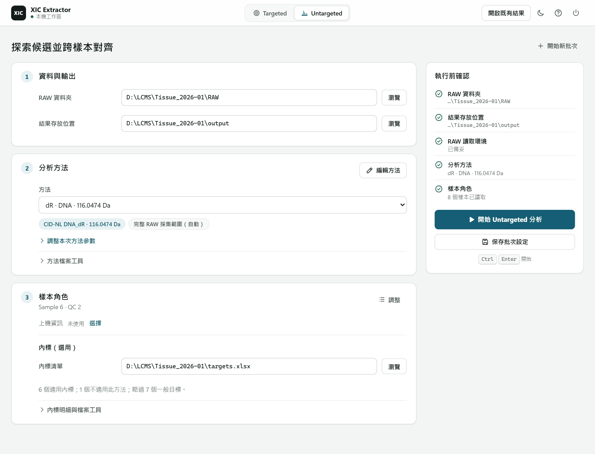

# XIC Extractor

XIC Extractor turns a batch of Thermo `.raw` LC-MS injections into peak areas
you can take downstream, and lets you check each area against its chromatogram.

For example, run a batch of DNA adduct samples and get either:

- **a known-target workbook (Targeted):** one area per target and sample, a
  batch summary, and a list of results that need a second look; or
- **a feature × sample area matrix (Untargeted):** features discovered from
  CID neutral-loss evidence and matched across samples, where you can open any
  value or blank cell to see the saved decision and its reason, and, with the
  source RAW files, re-extract its chromatogram.



Both workflows run on shared processing for peaks, areas and cross-sample
correspondence; method-specific evidence still decides what each method
accepts. They differ in what you ask for and what you receive.

## Use The Application

### Choose a workflow

| Your question | Prepare | Start reviewing here |
| --- | --- | --- |
| **Targeted:** What happened to my known targets in this batch? | RAW files and a target table or saved method XLSX: names, m/z, expected RT, identification methods, and optional ISTD pairs | One Excel workbook: `摘要` for the batch overview, then `需檢查` for results needing attention |
| **Untargeted:** Which features can I compare across samples? | RAW files and a CID-NL method (dR, R, MeR or custom neutral-loss tags); check sample information and any internal-standard list | `alignment_matrix.tsv` for feature × sample areas, then the workbench for evidence behind a feature or missing cell |

The [Targeted guide](docs/user/targeted-extraction.md) and
[Untargeted guide](docs/user/untargeted-discovery.md) take you from preparation
through execution and result review. You do not need to read the processing
contracts before running an analysis.

### Run the HTML workbench

The analysis workflow runs on **Windows 10 or 11** with Python **3.15**.
To run from source, install a current version of `uv`, then open PowerShell:

```powershell
git clone https://github.com/bosschen0429/XIC_Extractor.git
cd XIC_Extractor
uv sync --locked
uv run xic-workbench
```

`uv` finds or downloads Python 3.15 automatically. If an older `uv` cannot find
that version, update `uv` first. Windows release packages and all CI lanes use
the same locked Python 3.15 dependency stack. Linux runs the non-browser,
non-build compatibility tests in CI; this does not yet claim full Linux analysis
or desktop-package support. See [testing](docs/agent/testing.md).

The command opens a local browser workspace for analysis and result review.
On later launches, double-click `launch_gui.vbs` for a console-free start, or
use `launch_gui.bat` to keep a console visible. If you already have an installed
package, run `xic-workbench`; a packaged Windows build starts with
`XIC_Extractor.exe`. If you do not have a packaged build, use the source
instructions above.

RAW analysis also needs **.NET 8 or later** and **Thermo RawFileReader 8.0.42**.
On first launch, follow the setup notice: read the linked Thermo license,
check acceptance, then click **下載並設定 RawFileReader**. If .NET is missing,
run the command shown by the notice and restart. Xcalibur is not required;
its older DLLs are not supported. See [reader setup details](docs/user/README.md#reader-setup)
for manual installation and existing DLL overrides.

Choose a workflow, select the batch inputs, load a method, and run. After
completion, the same page shows the saved overview, review and downloads. Use
**開啟既有結果** to reopen a completed result without RAW files. Settings edits
apply to the next analysis, not the displayed result. Closing a tab does not cancel an active analysis; use the
workspace's cancellation control. Use **結束工作區** when finished.

## Read Your Results

**Targeted:** Open `xic_results_YYYYMMDD_HHMM.xlsx`. Start at `摘要`, follow
the indicated items into `需檢查` when present, and use `面積` for saved
sample × target areas. Open the XLSX in the workbench to inspect a target and
sample; request its XIC when needed. [Workbook reading guide](docs/user/targeted-extraction.md#review-the-batch).

**Untargeted:** Start at `alignment_matrix.tsv`. Rows are aligned features,
columns are samples, and cells contain published areas. Use workbench review
to investigate a feature, an unexpected value, or a missing cell. Optional
**矩陣整理** writes a separate curated result without changing the source
Matrix. Preview each step’s kept, removed, ISTD-protected and undetermined rows
before exporting. Preview and export use the same curation decisions.
[Matrix reading guide](docs/user/untargeted-discovery.md#read-and-use-the-matrix).

To reopen a completed batch or workbook:

```powershell
uv run xic-workbench "path/to/result-folder-or-workbook.xlsx"
```

Reviewing saved results and acquiring new XIC curves are different operations:
saved Targeted values can be read without RAW files; acquiring curves needs
the source RAW and reader. Review does not silently change saved decisions.

## Follow The Evidence

Finding a candidate, matching it across samples, measuring an area, and counting
a detection are different judgments. An area is not proof of chemical identity;
a blank cell is not automatically zero or proof of absence.

For an explanation, follow the [A/B/C sample story](docs/user/processing-guide.html):
two samples have candidate peaks, a third has a missing cell, and each step
answers a different question before a value can be used. The
[DNA adduct CID-NL example](docs/user/raw-to-final-matrix-product-story.html)
applies that reasoning to one method; it does not define the whole platform.

The Untargeted Matrix currently comes from CID-NL Discovery. Other Discovery
methods, such as Delta Mass / Pt pattern, produce diagnostic candidates for
review and do not yet publish a Matrix; a diagnostic candidate or review plot
alone does not establish support for quantitative output. Exact rules are in the
[product topic index](docs/product/README.md).

## Get Help

Use the [user guide index](docs/user/README.md) to find setup, operation,
field references, and explanations. Start troubleshooting with your workflow:
[Targeted](docs/user/targeted-extraction.md#troubleshooting) or
[Untargeted](docs/user/untargeted-discovery.md#troubleshooting).

If the problem remains, [open an issue](https://github.com/bosschen0429/XIC_Extractor/issues).
Include the app version, workflow, steps, expected and actual result, and the
error message or a relevant screenshot. For a feature request, describe the
analysis task you want to complete.

## Work On The Source

Start with the [repository layout](docs/project-layout.md#repository-tree)
and [architecture reading guide](docs/architecture-contract.md#reading-the-code).
Coding agents start at [AGENTS.md](AGENTS.md); developer worktree setup and
validation use [Local Execution](docs/agent/local-execution.md#runner-and-environment).

For local changes, run `.venv\Scripts\python.exe -m tools.testing.test_selection`
by default. Known test files or failing nodes can be run directly; plain
`pytest` without a target still collects the whole suite. See
[test selection](docs/agent/testing.md#affected-test-selection).
