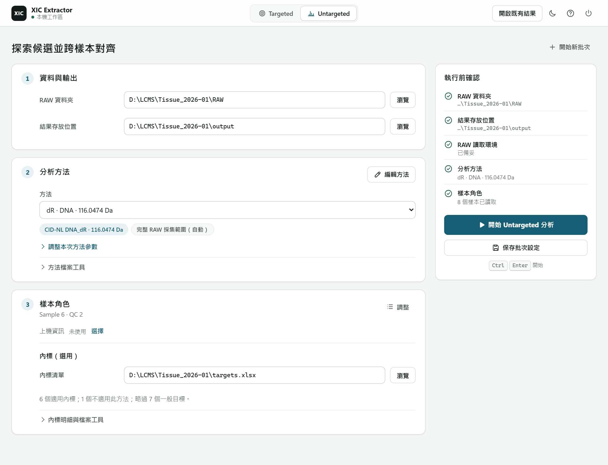

# XIC Extractor

XIC Extractor turns a batch of Thermo `.raw` LC-MS injections into peak areas
you can take downstream, and lets you check each area against its chromatogram.

For example, run a batch of DNA adduct samples and get either:

- **a known-target workbook (Targeted):** one area per target and sample, a
  batch summary, and the results to look at first; or
- **a feature × sample area matrix (Untargeted):** features discovered from
  CID neutral-loss evidence and matched across samples, where you can open any
  value or blank cell to see the saved decision and its reason, and, with the
  source RAW files, re-extract its chromatogram.

## Use The Application

### Choose a workflow

| Your question | Prepare | Start reviewing here |
| --- | --- | --- |
| **Targeted:** What happened to my known targets in this batch? | RAW files and a target list (XLSX, CSV or TSV): names, m/z, expected RT, CID-NL / Delta Mass specificity, and optional ISTD pairs | One Excel workbook: `摘要` for the batch conclusion and the results to look at first, `面積` for saved areas |
| **Untargeted:** Which features can I compare across samples? | RAW files and a CID-NL method (dR, R, MeR or custom neutral-loss tags); check sample information and any internal-standard list | `alignment_matrix.tsv` for feature × sample areas, then the workbench for evidence behind a feature or missing cell |

The [Targeted guide](docs/user/targeted.md) and
[Untargeted guide](docs/user/untargeted.md) each take you from preparation
through execution and result review on one page.

### Run the HTML workbench

Download the `XIC_Extractor-Windows-*.zip` asset from
[Releases](https://github.com/bosschen0429/XIC_Extractor/releases), not a
Source code archive. Extract the whole folder and double-click
`XIC_Extractor.exe`; keep `_internal/` beside it. No Python, uv, Git or
Xcalibur installation is needed. A local browser workspace opens for analysis
and result review; `開始使用.html` in the folder opens the offline
[user guide](docs/user/README.md).

RAW analysis also needs **.NET 8 or later** and **Thermo RawFileReader 8.0.42**.
On first launch, follow the setup notice: read the linked Thermo license,
check acceptance, then click **下載並設定 RawFileReader**. If .NET is missing,
run the command shown by the notice and restart. Xcalibur's older DLLs are not
supported. See [reader setup details](docs/user/README.md#第一次使用準備-rawfilereader)
for using an already installed reader.

Choose a workflow, select the batch inputs, load a method, and run. After
completion, the same page shows the saved overview, review and downloads. Use
**開啟既有結果** to reopen a completed result without RAW files. Settings edits
apply to the next analysis, not the displayed result. Closing a tab does not
cancel an active analysis; use the workspace's cancellation control. Use
**結束工作區** when finished.

## Read Your Results

**Targeted:** Open `xic_results_YYYYMMDD_HHMM.xlsx`. Start at `摘要`: its first
line says how many results to look at first (需先看), listed right below; use
`面積` for saved sample × target areas. Open the XLSX in the workbench to
inspect a target and sample. [Workbook reading guide](docs/user/targeted.md#看結果).

**Untargeted:** Start at `alignment_matrix.tsv`. Rows are aligned features,
columns are samples, and cells contain published areas. Use workbench review
to investigate a feature, an unexpected value, or a missing cell. Optional
**整理矩陣** writes a separate curated matrix without changing the source;
preview each step's kept and removed rows before exporting.
[Matrix reading guide](docs/user/untargeted.md#看結果).

Saved values can be read without RAW files; acquiring XIC curves needs the
source RAW and reader. Review does not silently change saved decisions.

## Follow The Evidence

Finding a candidate, matching it across samples, measuring an area, and counting
a detection are different judgments. An area is not proof of chemical identity;
a blank cell is not automatically zero or proof of absence. The
[interpretation guide](docs/user/concepts.md#從-raw-到矩陣) walks through one
example step by step.

The Untargeted Matrix currently comes from CID-NL Discovery. Delta Mass / Pt
pattern methods produce diagnostic candidates for review and do not yet publish
a Matrix. Exact rules are in the [product topic index](docs/product/README.md).

## Get Help

Start troubleshooting with your workflow:
[Targeted](docs/user/targeted.md#遇到問題) or
[Untargeted](docs/user/untargeted.md#遇到問題).

If the problem remains, [open an issue](https://github.com/bosschen0429/XIC_Extractor/issues).
Include the app version, workflow, steps, expected and actual result, and the
error message or a relevant screenshot. For a feature request, describe the
analysis task you want to complete.

## Work On The Source

Running from source, the Python and CI support matrix, and test commands are in
the [developer guide](docs/development/README.md). Coding agents start at
[AGENTS.md](AGENTS.md).
