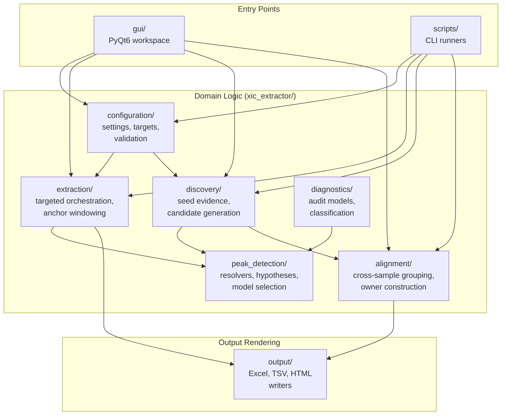

# Architecture Contract

This document owns XIC Extractor's durable code-organization and responsibility
rules. `AGENTS.md` keeps only the high-priority guardrails; this file carries the
longer architecture contract and known decomposition targets.

## Design Principles

- Make logic, dependencies, and data flow obvious.
- Prefer explicit interfaces over hidden coupling or global context.
- Keep one reason to change per module. Split by responsibility, not by fashion.
- Keep high-level domain behavior independent from IO, GUI, workbook rendering,
  process backends, and CLI wrappers.
- Use orchestration modules to coordinate focused submodules; do not let the
  orchestrator become the permanent home for every implementation detail.
- Add abstraction only when it reduces real coupling, duplication, or cognitive
  load. Avoid both monoliths and many tiny indistinguishable modules.
- Preserve public contracts unless an approved plan says otherwise.

## System Overview

**Product-method flow — target architecture:**
`.raw` files + method constraints → Discovery → PeakHypothesis/evidence → cross-sample Alignment → evidence-based Backfill → workflow projection

**Untargeted application:** broad candidate search → shared core → feature-by-sample quantitative matrix + review artifacts → downstream preprocessing/calibration/statistics

**Targeted application:** known target/m/z/RT/role/pairing constraints → narrowly scoped shared core → targeted evidence delivery (CSV/workbook)

Untargeted is the general XIC method and architectural core. Targeted is a
constrained specialization over that lifecycle with its own application policy,
GUI flow, and output projection. Separate output contracts and writer authority
do not justify permanent duplicate evidence, peak-identity, Alignment, or
Backfill systems.

The current runtime has not completed that convergence. Targeted uses bounded
sample-local hypotheses, configured target identity, and cross-sample RT,
paired-area, and MS1-shape evidence through `extraction/`. The headless limited
`5-hmdC + 5-medC` CLI additionally runs a baseline/support/final rescue before
publishing; GUI and direct `extractor.run` calls do not generate that support
automatically. Targeted does not yet reuse the Untargeted owner/group Alignment
and Backfill implementation in `alignment/`.

Treat this package and entry-point split as migration state and a parity gap,
not as the product model or a reason to build two independent decision cores.
The minimum workflow-neutral types, lifecycle operations, policy seam, and
CID-NL / NL116 dual-projection tracer contract are owned by
[`docs/product/shared-processing-kernel.md`](product/shared-processing-kernel.md).
Stable processing-request, attempt, evidence-artifact, delivery-cell, and
delivery-seal lineage is owned separately by
[`docs/product/processing-lineage.md`](product/processing-lineage.md). Attempt
scheduling, cancellation, retry/resume, worker/resource cleanup, cache
lifecycle, and runtime observability are owned by
[`docs/product/execution-runtime.md`](product/execution-runtime.md). Storage
engine, schema, location, and retention policy remain outside both contracts;
the runtime may only execute owner-supplied lifecycle actions for registered
temporary resources and caches while respecting lineage pins.

## Dependency Direction

- Domain algorithms may use arrays, config, typed context objects, and small
  models.
- Domain algorithms must not import GUI, workbook builders, CLI scripts, process
  backends, report renderers, or RAW/CSV adapters.
- IO/rendering/adapters depend inward on domain helpers.
- Public entry points and compatibility facades should stay thin. Move behavior
  into focused modules while keeping old imports working when they are public.

## Ownership Map

Use this map when adding or moving package code. `docs/project-layout.md` owns
where files live; this section owns the reason each package changes.

| Surface | Owns | Should not own |
| --- | --- | --- |
| `xic_extractor/alignment/` | Cross-sample alignment, owner construction, backfill, matrix identity, primary consolidation, and alignment-side diagnostics | GUI, workbook rendering, RAW adapters, targeted extraction orchestration |
| `xic_extractor/discovery/` | General candidate discovery and seed generation; reusable workflow-neutral discovery facts; Untargeted adapter from direct measured CID-NL seeds to canonical evidence refs | Cross-sample matrix consolidation, targeted target-list policy, or Matrix authority from diagnostic projection refs |
| `xic_extractor/extraction/` | Targeted extraction orchestration, target jobs, anchor windowing, drift handling, backend coordination, and Targeted adapter from typed MS2 product evidence to canonical CID-NL refs | Workbook rendering, GUI, alignment matrix decisions, or counted-detection authority from diagnostic projection refs |
| `xic_extractor/peak_detection/` | Trace models, owner-backed physical MS1 observation refs, hypotheses, resolver implementations, boundary selection, baseline/integration audit, region logic, and workflow-neutral canonical CID-NL observation content | Cross-sample ownership, workflow projection policy, workbook output, GUI, or RAW IO orchestration |
| `xic_extractor/configuration/` | Settings schema, config/target CSV loading, validation, normalization into typed runtime settings, and owner-minted target key/definition/ordered-list snapshots | Extraction behavior, lineage-owned target ID minting, or output rendering |
| `xic_extractor/sample_metadata.py` | `sample_metadata_v1` schema, namespaced canonical sample identity, immutable metadata snapshots, alias resolution, and injection-order projection | Acquisition identity, role-driven value changes, normalization, or writer authority |
| `xic_extractor/review_records.py` | Review-roundtrip-owned subject identity over canonical sample/stable target key; immutable typed-action references bound to exact target definition/request/artifacts; registry snapshots, current resolution, and same-subject supersession validation | Sample/target/request ID minting, arbitrary payload schemas, review truth, private rationale storage, product mutation, or lineage-owned ID minting |
| `xic_extractor/evidence_artifacts.py` | Workflow-neutral exact-byte content identity and immutable producer-attempt artifact-reference value objects | Producer role/schema selection, storage, runtime lifecycle, delivery, or publication authority |
| `xic_extractor/artifact_lineage.py` | Order-neutral completeness and cycle validation over supplied owner-minted artifact references | Artifact minting, cross-attempt runtime resolution, storage, or delivery eligibility |
| `xic_extractor/peak_detection/observations.py` | Canonical sample-local selected MS1 subtrace plus integration content identity; exact request-bound acquisition-source/trace/query/resolver provenance; immutable request/attempt artifact ref and binding validation | RAW/XIC access, provider or target policy, hypothesis/group/selection identity, storage, or product authority |
| `xic_extractor/peak_detection/cid_nl_evidence.py` | Canonical direct measured DDA/ddMS2 CID-NL observation content, including exact request-bound acquisition source and scan identity, plus an immutable no-write artifact ref shared by both tracer projections | DIA interpretation, Target/Discovery policy, inferred-precursor evidence, candidate selection, group identity, or product authority |
| `xic_extractor/peak_detection/cid_nl_peak_support*.py` | CID-NL-owner composition of one strict DDA/ddMS2 scan ref with exactly one physical MS1 peak ref inside an exact supplied candidate universe | Candidate-universe generation/completeness, DIA/co-isolation interpretation, method-hypothesis selection, group identity, or product authority |
| `xic_extractor/peak_detection/cid_nl_chromatographic_support*.py` | Order-neutral CID-NL-owner aggregation of one or more strict DDA scan-to-peak refs into exactly one chromatographic support event for one physical MS1 peak | Multiple-event counting, cross-peak merging, candidate generation, hypothesis selection, DIA interpretation, or product authority |
| `xic_extractor/peak_detection/peak_hypothesis_identity.py` | Immutable composition of owner-minted physical observations and typed evidence into the existing `PeakHypothesis`; workflow-neutral content identity, exact attempt artifact closure, and binding validation | A second hypothesis model, Targeted context minting, candidate generation, model selection, cross-sample grouping, counting, or product authority |
| `xic_extractor/extraction/cid_nl_evidence_projection.py` | Validate existing Targeted `MS2ProductEvidence` plus exact request-bound target snapshot, acquisition source, scan, and sample context against a canonical CID-NL ref | Recompute evidence, select/count a peak, write output, or mint canonical evidence |
| `xic_extractor/discovery/cid_nl_evidence_projection.py` | Validate an existing direct `scan_precursor` `DiscoverySeed` plus exact request-bound acquisition source and sample context against a canonical CID-NL ref | Inferred-precursor special cases, group/Matrix decisions, product writes, or canonical evidence minting |
| `xic_extractor/processing_identity.py` | Workflow-neutral acquisition-source, processing-request, processing-attempt identity, and composition/closure validation of complete owner-resolved sample/target/artifact/review references | Sample/target/artifact/review ID minting or resolution, runtime events, storage, scientific selection, projection, or writer authority |
| `xic_extractor/execution_runtime.py` | Owner-backed append-only attempt lifecycle facts and their workflow-neutral ordering rules | Request/attempt identity minting, scheduling, acquisition/resource implementation, scientific state, artifact delivery, or writer authority |
| `xic_extractor/output/` | Workbook sheet rendering, TSV/HTML/XLSX writers, and output schema presentation | Domain evidence recomputation or RAW scanning |
| `xic_extractor/diagnostics/` | Reusable diagnostic models, summaries, and classification helpers used by diagnostic CLIs | CLI argument parsing, one-off file-system orchestration, production behavior changes |
| Root facades such as `extractor.py`, `signal_processing.py`, and `peak_scoring.py` | Public compatibility imports and thin orchestration while behavior is migrated | Permanent home for new implementation detail |

If a change appears to fit multiple rows, keep the low-level domain behavior in
the package that owns the concept and put only orchestration at the caller. Do
not add a new package just to avoid choosing an existing owner.

Boundary ownership note:

- `ChromPeakSegment` / segment-native projection owns active Gaussian15
  chromatographic boundary promotion for selected peaks.
- `selected_full_envelope` owns diagnostic and fallback envelope evidence. It
  must not remain a permanent product gate when a segment-native boundary is
  available.
- Targeted extraction may orchestrate both, but boundary selection logic belongs
  in `xic_extractor/peak_detection/`.
- `xic_extractor/extraction/rt_windows.py` owns paired-target candidate-search
  windowing. It may use a target-specific MS2/NL anchor as support, but paired
  ISTD fallback references must be resolved before `peak_detection` enumerates
  Gaussian15/ChromPeakSegment candidates.

## Dataset-Agnostic Evidence Architecture

This repo is an LC-MS evidence and model-selection system, not a single-dataset
or CID-NL-only tool.

- 8RAW and 85RAW are validation fixtures and stress oracles. They are not the
  architecture boundary.
- CID-NL, HCD-PI, Delta Mass, MS1 isotope/adduct pattern, RT/iRT, shape, clean
  standards, library matches, and future learned models are evidence providers.
- Evidence providers should enter through `EvidenceVector`, `PeakHypothesis`,
  model selection, and `AuditTrail` before any matrix/export mutation.
- A new evidence source must state whether it is `audit_only`, hypothesis
  enumeration, model-selection calibration, production candidate, or retirement.
- Direct matrix writes require an explicit activation/export contract, expected
  diff, and focused output tests.

Naming rule:

- Permanent package modules and CLI entry points should be named by product role
  or evidence role, not by the validation fixture that first exposed the need.
  Avoid new names that bake in `8raw`, `85raw`, a specific batch, or a phase code
  when the behavior is really a reference-alignment gate, activation bridge,
  evidence adapter, or review queue.
- Existing fixture-shaped names may remain as compatibility or archival
  surfaces, but new work should prefer role-named successors instead of extending
  the fixture name into product architecture.
- Opaque phase codes such as `p1`, `p2`, `p2b`, `p2c`, and `p7` need a behavior
  name in docs, summaries, and PR descriptions. The code can stay for historical
  artifacts, but it is not an acceptable standalone explanation of behavior.

Before implementing non-trivial diagnostics, RAW-backed evidence, preset
performance optimization, matrix activation, HCD-PI, Delta Mass, CID-NL
expansion, or other evidence-provider work, use
`.codex/skills/xic-architecture-preflight/SKILL.md` to name the existing owner,
reuse target, call-cost model, public contract risk, validation gate, and stop
rule.

### Shared Decision Semantics Positioning

`xic_extractor/evidence_semantics.py` is the shared, **role-neutral** decision
layer. It is genuinely load-bearing, not a tiebreaker afterthought, and it serves
two distinct consumers:

- **Candidate selection** — `decision_class` ranks scored candidates in
  `peak_detection/candidate_selection.py`.
- **Targeted product authority** — the selected hypothesis's
  `decision_semantics` is consumed by `selection_decision_from_hypothesis`
  (`peak_detection/selection_decision.py`) and by the projection builder
  (`extraction/result_assembly.py:_targeted_product_projection`) to produce the
  `TargetedProductProjection`, which is the authority for counts and matrix
  presence.

Invariant: the shared layer stays role-neutral. Targeted-only, role-aware policy
(ISTD plausible-dropout, paired-analyte downgrades) lives in the projection
builder in `result_assembly.py`, **not** in `evidence_semantics.py`. The shared
layer may say `review` with `plausible_nl_dropout_review`; it must never decide
"this ISTD is present" or "this row is counted". Do not let targeted role policy
leak into the shared semantics, and remember `evidence_semantics.py` is also on
the untargeted alignment path (`common_evidence_from_aligned_cell`), so a change
there has cross-path blast radius.

The end-to-end `Confidence` / `Reason` / counted-detection resolution order is
documented in `docs/product/decision-policy.md`; the authority
migration now lives in `docs/product/alignment.md` and
`docs/product/evidence-spine.md` after the dated evidence-chain spec was reduced
to a migration/history stub.

## Diagnostics Contract

Treat `tools/diagnostics/` as maintained product-adjacent code.

- Diagnostic CLIs should parse, validate, and orchestrate only.
- Reusable loading, classification, models, summaries, plotting, and writers
  belong in focused package modules.
- Diagnostic writers render TSV/JSON/HTML/XLSX/plots only. They must not
  recompute domain evidence or re-scan RAW files.
- Pass typed summaries from the code path where trace context already exists.
- Gate diagnostics must emit machine-readable status/reason fields plus a short
  human summary with the blocker and next action.
- Missing inputs, missing columns, stale artifacts, and unsupported schemas
  should name the expected file/column and how to regenerate or bypass the
  artifact.
- Optional diagnostics should use sidecar artifacts. Do not silently change
  established TSV/workbook schemas unless an approved contract says so.
- Architecture reviews for large diagnostics PRs should start from the shared
  helper and public-contract blast radius, not from an even line-by-line pass
  over every writer. Check package-neutral helpers, matrix identity/value-delta
  surfaces, RAW-access fallback behavior, and diagnostic-vs-production claims
  before treating mechanical TSV writer churn as low risk.

Before any PR that adds, removes, or renames a CLI entry point in
`tools/diagnostics/`, read `tools/diagnostics/INDEX.md` and cite which existing
entries were considered. Every PR that changes the set of entry points must
update `INDEX.md` in the same diff. Full lifecycle rules live in
this Diagnostics Contract plus `docs/agent/architecture-public-contracts.md`;
the dated lifecycle spec is retained only as a migration/history stub.

## Refactor And Test Discipline

- Move behavior before changing behavior.
- Do not mix structural refactors with scoring thresholds, peak selection rules,
  neutral-loss matching, or area integration changes.
- Add characterization tests before moving behavior that is not already covered.
- Tests should live in `tests/`, keep the repo's flat test layout, and normally
  use `tests/test_<module>_<behavior>.py` naming. Prove behavior or public
  contracts with small deterministic fixtures before real RAW data.
- Separate real-data validation from normal unit tests. Use explicit validation
  scripts or fixture gates for RAW/workbook checks.
- Use 8-RAW validation for extraction/output refactors that can affect real
  workbook output.
- For output changes, pair narrow writer/sheet tests with a workbook or schema
  contract test.
- For process-mode changes, add a no-RAW spawn/pickling smoke test before
  raw-data benchmarking.
- Windows process mode must receive pickleable payloads only. Do not pass nested
  closures or non-pickleable factories across process boundaries.

Line count is a signal, not a hard rule. Pause when a module is near 500 lines
and a change adds a responsibility, or near 800 lines and the change is not a
local bug fix. Responsibility count matters more than exact length.

## Shared Models And Contracts

- Shared dataclasses and protocols belong in small model/contract modules when
  they prevent circular imports or schema drift.
- Do not create shared concrete implementations before targeted/untargeted
  semantics actually match.

## Current Decomposition Targets

These modules are known maintainability targets. This list is an orientation
surface, not an active phase plan:

- `scripts/csv_to_excel.py`: keep as CLI/import wrapper; move workbook logic to
  `xic_extractor/output/` modules.
- `xic_extractor/extractor.py`: keep as public extraction facade; move pipeline,
  backend, pre-pass, target extraction, anchor, drift, and output dispatch logic
  into `xic_extractor/extraction/`.
- `xic_extractor/signal_processing.py`: keep as compatibility facade; move
  models, resolver implementations, selection, recovery, integration, and trace
  quality into focused peak-detection modules.
- `xic_extractor/peak_scoring.py`: split scoring models, score component
  calculations, and selection helpers only after characterization tests pin
  current confidence/reason outputs.
- `xic_extractor/alignment/primary_consolidation.py`: add characterization tests
  before splitting graph construction, winner selection, cell merge, or loser
  audit helpers.
- `xic_extractor/diagnostics/backfill_reconciliation_gallery.py`: keep as the
  reconciliation-gallery orchestrator; continue moving static presentation
  assets, input/index construction, classification, and HTML section rendering
  into focused diagnostics submodules without changing TSV/HTML contracts.

See also:

- `docs/project-layout.md`
- `docs/agent/architecture-public-contracts.md`
- `docs/product/alignment.md`

Retired dated decomposition specs have been folded into this contract and are
kept only as migration/history stubs while exact historical refs are cleaned up.
