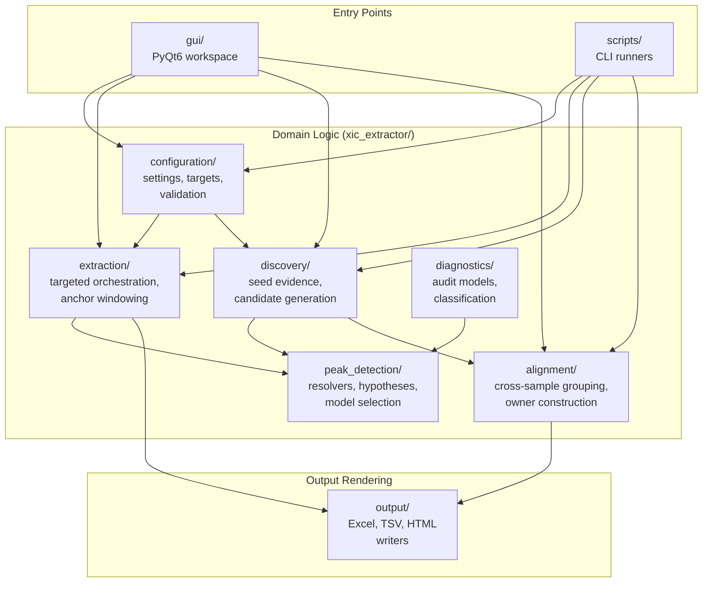

# Architecture Contract

This document owns XIC Extractor's durable code-organization and responsibility
rules. `AGENTS.md` keeps only the high-priority guardrails; this file carries the
longer architecture contract and known decomposition targets.

## Design Principles

- Make logic, dependencies, and data flow obvious.
- Prefer explicit interfaces over hidden coupling or global context.
- Keep one reason to change per module. Split by responsibility, not by fashion.
- Keep high-level domain behavior independent from IO, GUI, workbook rendering,
  process backends, and CLI wrappers.
- Use orchestration modules to coordinate focused submodules; do not let the
  orchestrator become the permanent home for every implementation detail.
- Add abstraction only when it reduces real coupling, duplication, or cognitive
  load. Avoid both monoliths and many tiny indistinguishable modules.
- Preserve public contracts unless an approved plan says otherwise.

## System Overview

**Product-method flow — target architecture:** `.raw` files + typed SearchScope
→ shared Discovery/capture → PeakHypothesis → CrossSample → ModeTrack proposal
and CrossSample application → optional ObservationRepair → CrossSample
reconciliation → optional one final ModeTrack proposal/application →
FinalizedScientificAlignment → projection binding/subjects →
ProductionCellDecision → projection completion → result finalizer → archive,
explanation, and delivery

```mermaid
flowchart LR
    TS["TargetSearchScope"] --> D["Shared Discovery / capture"]
    US["Untargeted SearchScope"] --> D
    D --> CS["CrossSample<br/>group identity and disposition"]
    CS --> MT["ModeTrack<br/>refinement proposal"]
    MT -. "proposal only" .-> CS
    CS --> BF["Backfill<br/>ObservationRepair 0..1"]
    BF --> CSR["CrossSample<br/>repair reconciliation"]
    CSR --> MTF["ModeTrack<br/>final proposal 0..1"]
    MTF -. "proposal only" .-> CSF["CrossSample<br/>final receipt"]
    CSR --> CSF
    CSF --> R["FinalizedScientificAlignment"]
    R --> TPB["Target projection<br/>binding + Target subjects"]
    R --> UPB["Untarget projection<br/>row keys + Group subjects"]
    TPB --> CD["ProductionCellDecision<br/>Target subject"]
    UPB --> GD["ProductionCellDecision<br/>Group subject"]
    CD --> TPC["Target projection completion<br/>inclusion / counts / reasons / review"]
    GD --> UPC["Untarget projection completion<br/>inclusion / archive routing"]
    TPC --> TR["Finalized Targeted result"]
    UPC --> UR["Finalized Untargeted result"]
    TR --> EA["Evidence archive<br/>typed staged bundle"]
    UR --> EA
    TR --> EX["Explanation<br/>render + navigation"]
    UR --> EX
    EA --> EX
    TR --> DL["Delivery<br/>ArtifactPlan + atomic publish"]
    UR --> DL
    EA --> DL
    EX --> DL
```

Each projection appears twice because one owner has two ordered operations:
binding/subject construction before cell decision and completion after it. The
diagram does not introduce a second Target or Untarget projection owner.

**Untargeted application:** configured evidence search → shared core →
established-group quantitative matrix + review/archive artifacts → downstream
preprocessing/calibration/statistics

**Targeted application:** exact target-list/search scope → the same capture,
group, trajectory, repair, and cell-decision core → fixed target-row evidence
delivery (CSV/workbook)

Untargeted is the general XIC method and architectural core. Targeted is a
constrained specialization over that lifecycle with its own search scope,
application policy, GUI flow, and output projection. A broad candidate-
discovery policy is not Untargeted-only: Targeted may inspect the same broad
evidence relationships while accepting only configured targets. Separate
output contracts and writer authority do not justify permanent duplicate
capture, peak-identity, CrossSample, ModeTrack, ObservationRepair, or cell-
decision implementations.

The current runtime has not completed that convergence. Targeted uses bounded
sample-local hypotheses, configured target identity, and cross-sample RT,
paired-area, and MS1-shape evidence through `extraction/`. The headless limited
`5-hmdC + 5-medC` CLI additionally runs a baseline/support/final rescue before
publishing; GUI and direct `extractor.run` calls do not generate that support
automatically. Targeted does not yet reuse the Untargeted owner/group Alignment
and Backfill implementation in `alignment/`.

Treat this package and entry-point split as migration state and a parity gap,
not as the product model or a reason to build two independent decision cores.
The minimum workflow-neutral types, lifecycle operations, policy seam, and
CID-NL / NL116 dual-projection tracer contract are owned by
[`docs/product/shared-processing-kernel.md`](product/shared-processing-kernel.md).
Stable processing-request, attempt, evidence-artifact, delivery-cell, and
delivery-seal lineage is owned separately by
[`docs/product/processing-lineage.md`](product/processing-lineage.md). Attempt
scheduling, cancellation, retry/resume, worker/resource cleanup, cache
lifecycle, and runtime observability are owned by
[`docs/product/execution-runtime.md`](product/execution-runtime.md). Processing
lineage owns logical retention classes and the archive/handoff bundle contract;
the future evidence-archive owner owns its native typed storage projection.
Physical activation, location, catalog, and migration remain separate delivery
decisions. The runtime may only execute owner-supplied lifecycle actions for
registered temporary resources and caches while respecting lineage pins.

## Dependency Direction

- Domain algorithms may use arrays, config, typed context objects, and small
  models.
- Domain algorithms must not import GUI, workbook builders, CLI scripts, process
  backends, report renderers, or RAW/CSV adapters.
- IO/rendering/adapters depend inward on domain helpers.
- Public entry points should stay thin. Retain a compatibility facade only when
  a current explicit public/downstream contract or a real external consumer
  still names it. Tests, historical artifacts, and the former implementation
  are not consumer evidence; when an internal function is replaced, delete its
  old implementation, alias, and migration shim in the same change.
- Migration tests follow the invariant's current semantic owner. Move them to
  the successor surface or delete implementation-detail coverage; retain legacy
  tests only for a current public compatibility contract, explicit migration or
  rejection behavior, or parity during an active transition.
- An `audit_only`, `shadow_only`, or `diagnostic_only` migration path names the
  smallest next production or adapter transfer in its exit rule, not only the
  evidence still missing.

## Frozen Alignment Owner Decomposition

The current `xic_extractor/alignment/` tree mixes grouping, trajectory review,
Backfill, Matrix assembly, decision policy, diagnostics, rendering, and
publication. The target is replace-don't-layer: deepen the existing scientific
owners behind small interfaces, move consumers in dependency order, then remove
the superseded implementation and compatibility path. Do not create a generic
`core/`, `common/`, `utils/`, or storage-first model package.

These paths are the target locality contract. A path may not exist yet; its row
defines the successor owner rather than claiming current implementation status.

| Target module | Owns | Must not own |
| --- | --- | --- |
| `peak_detection/search_scope.py` | Closed `TargetSearchScope | UntargetedSearchScope` boundary schema and common request/sample/provider binding validation; Target-list and Discovery/provider owners mint their own variant content | Reminting Target identity, choosing provider policy, capture science, rows, groups, values, or artifacts |
| `alignment/workflow.py` | Typed composition of stage order, resource/cancellation handling, transaction scope, runtime receipts, finalization, and delivery | Grouping, trajectory fitting, Backfill science, selected-value rules, mutable Matrix transport, renderer flags, or fallback algorithms |
| `alignment/cross_sample/` | Initial grouping, canonical member set, `group_hypothesis_id`, `GroupDispositionDecision`, split/merge lineage, and application of accepted refinement proposals | Trace integration, ModeTrack fitting, ObservationRepair, cell values, row inclusion, or rendering |
| `alignment/mode_track/` | Immutable trajectory-input snapshots, simplest validated trajectory model, assignment/refinement proposals, and their audit; absorbs reusable `identity_coherence` capability | Group minting, membership mutation, Backfill, value selection, Matrix writes, or a second control plane |
| `alignment/backfill/` | Bounded work planning, exact request reuse, one `ObservationRepair` epoch, owner-backed repaired observations, and transaction closure | First-hit Discovery, group identity, implicit membership, recursive support, final selected value, or writer authority |
| `alignment/cell_decision/` | One deep `ProductionCellDecision` interface over explicit `TargetCellSubject` and `GroupCellSubject` variants; returns typed write/no-write decisions | RAW access, regrouping, workflow row identity, renderer strings, or cross-projection authority leakage |
| `alignment/result/` | Shared-core closure into `FinalizedScientificAlignment`, then final closure of immutable Targeted/Untargeted result variants after projection completion | Re-running RAW, ModeTrack, Backfill, selection, or projection policy |
| `alignment/projection/target/` | Consumes owner-issued `TargetSearchScope`; pre-cell zero/one/many `TargetRowBinding`, fixed `TargetKey` rows, and Target subjects; post-cell inclusion/count/reason policy and references to the existing Review Queue | Reminting SearchScope/Target identity, a second capture/repair/cell-decision implementation, or arbitrary winner selection |
| `alignment/projection/untarget/` | Pre-cell `UntargetRowKey` and Group subjects; post-cell established-group row inclusion, archive routing, Untarget delivery-cell identity, and analytical-handoff projection | Target policy, provisional-row promotion by implication, or m/z/RT/display labels as identity |
| `alignment/backfill_evidence_parquet.py` + `alignment/backfill_evidence_parquet_bundle.py` (accepted archive implementation locality; see `docs/adr/0003-separate-evidence-archive-explanation-and-delivery.md`) | Native typed-Parquet persistence and bounded query of finalized Backfill/skipped owner records; retention-class projection; staged bundle/reference identity; verification and atomic internal archive publication | Scientific record semantics, product row/value decisions, delivery schema, TSV-mediated canonical typing, final product bundle publication, public Parquet-v2 activation, a generic evidence/database framework, or persistence for hypothetical future owners |
| `explanation/` | Human reason rendering and stable archive/reference navigation from typed decisions | Parsing reason strings back into core decisions or minting scientific authority |
| `delivery/` | Final `ArtifactPlan` compilation after render/query consumers stabilize, render-only writers, atomic bundle publication, required claim-group closure, and typed delivery receipts | Scientific recomputation, caller-authored emit booleans, or evidence-archive query policy |

### Identity, refinement, and finalization invariants

- `group_hypothesis_id` is an owner-minted typed digest over the group identity
  schema, exact `processing_request_id`, and canonical-sorted identity-bearing
  member subjects. A member subject combines canonical sample identity with a
  discriminated union of owner-backed `PeakHypothesis` identity or owner-backed
  physical-observation identity; its canonical variant tag is part of identity.
  Different wrappers over one physical observation canonicalize to the same
  member subject unless explicit distinct variant tags intentionally keep them
  separate. Ordinals, `FAM...`, area, display RT, sample stem, and ModeTrack
  anchor ID are forbidden identity bases.
- Group/member/Untarget-row identity bases are versioned discriminated mappings
  serialized as UTF-8 canonical JSON with sorted keys, compact separators, and
  exact variant spellings. The owner preserves or can reproduce the basis bytes;
  equal digest with unequal basis bytes is a contract collision and fails closed.
  Their constructors delegate canonical serialization and typed-digest mechanics
  to `xic_extractor/processing_identity.py`; they do not copy its private helpers
  or create package-local canonicalizers.
- One group has at most one identity-bearing member per canonical sample.
  Distinguishable same-sample peaks form different groups; unresolved
  ambiguity is not settled by picking one.
- Membership or split/merge changes mint successor group identities and
  immutable lineage. A new processing request creates new group and row
  identities; cross-request continuity is not inferred during the first
  migration.
- `GroupDispositionDecision` is exactly one of `established`, `provisional`,
  `unresolved`, or `rejected`. `established` requires accepted identity-bearing
  members from at least two distinct canonical samples plus the active method's
  hard gates. A singleton is always `provisional`; low support alone is not
  `rejected`. Disposition and output inclusion are separate decisions.
- ModeTrack consumes one immutable `trajectory_input_id` whose content is
  limited to trajectory-relevant anchors, members, apexes, injection order,
  evidence profile, and exclusions. Value-only area or boundary changes do not
  rerun it. CrossSample alone applies proposals and mints successors.
- CrossSample owns the closed `eligible | review_only | excluded` edge
  classifier used by initial grouping, claim candidates, and repaired
  observations. Only `eligible` edges connect one bounded atomic ModeTrack
  neighborhood; `excluded` cannot be reopened. CrossSample applies the complete
  coupled successor set or none. An oversized eligible neighborhood is
  unassessable and cannot be split, truncated, or processed greedily to alter
  membership.
- ObservationRepair may trigger at most one rebuilt trajectory snapshot and one
  final ModeTrack rerun when trajectory identity actually changes. CrossSample
  reconciles repaired observations, applies or rejects the optional final
  proposal, and mints the final receipt consumed by scientific closure. There is
  no repair/refit loop. A repaired observation is neither group membership nor
  a selected product value.
- Repair provenance persists. A subsequent execution grants anchor eligibility
  only when the active method-specific evidence owner freshly classifies the
  required independent evidence; repair acceptance or trajectory agreement is
  insufficient.
- `FinalizedScientificAlignment` carries the exact canonical sample universe
  and one terminal search/observation state for every required subject; absence
  is never inferred from a missing row. Target binding considers only unique
  established/provisional groups and creates every Target × sample subject.
  Untarget row identity is processing-request-scoped and every finalized group
  × sample creates a subject; standard Matrix completion includes established
  groups only.
- `ProductionCellDecision` is the sole selected-value owner. Its no-write
  taxonomy is `not_searched`, `searched_no_observation`, `unresolved`,
  `rejected_observation`, `not_quantifiable`, and `unavailable`. Only a complete
  owner-bound search receipt may prove `searched_no_observation`; missing,
  incomplete, or corrupt evidence is `unavailable`.
  These are closed terminal variants, not overlapping booleans: explicit
  no-search, searched-empty, unresolved, all-rejected, accepted-nonquantifiable,
  technical-unavailable, or authorized-quantifiable maps to exactly one result.
  Cross-request/cross-subject evidence is a contract error rather than a
  no-write reason.
- `finalize_alignment_result(request)` accepts a discriminated Targeted or
  Untargeted request and returns the matching immutable result variant. It
  validates closure only. Public construction, mutable dictionaries, optional
  mode fields, and workflow boolean soup are forbidden.
- The type name `Matrix` is reserved for the final canonical grid. Pre-final
  owner/cell collections use distinct observation or provisional-snapshot
  types and cannot be passed to delivery as if already finalized.

### Compatibility and promotion

Current TSV/CSV/workbook schemas, command/configuration shape, default artifact
selection, and interaction mechanics remain unchanged during a structural-only
migration. Selected values, counted detections, and public scientific identity
remain unchanged only until an explicit behavior-promotion packet binds the
new semantic owner, expected diff, focused output contracts, method-appropriate
evidence, structured writer authority, and rollback. Legacy facades may
delegate and project for a finite list of named current consumers; they may not
retain a same-capability failure fallback. Capability-scoped activation may
keep a separately named method authority outside the activated universe.
Target local fill, ModeTrack sensitivity changes, Untarget row-key cutover,
typed Parquet v2, and analytical-handoff activation are separate behavior-promotion
lanes with expected diffs, method-appropriate evidence, rollback, and explicit
consumer proof.

## Ownership Map

Use this map when adding or moving package code. `docs/project-layout.md` owns
where files live; this section owns the reason each package changes.

| Surface | Owns | Should not own |
| --- | --- | --- |
| `xic_extractor/alignment/` | Transitional facade and composition surface while the frozen semantic owners above absorb current behavior; current public entry compatibility and Alignment process adaptation | Permanent grouping/ModeTrack/Backfill/cell-decision implementation in one package root, mutable Matrix transport, renderer-local decisions, GUI, RAW adapters, targeted-only science, or a second runtime lifecycle owner |
| `xic_extractor/discovery/` | General candidate discovery and seed generation; reusable workflow-neutral discovery facts; content-bound batch receipts that close exact candidate artifact bytes/payload/count against acquisition identity; Untargeted adapter from direct measured CID-NL seeds to canonical evidence refs | Cross-sample matrix consolidation, targeted target-list policy, or Matrix authority from diagnostic projection refs |
| `xic_extractor/extraction/` | Targeted extraction orchestration, target jobs, anchor windowing, drift handling, backend coordination, and Targeted adapter from typed MS2 product evidence to canonical CID-NL refs | Workbook rendering, GUI, alignment matrix decisions, or counted-detection authority from diagnostic projection refs |
| `xic_extractor/peak_detection/` | Trace models, owner-backed physical MS1 observation refs, hypotheses, resolver implementations, boundary selection, baseline/integration audit, region logic, and workflow-neutral canonical CID-NL observation content | Cross-sample ownership, workflow projection policy, workbook output, GUI, or RAW IO orchestration |
| `xic_extractor/configuration/` | Settings schema, config/target CSV loading, validation, normalization into typed runtime settings, and owner-minted target key/definition/ordered-list snapshots | Extraction behavior, lineage-owned target ID minting, or output rendering |
| `xic_extractor/sample_metadata.py` | `sample_metadata_v1` schema, namespaced canonical sample identity, immutable metadata snapshots, alias resolution, and injection-order projection | Acquisition identity, role-driven value changes, normalization, or writer authority |
| `xic_extractor/review_records.py` | Review-roundtrip-owned subject identity over canonical sample/stable target key; immutable typed-action references bound to exact target definition/request/artifacts; registry snapshots, current resolution, and same-subject supersession validation | Sample/target/request ID minting, arbitrary payload schemas, review truth, private rationale storage, product mutation, or lineage-owned ID minting |
| `xic_extractor/evidence_artifacts.py` | Workflow-neutral exact-byte content identity and immutable producer-attempt artifact-reference value objects | Producer role/schema selection, storage, runtime lifecycle, delivery, or publication authority |
| `xic_extractor/artifact_lineage.py` | Order-neutral completeness and cycle validation over supplied owner-minted artifact references | Artifact minting, cross-attempt runtime resolution, storage, or delivery eligibility |
| `xic_extractor/peak_detection/observations.py` | Canonical sample-local selected MS1 subtrace plus signal-validated integration content identity; exact raw/selection traces must support the declared apex, heights, raw area, and any AsLS/Gaussian15 derived facts; semantically equal numeric inputs have one canonical representation; exact request-bound acquisition-source/trace/query/resolver provenance; immutable request/attempt artifact ref; persisted exact-field parsing, canonical byte identity, and narrow verification of only raw apex/height/area claims supported by retained selected RT/intensity; and binding validation | RAW/XIC access, provider or target policy, hypothesis/group/selection identity, storage, full persisted-content semantic rehydration without complete live primitives, or product authority |
| `xic_extractor/peak_detection/observation_batch.py` | Resolve the sample's exact request-bound acquisition source before adapter I/O, then compose one matching capability-bound `TraceAcquisitionBatch` with owner-supplied `IntegrationResult` plans into an immutable, coordinate-preserving `PeakObservationRef` batch receipt shared by runtime consumers | Peak selection/scoring, provider interpretation, runtime settlement, RAW/vendor implementation, storage, workflow projection, or writer authority |
| `xic_extractor/peak_detection/cid_nl_evidence.py` | Canonical direct measured DDA/ddMS2 CID-NL observation content, including exact request-bound acquisition source and scan identity, plus an immutable no-write artifact ref shared by both tracer projections | DIA interpretation, Target/Discovery policy, inferred-precursor evidence, candidate selection, group identity, or product authority |
| `xic_extractor/peak_detection/cid_nl_peak_support*.py` | CID-NL-owner composition of one strict DDA/ddMS2 scan ref with exactly one physical MS1 peak ref inside an exact supplied candidate universe | Candidate-universe generation/completeness, DIA/co-isolation interpretation, method-hypothesis selection, group identity, or product authority |
| `xic_extractor/peak_detection/cid_nl_chromatographic_support*.py` | Order-neutral CID-NL-owner aggregation of one or more strict DDA scan-to-peak refs into exactly one chromatographic support event for one physical MS1 peak | Multiple-event counting, cross-peak merging, candidate generation, hypothesis selection, DIA interpretation, or product authority |
| `xic_extractor/peak_detection/peak_hypothesis_identity.py` | Immutable composition of owner-minted physical observations and typed evidence into the existing `PeakHypothesis`; workflow-neutral content identity, exact attempt artifact closure, and binding validation | A second hypothesis model, Targeted context minting, candidate generation, model selection, cross-sample grouping, counting, or product authority |
| `xic_extractor/extraction/cid_nl_evidence_projection.py` | Validate existing Targeted `MS2ProductEvidence` plus exact request-bound target snapshot, target-precursor ppm tolerance, acquisition source, scan, and sample context against a canonical CID-NL ref | Recompute evidence, select/count a peak, write output, or mint canonical evidence |
| `xic_extractor/discovery/cid_nl_evidence_projection.py` | Validate an existing direct `scan_precursor` `DiscoverySeed`, including its finite measured scan precursor, plus exact request-bound acquisition source and sample context against a canonical CID-NL ref | Inferred-precursor special cases, group/Matrix decisions, product writes, or canonical evidence minting |
| `xic_extractor/processing_identity.py` plus `xic_extractor/artifact_lineage.py` | Workflow-neutral canonical identity serialization and typed-digest mechanics; acquisition-source, processing-request, and processing-attempt identity; complete retry-predecessor-chain derivation; and producer-attempt-derived closure validation of complete owner-resolved sample/target/artifact/review references | Owning the domain payload of Target, CrossSample, or projection identities; sample/target/artifact/review ID minting or resolution; caller-authored artifact-attempt allowlists; caller-authorized retry dependencies; runtime events, storage, scientific selection, projection, or writer authority |
| `xic_extractor/process_job_execution.py` | Bounded spawned-process submission, deterministic result collection, pending-future cancellation, first terminal failure preservation, all observed terminal results, and submitted/completed/failed/cancelled/in-flight/unsubmitted mechanical census; consumers reject a non-terminal incomplete census before scientific projection | Scientific state, runtime lifecycle facts, retry/resume, RAW handles, domain result interpretation, persistence, or worker payload authority |
| `xic_extractor/execution_runtime.py`, `execution_runtime_owner.py`, plus focused `execution_runtime_finalization*.py`, `execution_runtime_marker.py`, and `execution_runtime_observability.py` companions | One atomic runtime execution/finalization entry over accepted running manifests or an empty preflight-terminal state and append-only attempt/work facts; typed adapter receipt acceptance; owner-derived lifecycle, resource cleanup, opened-process-worker topology, fixed metric provenance, runtime-artifact disposition, acquisition metrics, and observability; content-bound coordinator/supervisor terminal records carried by one finalization receipt; one atomic owner-path-supplied launch/finalization recovery marker; coordinator/supervisor phase enforcement; and typed external monotonic-offset/RSS/runtime-mediated-I/O samples | Request/attempt identity minting, acquisition/resource implementation, live telemetry collection, caller-authored ledgers/counts/provenance/finalization halves, partial lifecycle calls or settlement-only consumer bypasses, storage-location or retention policy, a generic persistence framework, scientific state, artifact delivery, or writer authority |
| `xic_extractor/acquisition_contract.py` | Capability-aware batch use of existing `XICRequest`/`XICTrace`, exact acquisition-source binding, truthful `native_scan`/`conversion_scan`/`rt_only` coordinates, and mechanical call/point counts | Vendor/RAW implementation, cache/storage, PeakObservation, scientific selection, workflow flags, or writer authority |
| `xic_extractor/delivery_lineage.py` | Targeted-only owner-backed delivery-cell, revision, stage, and seal-candidate content identities plus in-memory two-phase closure validation; retry dependencies must equal the processing-identity owner's complete predecessor chain | Caller-authorized same-request sibling dependencies, product seals, current pointers, publication, CAS/storage, physical writing, selected-value authority, or a second projection model |
| `xic_extractor/output/` | General extraction workbook/TSV presentation and reusable output-schema rendering; Alignment-specific renderers remain in `xic_extractor/alignment/` under the same render-only boundary | Domain evidence recomputation, scientific decision rebuilding, or RAW scanning |
| `xic_extractor/diagnostics/` | Reusable diagnostic models, summaries, and classification helpers used by diagnostic CLIs | CLI argument parsing, one-off file-system orchestration, production behavior changes |
| Root facades such as `extractor.py` and `signal_processing.py` | Public compatibility imports and thin orchestration while behavior is migrated | Permanent home for new implementation detail |

If a change appears to fit multiple rows, keep the low-level domain behavior in
the package that owns the concept and put only orchestration at the caller. Do
not add a new package just to avoid choosing an existing owner.

Boundary ownership note:

- `ChromPeakSegment` / segment-native projection owns active Gaussian15
  chromatographic boundary promotion for selected peaks.
- `selected_full_envelope` owns diagnostic and fallback envelope evidence. It
  must not remain a permanent product gate when a segment-native boundary is
  available.
- Targeted extraction may orchestrate both, but boundary selection logic belongs
  in `xic_extractor/peak_detection/`.
- `xic_extractor/extraction/rt_windows.py` owns paired-target candidate-search
  windowing. It may use a target-specific MS2/NL anchor as support, but paired
  ISTD fallback references must be resolved before `peak_detection` enumerates
  Gaussian15/ChromPeakSegment candidates.

## Dataset-Agnostic Evidence Architecture

This repo is an LC-MS evidence and model-selection system, not a single-dataset
or CID-NL-only tool.

- 8RAW and 85RAW are validation fixtures and stress oracles. They are not the
  architecture boundary.
- CID-NL, HCD-PI, Delta Mass, MS1 isotope/adduct pattern, RT/iRT, shape, clean
  standards, library matches, and future learned models are evidence providers.
- Evidence providers should enter through `EvidenceVector`, `PeakHypothesis`,
  model selection, and `AuditTrail` before any matrix/export mutation.
- A new evidence source must state whether it is `audit_only`, hypothesis
  enumeration, model-selection calibration, production candidate, or retirement.
- Direct matrix writes require an explicit activation/export contract, expected
  diff, and focused output tests.

Naming rule:

- Name modules, types, functions, config keys, commands, and current artifacts by
  the product or evidence behavior they own. A name should remain accurate when
  the milestone, ticket, validation fixture, or first dataset disappears.
- A fixture name such as `8raw` or `85raw` is correct only when the surface
  actually selects or reports that validation lane. A phase or package code is
  correct only inside frozen historical evidence; it is not a current behavior
  name and does not justify a runtime alias.
- Apply this semantic rule when a name is introduced or changed. Do not enforce
  it with repository-wide token counts, occurrence budgets, spelling ratchets,
  or blacklists: lexical presence cannot prove whether a name matches behavior.
- When behavior is replaced, remove its obsolete name, implementation, tests,
  and compatibility/migration code together unless the public-contract rule
  above identifies a current consumer. Git history is the recovery path.

Architecture preflight applies when work creates or replaces a semantic owner,
crosses an evidence/runtime boundary, or changes Matrix, activation, a public
contract, or scientific authority. A technology, method, diagnostic, or RAW
label alone is not a trigger; focused work inside an established owner stays on
that owner's ordinary verification path. When the boundary applies, use
`.codex/skills/xic-architecture-preflight/SKILL.md` to bind the existing owner,
reuse target, call-cost model, public contract risk, validation gate, and stop
rule.

### Shared Decision Semantics Positioning

`xic_extractor/evidence_semantics.py` is the shared, **role-neutral** decision
layer. It is genuinely load-bearing, not a tiebreaker afterthought, and it serves
two distinct consumers:

- **Candidate selection** — `decision_class` ranks scored candidates in
  `peak_detection/candidate_selection.py`.
- **Targeted product authority** — the selected hypothesis's
  `decision_semantics` is consumed by `selection_decision_from_hypothesis`
  (`peak_detection/selection_decision.py`) and by the projection builder
  (`extraction/result_assembly.py:_targeted_product_projection`) to produce the
  `TargetedProductProjection`, which is the authority for counts and matrix
  presence.

Invariant: the shared layer stays role-neutral. Targeted-only, role-aware policy
(ISTD plausible-dropout, paired-analyte downgrades) lives in the projection
builder in `result_assembly.py`, **not** in `evidence_semantics.py`. The shared
layer may say `review` with `plausible_nl_dropout_review`; it must never decide
"this ISTD is present" or "this row is counted". Do not let targeted role policy
leak into the shared semantics, and remember `evidence_semantics.py` is also on
the untargeted alignment path (`common_evidence_from_aligned_cell`), so a change
there has cross-path blast radius.

The end-to-end `Confidence` / `Reason` / counted-detection resolution order is
documented in `docs/product/decision-policy.md`; the authority
migration now lives in `docs/product/alignment.md` and
`docs/product/evidence-spine.md` after the dated evidence-chain spec was reduced
to a migration/history stub.

## Diagnostics Contract

Treat `tools/diagnostics/` as maintained product-adjacent code.

- Diagnostic CLIs should parse, validate, and orchestrate only.
- Reusable loading, classification, models, summaries, plotting, and writers
  belong in focused package modules.
- Diagnostic writers render TSV/JSON/HTML/XLSX/plots only. They must not
  recompute domain evidence or re-scan RAW files.
- Pass typed summaries from the code path where trace context already exists.
- Gate diagnostics must emit machine-readable status/reason fields plus a short
  human summary with the blocker and next action.
- Missing inputs, missing columns, stale artifacts, and unsupported schemas
  should name the expected file/column and how to regenerate or bypass the
  artifact.
- Optional diagnostics should use sidecar artifacts. Do not silently change
  established TSV/workbook schemas unless an approved contract says so.
- Architecture reviews for large diagnostics PRs should start from the shared
  helper and public-contract blast radius, not from an even line-by-line pass
  over every writer. Check package-neutral helpers, matrix identity/value-delta
  surfaces, RAW-access fallback behavior, and diagnostic-vs-production claims
  before treating mechanical TSV writer churn as low risk.

Before any PR that adds, removes, or renames a CLI entry point in
`tools/diagnostics/`, read `tools/diagnostics/INDEX.md` and cite which existing
entries were considered. Every PR that changes the set of entry points must
update `INDEX.md` in the same diff. Full lifecycle rules live in
this Diagnostics Contract plus `docs/agent/architecture-public-contracts.md`;
the dated lifecycle spec is retained only as a migration/history stub.

## Refactor And Test Discipline

- Move behavior before changing behavior.
- Do not mix structural refactors with scoring thresholds, peak selection rules,
  neutral-loss matching, or area integration changes.
- Add characterization tests before moving behavior that is not already covered.
- Tests should live in `tests/`, keep the repo's flat test layout, and normally
  use `tests/test_<module>_<behavior>.py` naming. Prove behavior or public
  contracts with small deterministic fixtures before real RAW data.
- Separate real-data validation from normal unit tests. Use explicit validation
  scripts or fixture gates for RAW/workbook checks.
- Use 8-RAW validation for extraction/output refactors that can affect real
  workbook output.
- For output changes, pair narrow writer/sheet tests with a workbook or schema
  contract test.
- For process-mode changes, add a no-RAW spawn/pickling smoke test before
  raw-data benchmarking.
- Windows process mode must receive pickleable payloads only. Do not pass nested
  closures or non-pickleable factories across process boundaries.

Line count is a signal, not a hard rule. Pause when a module is near 500 lines
and a change adds a responsibility, or near 800 lines and the change is not a
local bug fix. Responsibility count matters more than exact length.

## Shared Models And Contracts

- Shared dataclasses and protocols belong in small model/contract modules when
  they prevent circular imports or schema drift.
- Do not create shared concrete implementations before targeted/untargeted
  semantics actually match.

## Current Decomposition Targets

These modules are known maintainability targets. This list is an orientation
surface, not an active phase plan:

- `scripts/csv_to_excel.py`: keep as CLI/import wrapper; move workbook logic to
  `xic_extractor/output/` modules.
- `xic_extractor/extractor.py`: keep as public extraction facade; move pipeline,
  backend, pre-pass, target extraction, anchor, drift, and output dispatch logic
  into `xic_extractor/extraction/`.
- `xic_extractor/signal_processing.py`: keep as compatibility facade; move
  models, resolver implementations, selection, recovery, integration, and trace
  quality into focused peak-detection modules.
- `xic_extractor/alignment/`: migrate in dependency order to the frozen owner
  decomposition above. `primary_consolidation.py`, `matrix_identity.py`,
  `production_decisions.py`, `pipeline.py`, `identity_coherence/`, current
  Backfill files, and output-level flags are evidence-bearing legacy sources,
  not permanent owner shapes. Characterize before moving; delete replaced
  implementations and adapters after their named consumer census reaches zero.
- `xic_extractor/diagnostics/backfill_reconciliation_gallery.py`: keep as the
  reconciliation-gallery orchestrator; continue moving static presentation
  assets, input/index construction, classification, and HTML section rendering
  into focused diagnostics submodules without changing TSV/HTML contracts.

See also:

- `docs/project-layout.md`
- `docs/agent/architecture-public-contracts.md`
- `docs/product/alignment.md`
- [GitHub Issue #301](https://github.com/Chao-hu-Lab/XIC_Extractor/issues/301)

Retired dated decomposition specs are folded into this contract and removed;
active implementation maps, acceptance, and dependency sequencing live in
GitHub Issues rather than tracked history stubs.
