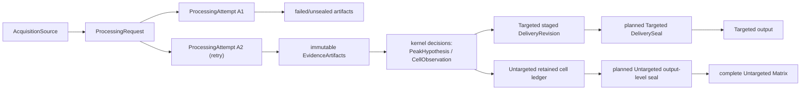

# Result Traceability

Result traceability distinguishes which request, attempt, source observations,
and immutable evidence produced a result. Identity is not scientific acceptance
or permission to publish.

## Current Status

This page separates current identity and artifact contracts from the
[reserved delivery design](#reserved-delivery-contract). The latter is an
accepted design boundary, not a claim that product sealing exists.

| Part | Plain meaning | Status |
| --- | --- | --- |
| Processing identity (`xic_extractor/processing_identity.py`) | Which request and attempt ran, over which RAW sources | Implemented; production Alignment, Backfill, and Discovery modules use it |
| Target identity (`TargetKey`, `TargetListSnapshot` in `xic_extractor/configuration/target_identity.py`) | Which exact target list a run used | Implemented; production Targeted modules use it |
| Targeted delivery lineage | Per-cell Targeted revisions, stages, and seals | Planned; no current implementation or product publication authority |
| Untargeted group label (`feature_id`) | A report-scoped `F000001` label for one published cross-sample group | Implemented in `alignment/untargeted_finalized_matrix.py` |
| Untargeted per-cell delivery lineage | A retained revision/evidence bundle for each Matrix cell | Not planned; see [Untargeted delivery decision](#workflow-specific-delivery) |
| Untargeted output-level seal | One sealed manifest for one complete Untargeted Matrix delivery | Planned; not implemented |

Current entry points are
[processing identity](../../xic_extractor/processing_identity.py),
[target identity](../../xic_extractor/configuration/target_identity.py), and
the [feature_id label](../../xic_extractor/alignment/untargeted_finalized_matrix.py).
Executable identity does not establish a production artifact registry or
delivery seal.

## Ownership Boundary

This page owns:

- workflow-neutral processing-request and attempt identity;
- file-boundary fingerprints that bind written evidence to its sources;
- the relationship between kernel decisions and projection-owned delivery
  cells;
- the reserved two-phase staging and sealing contract;
- logical retention classes and plot-ready evidence closure;
- retry, stale, supersession, failure, and null lineage semantics.

Other owners remain:

- [`run-provenance.md`](run-provenance.md): Targeted workbook run metadata;
- [`sample-metadata-qc.md`](sample-metadata-qc.md): canonical sample identity
  schema and lookup projection;
- [`shared-processing-kernel.md`](shared-processing-kernel.md): scientific
  hypotheses, observation states, group membership, selection, and Backfill
  facts;
- [`vendor-raw-evidence-model.md`](vendor-raw-evidence-model.md): source-query
  and scan-selection meaning;
- [Execution Runtime](execution-runtime.md): scheduling, cancellation, retry
  execution, cleanup, cache lifecycle, and runtime observability;
- Targeted and Untargeted projection owners: counted detection, Matrix
  presence/value, output schemas, and final writer authority.

## Minimal Vocabulary

These are internal lineage concepts, not additional user-visible review tags.

| Term | Meaning | Not the same as |
| --- | --- | --- |
| `AcquisitionSource` | One immutable source-data identity plus its acquisition format and adapter-readable observation namespace | A local file path or sample display name |
| `TargetKey` | One target-list-owner namespace plus its stable normalized target label | An exact m/z/RT/transition definition or row number |
| `TargetDefinition` | One exact normalized Target definition under a `TargetKey` | A mutable CSV row or label alone |
| `TargetListSnapshot` | One immutable ordered set of owner-minted target definitions used by a processing request | `target_config_hash`, a path, or a caller-owned mutable list |
| `ProcessingRequest` | One normalized scientific computation request over identified sources, effective method/evidence settings, workflow constraints, and contract versions | An execution, output folder, timestamp, or UI session |
| `ProcessingAttempt` | One execution of a `ProcessingRequest`; every retry receives a new identity | The logical request or the product delivery |
| `EvidenceLocator` | A completed evidence report path plus the Matrix file SHA-256, attempt UUID, and schema version it belongs to | A digest of in-memory facts or an authority decision |
| `feature_id` | Report-scoped `F000001` label of one published cross-sample group, numbered in raw measured member order | A cross-run identity, chemical identity, or Matrix row number |

Do not introduce a generic `run_id` as a substitute for these identities.
Existing diagnostic `run_id` / `source_run_id` fields remain local compatibility
labels until an adapter binds them to the contract above.

## Identity Contract

| Key | Basis | Forbidden basis |
| --- | --- | --- |
| `acquisition_source_id` | `sha256:<full-file content digest>` for content-bound sources, or `local:<device>:<file id>:<size>:<mtime>:<ctime>` for a local file revision; format and observation namespace stay on the source object | Path, file order, or display name alone |
| `TargetKey` | Target-list-owner namespace + owner-normalized target label | m/z, RT window, current row order, or label without an owner namespace |
| `TargetListSnapshot`, `ProcessingRequest` | Compared by their complete content; no scalar ID | A path, config hash, or digest standing in for the content |
| `processing_attempt_id` | A fresh UUID4 per execution; a retry links its predecessor through `retry_of` | Request content alone or a reused timestamp |
| `sample_key` | The sample-metadata `sample_name`, unchanged, under the [Sample Metadata contract](sample-metadata-qc.md#contract) | Reconstructing sample identity from acquisition sources or display/projection fields |
| `method_subject_id` | `target\|<label>` or `precursor\|<m/z>\|<ppm>\|<losses>` | A digest of the subject |
| Peak hypothesis key (in process) | Sample, method, measured m/z, apex RT, apex height, trace RT bounds and point count; DDA support appends its scan/loss facts | Target label, selection status, attempt token, or output position |
| `physical_peak_key` (written reports) | Sample, m/z, trace RT bounds and point count, apex RT, apex height; a key collision inside one report is an error | A content digest or a key reused across reports |
| Cross-sample group (in process) | The group object and its member subjects; members join in sample order | An ID persisted beyond the run |
| `feature_id` | Report-scoped `F000001` ordinal over published groups, in partition order and raw measured member order | Group centers, scores, hashes, worker order, or cross-report continuity |

Identifiers are allocated only where a reference crosses a file, table, or
human-facing boundary and no natural key suffices
([Change Locality](../architecture-contract.md#change-locality)). In-process
objects are compared by content and ordered by raw measured facts.
Its current content boundary is:

- normal Targeted acquisition binds the local filesystem revision (device,
  file identity, byte size, modification and creation/change timestamps),
  acquisition format, and adapter-readable observation namespace. Preparation
  does not scan RAW content. The adapter checks the revision before and after
  opening the vendor handle, and the workflow rejects input changes before
  finalization. This identifies a local file revision, not portable byte
  equality: copies are distinct sources and no full-content digest is claimed;
- persisted Discovery sources and explicit content fingerprinting bind the
  full-file SHA-256, byte size, acquisition format, and observation namespace;
- target keys, exact definitions, and ordered snapshots come from the
  [target-list owner](../../xic_extractor/configuration/target_identity.py);
  changing a definition or order creates a new snapshot, not a mutation of the
  request-pinned list;
- the Targeted processing request binds the canonical source set, the exact
  source-to-request-local-adapter-key and injection-order binding, all effective
  Targeted extraction settings, the exact owner-minted target-list snapshot,
  effective RT
  priors, approval records, optional MS1-shape support content and activation
  policy, the complete order-insensitive Discovery candidate universe for every
  acquisition sample, and the owning input-schema, algorithm, and contract
  versions. The candidate universe digest covers the full scientific candidate
  payload; missing, additional, or changed candidates cannot run under the same
  Targeted request. The adapter key is part of current execution semantics but
  is not a canonical sample identity and cannot be reused as a delivery-cell
  key;
- a processing attempt binds one request, a fresh UUID4, and an optional
  predecessor attempt. Retry always issues a new attempt. Terminal
  outcome and cancellation/failure events remain append-only facts owned by the
  execution-runtime contract and never rewrite identity.
- a written evidence report is located by its path, the Matrix path and file
  SHA-256, the attempt UUID, and the schema version; there is no separate
  artifact-instance identity;
- Delta Mass runs detection, matching, and trace confirmation in one pass.
  Its diagnostic CSV/sidecar outputs do not create processing-attempt
  authority;
- canonical samples come from [Sample Metadata](sample-metadata-qc.md).
  Lineage composes owner-resolved references and snapshots rather than deriving
  IDs from display labels.

The Targeted adapter currently names the existing Thermo MS-controller-1
namespace explicitly. A different controller, acquisition adapter, or
observation namespace therefore creates a different source identity rather
than silently reusing a bare scan number. The resolver performs one sequential
full-file read per source, but opens no vendor RAW handle and makes no XIC call.

### Owner-reference composition

This freezes the acquisition-source -> processing-request ->
processing-attempt boundary plus the sample and target-list owner APIs.
`ProcessingOwnerReferences` composes a complete request and attempt,
owner-resolved sample bindings whose exact lookup tokens cover every request
acquisition input and share one metadata snapshot, and the request-pinned
target-list snapshot. Lineage does not mint sample or target IDs. It rejects
mixed sample snapshots and target/request substitution.

Production workflows and diagnostic tracers consume this owner-reference
closure; it is not a production artifact registry. The processing-identity owner
derives the complete predecessor chain from `ProcessingAttempt.retry_of`.
Cross-attempt runtime dependency reuse remains unimplemented, as described in
[Execution Runtime](execution-runtime.md#retry-and-resume).

The [Evidence Spine](evidence-spine.md#cell-observation-reference) owns the
application of these references to provisional membership and bounded recovery.
It does not permit a naked target plus an independently valid peak to substitute
for recovery evidence.

An acquisition source and a sample remain different typed identities, but the
current lab contract is one independent canonical analysis sample per source
included in an XIC analysis folder. QC replicates and meaningful reinjections
therefore keep their distinct full names, result columns, and review scopes;
lineage must not strip suffixes or collapse them into a biological-specimen
identity. Invalid pre-crash acquisitions are excluded before this inventory.
Two paths containing the same exact source bytes remain one acquisition-source
identity and are rejected as duplicate request inputs; a filename copy cannot
mint another sample or source identity.
If the bounded tracer cannot obtain an unambiguous stable sample key from the
sample-metadata owner, it must stop rather than derive one independently from a
filename, display label, or row order.

[Group Boundary](family-hypothesis-boundary.md) owns canonical group membership,
successor identity, and the distinction between owner-backed observations and
legacy display labels. Untargeted reports label each published group with a
report-scoped `feature_id`; it is not a cross-run or chemical identity.
Automatic cross-request same/split/merge continuity is not implemented.

## Current bindings and storage limits

- [Targeted application](../../xic_extractor/applications/targeted/application.py)
  snapshots source content and the exact request before acquisition through
  `TargetedApplicationService.execute_application`,
  `snapshot_targeted_production_inputs`, and
  `build_targeted_processing_request_identity`. Its normal output is the
  workbook described by [Run Provenance](run-provenance.md), not a persisted
  delivery revision or seal.
- Current Untargeted output retains `alignment_cells.tsv` for per-cell tracing.
  Optional Backfill Parquet is a diagnostic shadow, not a shared production
  archive or a required future cutover.
- Same-run handoff uses immutable typed batches. Arrow IPC is considered only
  after a measured transport bottleneck. No generic archive, cross-run catalog,
  new delivery-plan type, or archive-to-delivery handoff is required without a
  current consumer.
- Heavy candidate, trace, and debug populations remain opt-in, validation-,
  review-, or failure-scoped. This contract does not add an ordinary-run archive.

Retention is by dependency rather than file extension. The lifecycle classes
below distinguish what may be retained; they do not assert that a shared
retention engine or product sealing implementation exists.

Every retained record also belongs to one lifecycle class:

| Class | Meaning |
| --- | --- |
| `essential` | Final result, delivery identity/seal, authority closure, and minimum evidence refs needed to explain a current value/null |
| `reviewable_compact` | Queryable machine archive needed for bounded review, including provisional groups and final cell-decision evidence |
| `diagnostic_heavy` | Candidate universes, traces, galleries, and debug payloads retained only for opt-in validation, active review, or failure forensics |
| `reconstructable` | Derived cache/artifact whose exact source identity, algorithm contract, and rebuild capability remain available |
| `compatibility` | Legacy schema/projection retained only for a named current consumer and removed when its consumer census reaches zero |

## Failure, Null, Stale, And Supersession

Keep orthogonal facts on separate axes. References to sealing and delivery
supersession below belong to the reserved delivery contract, not current
publication capabilities:

| Axis | Owner | Required distinction |
| --- | --- | --- |
| Scientific observation | Shared kernel | `observed`, `missing`, `absent`, `unassessable`, `ambiguous`, `failed` |
| Execution outcome | Execution runtime | Whether the attempt completed, failed, was cancelled, or produced partial diagnostic state |
| Artifact integrity | Lineage validation | Available and matching, missing, corrupt/hash-mismatched, or incompatible with the requested contract |
| Planned delivery lifecycle | Projection/writer | Staged, sealed/current, or explicitly superseded |
| Human review queue | Workflow review | Waiting for review versus a completed review conclusion |

Rules:

- Missing evidence, a failed attempt, or a missing artifact cannot silently
  become scientific `absent` or numeric zero.
- A missing/corrupt evidence artifact blocks sealing; it does not change the
  scientific observation.
- `missing` means no completed scientific evaluation result; `absent` means a
  completed evaluation found no supported hypothesis.
- `unassessable` remains a reviewed evidence conclusion, not a pending-review
  status.
- Staleness is a relationship between an immutable artifact and the request,
  contract, or input identity now being evaluated. Do not mutate the artifact
  to call it fresh again.
- Supersession changes which sealed delivery is current through an explicit
  supersession edge and the authorized writer. It never erases or rewrites the
  prior delivery; its granularity follows [workflow-specific delivery](#workflow-specific-delivery).

## Reserved delivery contract

The following preserves the accepted delivery and retention design from
[Issue #123](https://github.com/Chao-hu-Lab/XIC_Extractor/issues/123).
Its implementation status is recorded in [Current Status](#current-status).
These reserved requirements neither add a current writer gate nor authorize a
new output surface. Existing output transactions remain authoritative.

### Workflow-specific delivery

Targeted uses immutable per-cell revisions. Each revision references exactly
one `DeliveryCellKey` and producing attempt. An observed numeric revision
references its selected hypothesis or `CellObservation`, `IntegrationResult`,
selection/audit record, evidence artifacts, and source observations. An explicit
null revision records the underlying non-observation state and reason.

Untargeted uses one output-level seal binding the complete Matrix, retained cell
ledger, processing attempt, input sources, and output hashes. The ledger
preserves each cell's observation state and reason; per-cell tracing uses the
ledger or replay, not per-cell delivery revisions.

Both delivery forms can reference the same kernel decisions and evidence
artifacts. [Plot-ready evidence](#source-observation-and-plot-ready-evidence)
defines which evidence each workflow must retain, keeping storage proportional
to delivery and review needs.

### Delivery identities

| Term | Meaning |
| --- | --- |
| `DeliveryCellKey` | Targeted canonical sample plus target identity; not an acquisition source or kernel cell. |
| `DeliveryRevision` | Immutable Targeted value/null for a delivery cell, linked to its producing attempt and decision; not an Untargeted cell or publication permission. |
| `DeliverySeal` | Immutable authority-approved manifest for Targeted revisions or one complete Untargeted Matrix and retained ledger. |

| Identity | Required basis | Forbidden basis |
| --- | --- | --- |
| `delivery_cell_key` (Targeted) | `sample_metadata`-owned stable sample identity + target-list-owner identity | Acquisition-source identity, display name alone, column position, or output path |
| `delivery_revision_id` (Targeted) | Cell key + producer attempt + selected decision/null payload + projection policy/contract version | Mutable “latest” state or Untargeted cell identity |
| `delivery_seal_id` (planned) | Canonical sealed manifest content: Targeted revision and output-artifact identities, or Untargeted attempt, source, retained-ledger, and complete Matrix artifact identities | Directory existence, writer exit code, or a diagnostic candidate |

### Lineage Graph And Invariants

The [identity contract](#identity-contract) and
[failure, null, stale, and supersession rules](#failure-null-stale-and-supersession)
apply to this graph. Delivery also requires:

1. An attempt may consume an artifact from an earlier attempt only through an
   explicit immutable dependency reference. It must not copy or relabel that
   artifact as though the later attempt produced it.
2. Every selected hypothesis, integration, group observation, Targeted delivery
   revision, and retained Untargeted cell-ledger decision can identify the
   attempt and artifacts it used. Human review evidence cannot independently
   grant write authority; [Productization](productization.md#writer-authority)
   owns that boundary.

Publication validation belongs to [Two-Phase Delivery Seal](#two-phase-delivery-seal).

### Source-Observation And Plot-Ready Evidence

An evidence artifact that depends on source data records:

- `acquisition_source_id`;
- acquisition adapter/backend and source format;
- native scan/spectrum identity or a capability-validated equivalent;
- scan-selection predicate and trace type;
- m/z or mass range, tolerance, RT window, and relevant MS/precursor context;
- raw extracted trace points used as input;
- the exact decision-trace points or a deterministic transform contract and
  all inputs needed to reproduce them;
- detection, boundary, and quantitation basis;
- related sample, trace-group, hypothesis, integration, group, and cell
  references as applicable.

For Targeted selected, delivered, reintegrated, or manual-review candidates,
the retained bundle must be sufficient to render the evidence view without
reopening the acquisition source. Source references remain necessary for
audit, but they are not a substitute for retained plot-ready evidence.
Untargeted delivery retains the cell ledger for per-cell tracing or replays the
sealed attempt; it does not retain per-cell plot evidence or require zero-RAW
rendering for each Matrix cell. An explicit Untargeted review that promises an
offline plot must separately retain the exact evidence needed for that review.

This requirement does not select Thermo RAW, mzML, JSON, NPZ, Arrow, a
database, or another physical representation. [Acquisition capability evidence](../diagnostic-ledger.md#2026-07-24-acquisition-source-and-reusable-artifact-capability) must establish
source and reusable-artifact capabilities, fidelity, size, and rebuild cost.

### Delivery retention

| Class | Logical rule |
| --- | --- |
| Sealed Targeted delivery lineage | The seal, per-cell revision records, output hashes, decision/audit references, and source identities remain immutable for as long as that delivery can be cited |
| Sealed Untargeted delivery lineage (planned) | The output-level seal, complete Matrix artifact hashes, attempt and source bindings, and retained `alignment_cells.tsv` remain addressable for as long as that delivery can be cited |
| Current delivered Targeted plot-ready evidence | Pinned under the [plot-ready evidence contract](#source-observation-and-plot-ready-evidence) |
| Superseded delivered Targeted evidence | The immutable seal/revision/decision lineage remains audit-addressable; plot-ready evidence stays pinned while the old delivery remains a supported claim or is referenced by an active review, lockbox, expected diff, or retained audit claim |
| Active manual-review evidence | Pinned while waiting for a conclusion; the review binds to exact artifact identities and then moves to the completed-review class |
| Completed human-review evidence | The typed review record and exact evidence promised to that review stay pinned until the conclusion is explicitly superseded or retired and no active dependency still references it |
| Targeted selected or reintegrated but not delivered evidence | The selection/reintegration audit and exact plot-ready evidence stay pinned until the decision is explicitly superseded or retired and no active dependency still references it |
| Unselected and unreviewed evidence | May be evictable if it is not referenced by a seal, active review, lockbox, expected diff, or retained audit claim |
| Failed/cancelled-attempt artifacts | Never become delivery evidence by process success alone; cleanup and optional forensic retention belong to [Execution Runtime](execution-runtime.md) |
| Rebuildable cache | May be evicted only when the source identity, deterministic request/transform contract, and rebuild capability remain valid |

Previously delivered or human-reviewed decisions are comparators, not
immutable scientific truth. New evidence may explicitly supersede them, but a
refactor or rerun must not silently overwrite them. Completion of a refactor
alone is not retirement.

Here, `audit-addressable` includes the immutable seal, source references, and
artifact identities; Targeted also includes revisions and decision/review
records, while Untargeted includes the retained cell ledger. Retirement requires
a durable record of the subject, owning policy or actor, reason, and time; it is
invalid while a seal, active review, lockbox, expected diff, or supported audit
claim still depends on that evidence.

No numeric retention period or eviction technology is selected here. A
retention policy must never advertise “rebuildable” if the required source,
adapter, method contract, or fidelity is unavailable.

### Two-Phase Delivery Seal

The reserved delivery contract uses two phases:

1. **Stage** — write proposed output artifacts and a lineage manifest outside
   the final delivery location. Validate schemas, artifact existence and content
   identities, closure, and the owning projection's authority against the
   [workflow-specific delivery contract](#workflow-specific-delivery). Targeted
   also validates delivery-cell uniqueness and revision-to-kernel-decision
   references.
2. **Seal and publish** — create the immutable `DeliverySeal`, then atomically
   expose that sealed bundle or current-delivery pointer. Only sealed content
   is deliverable.

If staging, validation, sealing, or publication fails:

- the prior sealed delivery remains current;
- partial files remain non-deliverable;
- no scientific observation is rewritten;
- no null becomes zero;
- the failed attempt and stage can be diagnosed and cleaned through the execution runtime.

For Targeted, an exact duplicate retry does not require a new revision when
the existing sealed revision remains authoritative. A new sealed revision
references its producing attempt and any superseded revision. Untargeted
successors follow the [output-level delivery contract](#workflow-specific-delivery).

### Validation boundary

A delivery implementation must demonstrate, with synthetic/no-RAW artifacts:

- distinct attempts for retry and changed requests, immutable content identity,
  and explicit predecessor closure;
- no seal for partial/failed work, corrupt or missing artifacts, incompatible
  schemas, stale identity, or unauthorized publication;
- Targeted revision uniqueness and selected/null decision closure, versus
  complete-output and retained-ledger closure for Untargeted;
- zero acquisition-source opens for Targeted or explicitly promised offline
  review plots, while ordinary Untargeted cell tracing remains ledger/replay;
- immutable supersession and retention pins across active review and audit;
- unchanged scientific decisions, selected values, counts, and writer authority
  unless the separate workflow contract explicitly changes them.

No storage engine, numeric retention period, public registry, or publication
mechanism is selected by these requirements.

## Verification of current identities

[Processing identity tests](../../tests/test_processing_identity.py),
[owner-reference tests](../../tests/test_processing_owner_references.py), and
[target-list identity tests](../../tests/test_target_list_identity.py) exercise
the current identity and binding owners. They do not prove that the reserved
delivery system exists or that a product run has a delivery seal.
