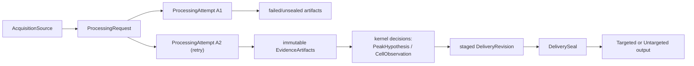

# Processing Identity, Lineage, And Retention

This page defines the minimum cross-workflow lineage contract for Issue #123.
It connects the shared scientific kernel to workflow-owned delivery without
choosing a storage engine, cache format, database, or vendor-source strategy.

Status: `diagnostic_only`. This contract grants no selected-value,
counted-detection, Matrix, workbook, Backfill-write, activation, publication,
or export authority.

## Problem And Decision

XIC already records useful fragments: method settings and artifact hashes,
sample-local trace and hypothesis IDs, cross-sample group IDs, selected
integrations, diagnostic trace bundles, and output metadata. Those fragments
do not yet form one durable chain from a delivered value or review plot back
to the exact processing attempt, evidence artifacts, and source observations.

The product rule is:

> Every delivered value or explicit null comes from one sealed delivery
> revision. That revision must trace to one processing attempt, the selected
> hypothesis/integration or non-observation conclusion, immutable evidence
> artifacts, and source-observation references.

Retries and recomputation create new attempts. They never overwrite the
identity or evidence of an earlier attempt. A new result can supersede an old
delivery revision only through the owning projection and writer authority.

This is a lineage and retention contract, not another scientific decision
core. `PeakHypothesis`, selection, Alignment, `CellObservation`, and Backfill
semantics remain owned by the shared processing kernel.

One workflow-neutral lineage contract serving both projections is still a
design hypothesis, not an observed implementation fact. Confidence is medium:
the shared-kernel decision establishes the intended scientific seam, but only
the bounded dual-projection tracer can prove that the lineage concepts do not
need workflow-specific meaning. If that probe fails, narrow or redraw this
contract instead of adding Targeted/Untargeted flags to the identities.

## Ownership Boundary

This page owns:

- workflow-neutral processing-request and attempt identity;
- immutable evidence-artifact identity and lineage edges;
- the relationship between kernel decisions and projection-owned delivery
  cells;
- two-phase staging and sealing requirements;
- logical retention classes and plot-ready evidence closure;
- retry, stale, supersession, failure, and null lineage semantics.

Other owners remain:

- [`run-provenance.md`](run-provenance.md): the current Targeted
  `method_manifest.json`, run metadata, and replay projection;
- [`sample-metadata-qc.md`](sample-metadata-qc.md): canonical sample identity
  schema and lookup projection;
- [`review-roundtrip.md`](review-roundtrip.md): typed review actions, review
  queues, expected-diff review, and reviewer-rationale routing;
- [`shared-processing-kernel.md`](shared-processing-kernel.md): scientific
  hypotheses, observation states, group membership, selection, and Backfill
  facts;
- [`vendor-raw-evidence-model.md`](vendor-raw-evidence-model.md): source-query
  and scan-selection meaning;
- Issue #124: measured Thermo RAW, mzML, scan-index/cache fidelity and cost;
- Issue #128: execution session and attempt granularity, worker/process,
  cancel, retry scheduling, cleanup, cache lifecycle, and runtime event
  observability;
- Targeted and Untargeted projection owners: counted detection, Matrix
  presence/value, output schemas, and final writer authority.

## Minimal Vocabulary

These are internal lineage concepts, not additional user-visible review tags.

| Term | Meaning | Not the same as |
| --- | --- | --- |
| `AcquisitionSource` | One immutable source-data identity plus its acquisition format and adapter-readable observation namespace | A local file path or sample display name |
| `TargetKey` | One target-list-owner namespace plus its stable normalized target label | An exact m/z/RT/transition definition or row number |
| `TargetDefinition` | One exact normalized Target definition under a `TargetKey` | A mutable CSV row or label alone |
| `TargetListSnapshot` | One immutable ordered set of owner-minted target definitions used by a processing request | `target_config_hash`, a path, or a caller-owned mutable list |
| `ProcessingRequest` | One normalized scientific computation request over identified sources, effective method/evidence settings, workflow constraints, and contract versions | An execution, output folder, timestamp, or GUI session |
| `ProcessingAttempt` | One execution of a `ProcessingRequest`; every retry receives a new identity | The logical request or the product delivery |
| `EvidenceArtifact` | One immutable artifact instance identified by producer attempt, content digest, schema, semantic role, and lineage references | A mutable path, cache entry, or authority decision |
| `DeliveryCellKey` | A projection-owned stable product position: canonical sample identity plus Targeted target identity, or canonical sample identity plus Untargeted matrix-row identity | An acquisition-source identity, kernel `CellObservation`, or ordinal group ID |
| `DeliveryRevision` | One immutable proposed or sealed value/null for a `DeliveryCellKey`, linked to its producing attempt and kernel decision | The current-value pointer or permission to publish |
| `DeliverySeal` | An immutable manifest proving a complete, authority-approved set of delivery revisions and output artifact hashes | A staging directory, successful process exit, or diagnostic report |

Do not introduce a generic `run_id` as a substitute for these identities.
Existing diagnostic `run_id` / `source_run_id` fields remain local compatibility
labels until an adapter binds them to the contract above.

## Identity Contract

| Identity | Required basis | Forbidden basis |
| --- | --- | --- |
| `acquisition_source_id` | Capability-validated content identity or stable source fingerprint, acquisition format, and observation namespace | Path, mtime, file order, or display name alone |
| `target_key_id` | Target-list-owner namespace + target-list schema/version + owner-normalized target label | m/z, RT window, current row order, or label without an owner namespace |
| `target_definition_id` | Owner-minted target key + every normalized effective `Target` field | Target label or raw CSV bytes alone |
| `target_list_snapshot_id` | Owner namespace + exact ordered target definitions + target-list schema/version | Mutable `list[Target]`, file path, truncated config hash, or unordered membership |
| `processing_request_id` | Identified acquisition sources; normalized evidence queries and method constraints; algorithm/schema/contract versions | Output path, wall-clock time, worker count, cache hit/miss, or product publication result |
| `processing_attempt_id` | A unique execution identity referencing exactly one request; optional retry/predecessor reference | Request digest alone or a reused timestamp |
| `canonical_sample_identity` | Owner-minted stable namespace + `sample_metadata_v1` identity schema/version + owner-stable primary sample key | Acquisition source, filename/path, row order, display alias, injection order, role, batch, or exclusion state |
| `immutable_review_record_ref` | Review-owner subject + schema/version + canonical content digest + exact artifact bindings + optional same-subject predecessor and supersession reason | Caller-provided ID/digest, mutable latest row, private rationale, or review truth inferred by lineage |
| `evidence_artifact_id` | Producer attempt + semantic role + schema version + content digest | Filename, directory, row count, or generated timestamp alone |
| kernel object reference | Request identity plus the normalized sample-local or cross-sample scientific identity | A bare ID whose meaning can change across requests |
| `delivery_cell_key` | Projection kind + `sample_metadata_v1`-owned stable sample identity + projection-owned target/row identity | Acquisition-source identity, display name alone, current row number, column position, `FAM000...` ordinal, or output path |
| `delivery_revision_id` | Cell key + producer attempt + selected decision/null payload + projection policy/contract version | Mutable “latest” state |
| `delivery_seal_id` | Canonical sealed manifest content, including revision and output-artifact identities | Directory existence or writer exit code |

The first executable identity slice uses `processing_identity_v1`: typed IDs
are SHA-256 digests over compact canonical JSON (`sort_keys`, UTF-8, finite JSON
numbers), with a type/version prefix. Its current content boundary is:

- an acquisition source binds the full-file SHA-256, byte size, acquisition
  format, and adapter-readable observation namespace; path and file stat values
  are used only to locate the file and detect mutation during hashing;
- the configuration owner mints `xic.target-key.v1` from an explicitly supplied
  owner namespace plus normalized target label, and
  `xic.target-definition.v1` from that key plus every effective `Target`
  fields. It freezes those definitions in user-declared row order as
  `xic.target-list-snapshot.v1`. Users may change the target list before a new
  request; the owner never mutates an existing snapshot. A same-label content
  change preserves the stable key but creates a new definition and snapshot;
  reorder also creates a new snapshot because Targeted request and output order
  currently consume that order. The namespace has no inferred path- or
  machine-based default;
- the Targeted processing request binds the canonical source set, the exact
  source-to-request-local-adapter-key and injection-order binding, all effective
  Targeted extraction settings, the exact owner-minted target-list snapshot,
  effective RT
  priors, approval records, optional MS1-shape support content and activation
  policy, and the owning input-schema, algorithm, and contract versions. The
  adapter key is part of current execution semantics but is not a canonical
  sample identity and cannot be reused as a delivery-cell key;
- a processing attempt binds one request, a fresh opaque 128-bit token, and an
  optional predecessor attempt. Retry always issues a new attempt. Terminal
  outcome and cancellation/failure events remain append-only facts owned by the
  execution-runtime contract and never rewrite identity.
- the sample-metadata owner mints `xic.sample.v1` from the
  stable owner namespace, `sample_metadata_v1` identity schema, and canonical
  `sample_name` key. Its `raw_stem` may resolve that key but is not identity
  content; other metadata projections do not invalidate identity, while
  renaming the canonical key does. Resolution retains one content-digested
  complete owner snapshot, exact lookup token, and metadata row;
- the review-roundtrip owner currently mints `xic.review-record.v1` only from
  an owner-validated typed `review_action_v1`, canonical exact artifact
  bindings, an owner-derived subject, and any complete same-subject
  predecessor/supersession edge. It resolves against a content-digested
  immutable registry snapshot and rejects stale or superseded references.

The Targeted adapter currently names the existing Thermo MS-controller-1
namespace explicitly. A different controller, acquisition adapter, or
observation namespace therefore creates a different source identity rather
than silently reusing a bare scan number. The resolver performs one sequential
full-file read per source, but opens no vendor RAW handle and makes no XIC call.
This slice is not wired into the production execution path until that I/O cost
and persisted-identifier surface receive an explicit promotion decision.

This freezes the acquisition-source -> processing-request ->
processing-attempt boundary plus the two prerequisite owner APIs. The lineage
layer's `ProcessingOwnerReferences` only composes and validates a complete
request and attempt, owner-resolved sample bindings whose exact lookup tokens
cover every request acquisition input and share one exact metadata snapshot,
and an optional owner-resolved current review record bound to one exact review
registry snapshot. It does not mint sample/review IDs and it rejects mixed
sample snapshots, unresolved review records, superseded review records, and
review-snapshot substitution. Evidence-artifact, delivery-cell, revision, and
seal identities remain incomplete later contracts. A timestamp can describe
when something happened; it cannot establish what happened.

An acquisition source and a sample are different identities: one sample may
have multiple acquisitions, and copying a source does not create a new sample.
If the bounded tracer cannot obtain an unambiguous stable sample key from the
sample-metadata owner, it must stop rather than derive one independently from a
filename, display label, or row order.

Current `TraceGroup`, `PeakHypothesis`, and
`CrossSamplePeakGroupHypothesis` IDs are scientific working identities. They
must be namespaced by a processing request or replaced by normalized successor
identity before they can serve as durable cross-attempt references. In
particular, the current sequential `FAM000...` group label is not a stable
delivery-cell identity.

## Lineage Graph And Invariants

Required invariants:

1. A `ProcessingAttempt` references exactly one `ProcessingRequest`.
2. Every evidence artifact references one producer attempt, declares its
   semantic role and schema, and names any upstream evidence-artifact
   dependencies.
3. Artifacts are immutable. Rebuilding under a new attempt creates a new
   artifact identity; matching content digests may prove byte equivalence but
   never collapse the producer-attempt lineage.
4. An attempt may consume an artifact from an earlier attempt only through an
   explicit immutable dependency reference. It must not copy or relabel that
   artifact as though the later attempt produced it.
5. Every selected hypothesis, integration, group observation, review action,
   and delivery revision can identify the attempt and artifacts it used. A
   retained human-review conclusion additionally references one immutable,
   typed review record owned by the review-roundtrip contract. That reference
   is lineage-valid only when the record has a stable identity, schema/version,
   content digest, exact artifact bindings, and any predecessor/supersession
   reference plus reason. This does not transfer review authority or private
   rationale ownership into the lineage layer.
6. A delivery revision references exactly one delivery cell and exactly one
   producing attempt. Its upstream evidence may come from other producer
   attempts through the declared artifact-dependency edges.
7. An observed numeric revision references the selected hypothesis or
   `CellObservation`, its `IntegrationResult`, selection/audit record, and the
   evidence needed to explain and plot it.
8. A null revision records the underlying non-observation state and reason.
   Missing evidence, a failed attempt, or a missing artifact cannot silently
   become scientific `absent` or numeric zero.
9. A seal is valid only when every referenced artifact exists, its content
   identity matches, and all delivery revisions pass the owning projection's
   authority gate.
10. Sealing a successor does not mutate the prior seal. It records an explicit
   supersession edge and changes the current delivery only through the
   authorized writer.
11. Targeted and Untargeted may use different `DeliveryCellKey` and projection
    policy. They can still reference the same kernel decision and evidence
    artifacts.

## Source-Observation And Plot-Ready Evidence

An evidence artifact that depends on source data records:

- `acquisition_source_id`;
- acquisition adapter/backend and source format;
- native scan/spectrum identity or a capability-validated equivalent;
- scan-selection predicate and trace type;
- m/z or mass range, tolerance, RT window, and relevant MS/precursor context;
- raw extracted trace points used as input;
- the exact decision-trace points or a deterministic transform contract and
  all inputs needed to reproduce them;
- detection, boundary, and quantitation basis;
- related sample, trace-group, hypothesis, integration, group, and cell
  references as applicable.

For selected, delivered, reintegrated, or manual-review candidates, the
retained bundle must be sufficient to render the evidence view without
reopening the acquisition source. Source references remain necessary for
audit, but they are not a substitute for retained plot-ready evidence.

This requirement does not select Thermo RAW, mzML, JSON, NPZ, Arrow, a
database, or another physical representation. Issue #124 must first measure
source and reusable-artifact capabilities, fidelity, size, and rebuild cost.

## Retention Contract

Retention is defined by product dependency, not by file extension or directory.

| Class | Logical rule |
| --- | --- |
| Sealed delivery lineage | The seal, revision records, output hashes, decision/audit references, and source identities remain immutable for as long as that delivery can be cited |
| Current delivered plot-ready evidence | Pinned; it cannot depend on a future source reopen |
| Superseded delivered evidence | The immutable seal/revision/decision lineage remains audit-addressable; plot-ready evidence stays pinned while the old delivery remains a supported claim or is referenced by an active review, lockbox, expected diff, or retained audit claim |
| Active manual-review evidence | Pinned while waiting for a conclusion; the review binds to exact artifact identities and then moves to the completed-review class |
| Completed human-review evidence | The typed review record and exact plot-ready evidence stay pinned until the conclusion is explicitly superseded or retired and no active dependency still references it |
| Selected or reintegrated but not delivered evidence | The selection/reintegration audit and exact plot-ready evidence stay pinned until the decision is explicitly superseded or retired and no active dependency still references it |
| Unselected and unreviewed evidence | May be evictable if it is not referenced by a seal, active review, lockbox, expected diff, or retained audit claim |
| Failed/cancelled-attempt artifacts | Never become delivery evidence by process success alone; cleanup and optional forensic retention belong to #128 |
| Rebuildable cache | May be evicted only when the source identity, deterministic request/transform contract, and rebuild capability remain valid |

Previously delivered or human-reviewed decisions are comparators, not
immutable scientific truth. New evidence may explicitly supersede them, but a
refactor or rerun must not silently overwrite them. Their exact review evidence
must remain reproducible with zero acquisition-source reopens until the
decision is explicitly superseded or retired; completion of a refactor alone
is not retirement.

Here, `audit-addressable` always includes the immutable seal, revision,
decision/review record, source references, and artifact identities. It includes
the plot-ready inputs whenever the historical decision is still a supported
claim or has another active dependency. Retirement requires a durable record
of the subject, owning policy or actor, reason, and time; it is invalid while a
seal, active review, lockbox, expected diff, or supported audit claim still
depends on that evidence.

No numeric retention period or eviction technology is selected here. A
retention policy must never advertise “rebuildable” if the required source,
adapter, method contract, or fidelity is unavailable.

## Two-Phase Delivery Seal

Delivery uses two phases:

1. **Stage** — write proposed output artifacts and a lineage manifest outside
   the final delivery location. Validate schemas, hashes, delivery-cell
   uniqueness, kernel-decision references, artifact closure, and the owning
   projection's authority.
2. **Seal and publish** — create the immutable `DeliverySeal`, then atomically
   expose that sealed bundle or current-delivery pointer. Only sealed content
   is deliverable.

If staging, validation, sealing, or publication fails:

- the prior sealed delivery remains current;
- partial files remain non-deliverable;
- no scientific observation is rewritten;
- no null becomes zero;
- the failed attempt and stage can be diagnosed and cleaned through #128.

When an already sealed revision remains authoritative, an exact duplicate
retry does not require a new delivery revision. If a new revision is sealed,
it still references its own producing attempt and records whether it
supersedes an earlier revision.

## Failure, Null, Stale, And Supersession

Keep orthogonal facts on separate axes:

| Axis | Owner | Required distinction |
| --- | --- | --- |
| Scientific observation | Shared kernel | `observed`, `missing`, `absent`, `unassessable`, `ambiguous`, `failed` |
| Execution outcome | #128 runtime contract | Whether the attempt completed, failed, was cancelled, or produced partial diagnostic state |
| Artifact integrity | Lineage validation | Available and matching, missing, corrupt/hash-mismatched, or incompatible with the requested contract |
| Delivery lifecycle | Projection/writer | Staged, sealed/current, or explicitly superseded |
| Human review queue | Workflow review | Waiting for review versus a completed review conclusion |

Rules:

- A failed attempt does not mean a sample is `absent`.
- A missing/corrupt evidence artifact blocks sealing; it does not change the
  scientific observation.
- `missing` means no completed scientific evaluation result; `absent` means a
  completed evaluation found no supported hypothesis.
- `unassessable` remains a reviewed evidence conclusion, not a pending-review
  status.
- Staleness is a relationship between an immutable artifact and the request,
  contract, or input identity now being evaluated. Do not mutate the artifact
  to call it fresh again.
- Supersession changes which sealed revision is current; it does not erase or
  rewrite the superseded revision.

## No-RAW Lifecycle Probe

The minimum design probe begins with one logical request and two attempts, then
checks same-request and changed-request recomputation:

| Step | Expected result |
| --- | --- |
| Create request `R1` | Identity depends on sources, scientific query/settings, and contract versions; not output path or time |
| Attempt `A1` fails after partial artifacts | `A1` and any forensic artifacts remain identifiable; no delivery revision can seal |
| Retry as `A2` | `A2 != A1`, both reference `R1`, and `A2.retry_of = A1` |
| Produce trace/evidence artifacts | Artifacts are immutable, role/schema/content identified, and linked to `A2` and source observations |
| Select hypothesis/integration | Decision and audit reference the exact artifact identities |
| Stage Targeted and Untargeted revisions | Each projection keeps its own delivery-cell key and authority while referencing shared kernel evidence where applicable |
| Validate a synthetic seal candidate | All referenced hashes and lineage close; plot rendering uses retained evidence and performs zero source reopens; no product seal or authority is created |
| Render a review plot | A fail-on-open acquisition adapter and call counter prove that rendering uses retained plot-ready evidence and makes exactly zero source opens |
| Recompute the same request | A new attempt is created; prior attempt/artifact identities remain unchanged |
| Recompute under changed normalized inputs or contract | A new request and attempt are created; the prior seal remains current until a separately authorized successor seals |

The model fails and must be narrowed or redrawn if:

- two retries can overwrite the same attempt or artifact identity;
- a path/timestamp collision changes scientific meaning;
- a delivery value cannot identify one selected integration and its evidence;
- a null cannot distinguish scientific absence from execution/artifact failure;
- a selected/delivered/review plot requires reopening the source;
- Targeted policy leaks into Untargeted delivery authority;
- the design requires choosing a storage engine before the logical contract can
  be stated.

## Current Implementation Gaps And Reuse

1. `method_manifest.json` records useful config fragments, input/output paths,
   hashes, runtime, and replay blockers, but it has no canonical
   processing-request, attempt, delivery-revision, or delivery-seal identity.
2. `TraceGroup` and `PeakHypothesis` carry useful working IDs in memory, but
   they do not currently close a durable artifact chain.
3. `CrossSamplePeakGroupHypothesis.group_hypothesis_id` is the pipeline
   identity, while current `FAM000...` construction is ordinal. It is not yet a
   durable cross-attempt delivery-cell key.
4. `AlignedCell` mixes observation, evidence sidecars, gap-fill, group,
   selection-blocker, consolidation, and Matrix projection fields. Its
   `source_candidate_id` / `source_raw_file` fields are not a lineage seal.
5. Pt trace manifests already bind candidate assignments, RAW identity,
   extraction settings, roles, schemas, and output hashes and make consumers
   fail closed. Reuse this content-bound pattern, not the Pt-specific schema or
   diagnostic authority.
6. Trace JSON/CSV sidecars and `source_run_id` fields exist across diagnostics,
   but there is no shared retention class or canonical attempt binding.
7. Current writers can emit method manifests and output metadata, but no
   workflow-neutral two-phase delivery seal owns the complete output lineage.
8. `review_action_v1` and current review artifacts provide typed actions,
   stable-row checks, and source hashes. The review owner can now mint and
   resolve a workflow-neutral immutable review-conclusion/supersession
   reference, but no production registry or persisted lineage integration has
   been selected.

These are migration facts. This ticket does not authorize a repository-wide
manifest rewrite or a new persistence framework.

## Alternatives And Trade-Offs

| Option | Decision | Reason |
| --- | --- | --- |
| Treat `method_manifest.json` or diagnostic `run_id` as the universal lineage owner | Rejected | They are current workflow/run projections and do not close attempt, decision, artifact, delivery-cell, or seal identity |
| Choose a database, cache format, or archive layout first | Rejected | Physical fidelity, cost, and rebuild capability remain unanswered by #124 |
| Retain every intermediate artifact forever | Rejected | It hides dependency semantics and commits storage cost before evidence; unreferenced, unreviewed artifacts may be evictable |
| Define the minimum logical contract and test it through one no-write/no-RAW dual-projection tracer | Selected | It can falsify the shared model before persistence or writer integration |

## Implementation Route And Stop Rule

The first implementation after this decision should be a no-write, no-RAW
lineage model used by the CID-NL / NL116 dual-policy tracer:

1. bind one normalized request to distinct attempts;
2. adapt existing Pt-style artifact fingerprints and method-manifest facts
   without importing diagnostic policy;
3. validate a would-be seal for one Targeted and one Untargeted staged
   projection without creating product authority;
4. prove zero source reopens with a fail-on-open acquisition adapter and call
   counter for retained selected/review evidence; and
5. leave both legacy writers authoritative.

The tracer must consume the sample identity owner and review-record owner
through explicit references. If either owner cannot provide an unambiguous
identity for the fixture, stop and record the missing prerequisite rather than
creating a lineage-local substitute.

Do not add a shared package or persisted production schema until at least the
Targeted and Untargeted tracer consumers prove the same contract. Stop and
route unanswered physical capability questions to #124 and runtime lifecycle
questions to #128. Promotion, writer integration, and retention-period
selection require later explicit contracts.

## Acceptance Mapping

- Stable request, attempt, artifact, delivery-cell, revision, and seal
  identities are distinguished.
- Cross-attempt artifact dependencies remain explicit and preserve the original
  producer-attempt lineage.
- Immutable versus rebuildable and selected/pinned versus evictable evidence
  are defined without selecting storage technology.
- Retry, stale, supersession, failure, and null semantics are fail-closed and
  do not multiply scientific observation states.
- Existing delivered or human-reviewed decisions remain reproducible
  comparators until explicit supersession or retirement; refactoring alone
  cannot overwrite or retire them.
- Two-phase delivery sealing protects existing Targeted and Untargeted output
  authority.
- Selected, delivered, reintegrated, and manual-review plots require zero
  source reopens, proven with a fail-on-open adapter and call counter.
- Delivery cells consume sample identity from the sample-metadata owner, and
  retained human-review conclusions consume immutable typed records from the
  review-roundtrip owner.
- Existing method-manifest and Pt lineage mechanics are reusable evidence, not
  a second universal framework.
- No output, value, count, Matrix, workbook, Backfill-write, activation,
  publication, or export authority is granted.
