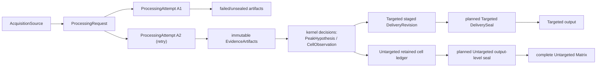

# Result Traceability（結果可追溯性）

Result traceability answers one question: which run, RAW sources, evidence,
and decision produced this delivered value or this explicit null? This page
defines the identities and rules that make that answer durable.

## Current Status

This table separates implemented identities and diagnostic candidates from
the planned delivery contract below. Neither a diagnostic candidate nor a
planned seal changes the current product writer.

| Part | Plain meaning | Status |
| --- | --- | --- |
| Processing identity (`xic_extractor/processing_identity.py`) | Which request and attempt ran, over which RAW sources | Implemented; production Alignment, Backfill, and Discovery modules use it |
| Target identity (`TargetKey`, `TargetListSnapshot` in `xic_extractor/configuration/target_identity.py`) | Which exact target list a run used | Implemented; production Targeted modules use it |
| Targeted delivery lineage | Per-cell Targeted revisions, stages, and seals | Planned; no current implementation or product publication authority |
| Untargeted row identity (`UntargetRowKey`) | A stable identity for one Untargeted Matrix row | Implemented in `alignment/projection/untarget/pre_cell.py` |
| Untargeted per-cell delivery lineage | A retained revision/evidence bundle for each Matrix cell | Not planned; see [Untargeted delivery decision](#untargeted-delivery-decision) |
| Untargeted output-level seal | One sealed manifest for one complete Untargeted Matrix delivery | Planned; not implemented |

Status source: module definitions and production import paths, checked on
2026-10-01. A status row is not validation evidence.

### Untargeted Delivery Decision

Decision (2026-09-26): Untargeted delivery uses one output-level seal. It does
not use a per-cell delivery revision or per-cell evidence retention.

- The output-level seal binds one complete Matrix delivery to one processing
  attempt, its input source identities, and its output artifact hashes.
- Per-cell tracing uses the retained cell ledger (`alignment_cells.tsv`) of
  the sealed attempt, or a replay of that attempt.
- Targeted delivery keeps per-cell delivery revisions.

Rationale: per-cell evidence retention costs far more than the review value it
adds. One 85-RAW Untargeted run delivered 2,455 rows × 85 samples (about
209,000 cells) in a 1.1 MB Matrix. The same run already wrote a 297 MB cell
ledger. Per-cell evidence retention would add trace or plot payloads on top of
that ledger. An output-level seal adds a manifest of a few kilobytes and closes
the missing link between the ledger and one sealed attempt.

The workflow rules below apply this decision throughout the contract.

## Scope

This page defines the minimum cross-workflow lineage contract for Issue #123.
It connects the shared scientific kernel to workflow-owned delivery without
choosing a storage engine, cache format, database, or vendor-source strategy.

Architecture status: `frozen`; executable adoption remains incomplete. This
contract grants no selected-value, counted-detection, Matrix, workbook,
Backfill-write, activation, publication, or export authority.

## Problem And Decision

XIC already records useful fragments: method settings and artifact hashes,
sample-local trace and hypothesis IDs, cross-sample group IDs, selected
integrations, diagnostic trace bundles, and output metadata. Those fragments
do not yet form one durable chain from a delivered value or review plot back
to the exact processing attempt, evidence artifacts, and source observations.

The product rule is:

> Every delivered Targeted value or explicit null comes from one sealed
> delivery revision. That revision must trace to one processing attempt, the
> selected hypothesis/integration or non-observation conclusion, immutable
> evidence artifacts, and source-observation references.
>
> Every delivered Untargeted Matrix comes from one output-level seal. That
> seal must trace to one processing attempt, its input source identities, its
> retained cell ledger, and its output artifact hashes.

Retries and recomputation create new attempts. They never overwrite the
identity or evidence of an earlier attempt. Targeted revision supersession and
Untargeted output-seal supersession each require the owning projection and
writer authority.

This is a lineage and retention contract, not another scientific decision
core. `PeakHypothesis`, selection, Alignment, `CellObservation`, and Backfill
semantics remain owned by the shared processing kernel.

One workflow-neutral lineage contract serving both projections is the frozen
design. Complete runtime adoption remains an unproven implementation claim:
each ownership-transfer lane must prove its real Targeted and Untargeted
consumers can preserve the same identity semantics. If that probe fails, stop
and refreeze the seam instead of adding Targeted/Untargeted flags to shared
identities.

## Ownership Boundary

This page owns:

- workflow-neutral processing-request and attempt identity;
- immutable evidence-artifact identity and lineage edges;
- the relationship between kernel decisions and projection-owned delivery
  cells;
- two-phase staging and sealing requirements;
- logical retention classes and plot-ready evidence closure;
- retry, stale, supersession, failure, and null lineage semantics.

Other owners remain:

- [`run-provenance.md`](run-provenance.md): the current Targeted
  `method_manifest.json`, run metadata, and replay projection;
- [`sample-metadata-qc.md`](sample-metadata-qc.md): canonical sample identity
  schema and lookup projection;
- [`review-roundtrip.md`](review-roundtrip.md): typed review actions, review
  queues, expected-diff review, and reviewer-rationale routing;
- [`shared-processing-kernel.md`](shared-processing-kernel.md): scientific
  hypotheses, observation states, group membership, selection, and Backfill
  facts;
- [`vendor-raw-evidence-model.md`](vendor-raw-evidence-model.md): source-query
  and scan-selection meaning;
- Issue #124: measured Thermo RAW, mzML, scan-index/cache fidelity and cost;
- Issue #128: execution session and attempt granularity, worker/process,
  cancel, retry scheduling, cleanup, cache lifecycle, and runtime event
  observability;
- Targeted and Untargeted projection owners: counted detection, Matrix
  presence/value, output schemas, and final writer authority.

## Minimal Vocabulary

These are internal lineage concepts, not additional user-visible review tags.

| Term | Meaning | Not the same as |
| --- | --- | --- |
| `AcquisitionSource` | One immutable source-data identity plus its acquisition format and adapter-readable observation namespace | A local file path or sample display name |
| `TargetKey` | One target-list-owner namespace plus its stable normalized target label | An exact m/z/RT/transition definition or row number |
| `TargetDefinition` | One exact normalized Target definition under a `TargetKey` | A mutable CSV row or label alone |
| `TargetListSnapshot` | One immutable ordered set of owner-minted target definitions used by a processing request | `target_config_hash`, a path, or a caller-owned mutable list |
| `ProcessingRequest` | One normalized scientific computation request over identified sources, effective method/evidence settings, workflow constraints, and contract versions | An execution, output folder, timestamp, or UI session |
| `ProcessingAttempt` | One execution of a `ProcessingRequest`; every retry receives a new identity | The logical request or the product delivery |
| `EvidenceArtifact` | One immutable artifact instance identified by producer attempt, content digest, schema, semantic role, and lineage references | A mutable path, cache entry, or authority decision |
| `DeliveryCellKey` | Targeted projection-owned product position: canonical sample identity plus target identity | An acquisition-source identity, kernel `CellObservation`, or ordinal group ID |
| `UntargetRowKey` | Untargeted projection-owned row identity derived from one finalized canonical group | `group_hypothesis_id`, `FAM...`, m/z/RT display text, or row order |
| `DeliveryRevision` | Targeted-only immutable proposed or sealed value/null for a `DeliveryCellKey`, linked to its producing attempt and kernel decision | An Untargeted cell record, current-value pointer, or permission to publish |
| `DeliverySeal` | Planned immutable manifest for an authority-approved output and its artifact hashes: Targeted revisions or one complete Untargeted Matrix and retained ledger | A staging directory, successful process exit, or diagnostic seal candidate |

Do not introduce a generic `run_id` as a substitute for these identities.
Existing diagnostic `run_id` / `source_run_id` fields remain local compatibility
labels until an adapter binds them to the contract above.

## Identity Contract

| Identity | Required basis | Forbidden basis |
| --- | --- | --- |
| `acquisition_source_id` | Capability-validated content identity or stable source fingerprint, acquisition format, and observation namespace | Path, mtime, file order, or display name alone |
| `target_key_id` | Target-list-owner namespace + owner-normalized target label | m/z, RT window, current row order, or label without an owner namespace |
| `target_definition_id` | Owner-minted target key + every normalized effective `Target` field | Target label or raw CSV bytes alone |
| `target_list_snapshot_id` | Owner namespace + exact ordered target definitions + target-list schema/version | Mutable `list[Target]`, file path, truncated config hash, or unordered membership |
| `processing_request_id` | Identified acquisition sources; normalized evidence queries and method constraints; algorithm/schema/contract versions | Output path, wall-clock time, worker count, cache hit/miss, or product publication result |
| `processing_attempt_id` | A unique execution identity referencing exactly one request; optional retry/predecessor reference | Request digest alone or a reused timestamp |
| `canonical_sample_identity` | Owner-minted stable namespace + `sample_metadata` identity schema/version + owner-stable primary sample key | Acquisition source, filename/path, row order, display alias, injection order, role, batch, or exclusion state |
| `immutable_review_record_ref` | Review-owner subject from canonical sample + stable target key; exact target definition + processing request; schema/version; canonical content digest; exact artifact bindings; optional same-subject predecessor and supersession reason | Bare sample/target labels, caller-provided ID/digest, mutable latest row, private rationale, or review truth inferred by lineage |
| `evidence_artifact_id` | Producer attempt + semantic role + schema version + content digest | Filename, directory, row count, or generated timestamp alone |
| owner-backed CID-NL `peak_hypothesis_id` | Hypothesis method + canonical sample identity + physical peak content ID + chromatographic-support artifact content ID | Target label, ISTD role/pairing, trace-group ID, selection status, attempt token, or output position |
| kernel object reference | Request identity plus the normalized sample-local or cross-sample scientific identity | A bare ID whose meaning can change across requests |
| `group_hypothesis_id` | Group identity schema + exact processing request + canonical-sorted identity-bearing members, each binding canonical sample to an owner-backed hypothesis identity | `FAM...`, group ordinal, sample stem, area, display RT/m/z, or an untagged wrapper identity |
| `untarget_row_key` | Untarget projection schema + finalized canonical group identity | Group/display label alone, center coordinates, current Matrix row number, or cross-request inference |
| `delivery_cell_key` (Targeted) | `sample_metadata`-owned stable sample identity + target-list-owner identity | Acquisition-source identity, display name alone, column position, or output path |
| `delivery_revision_id` (Targeted) | Cell key + producer attempt + selected decision/null payload + projection policy/contract version | Mutable “latest” state or Untargeted cell identity |
| `delivery_seal_id` (planned) | Canonical sealed manifest content: Targeted revision and output-artifact identities, or Untargeted attempt, source, retained-ledger, and complete Matrix artifact identities | Directory existence, writer exit code, or a diagnostic candidate |

The `processing_identity` owner defines typed IDs
as SHA-256 digests over compact canonical JSON (`sort_keys`, UTF-8, finite JSON
numbers), with a type/version prefix. Its current content boundary is:

- an acquisition source binds the full-file SHA-256, byte size, acquisition
  format, and adapter-readable observation namespace; path and file stat values
  are used only to locate the file and detect mutation during hashing;
- the configuration owner mints `xic.target-key` from an explicitly supplied
  owner namespace plus normalized target label, and
  `xic.target-definition` from that key plus every effective `Target`
  field. It freezes those definitions in user-declared row order as
  `xic.target-list-snapshot`. Users may change the target list before a new
  request; the owner never mutates an existing snapshot. A same-label content
  change preserves the stable key but creates a new definition and snapshot;
  reorder also creates a new snapshot because Targeted request and output order
  currently consume that order. The namespace has no inferred path- or
  machine-based default;
- the Targeted processing request binds the canonical source set, the exact
  source-to-request-local-adapter-key and injection-order binding, all effective
  Targeted extraction settings, the exact owner-minted target-list snapshot,
  effective RT
  priors, approval records, optional MS1-shape support content and activation
  policy, the complete order-insensitive Discovery candidate universe for every
  acquisition sample, and the owning input-schema, algorithm, and contract
  versions. The candidate universe digest covers the full scientific candidate
  payload; missing, additional, or changed candidates cannot run under the same
  Targeted request. The adapter key is part of current execution semantics but
  is not a canonical sample identity and cannot be reused as a delivery-cell
  key;
- a processing attempt binds one request, a fresh opaque 128-bit token, and an
  optional predecessor attempt. Retry always issues a new attempt. Terminal
  outcome and cancellation/failure events remain append-only facts owned by the
  execution-runtime contract and never rewrite identity.
- artifact content binds exact payload bytes through SHA-256, byte size, media
  type, and an owner-fixed serialization format. An artifact instance separately
  binds one producer request/attempt, the producer-owned semantic role/schema
  contract, that content identity, and a canonical set of upstream artifact
  references. Equal bytes across attempts preserve content equality but never
  collapse artifact-instance identity;
- the two artifact-envelope adapters are deliberately diagnostic-only. The
  Targeted MS1-shape owner fixes the
  `targeted_ms1_shape_identity` UTF-8 TSV bytes and role; the Pt Discovery
  evidence CSV owner fixes the `pt_pattern_discovery_evidence` UTF-8 CSV
  bytes and role. Callers cannot supply role/schema strings, and both owner APIs
  require an owner-issued processing attempt;
- the sample-metadata owner mints `xic.sample` from the
  stable owner namespace, `sample_metadata` identity schema, and canonical
  `sample_name` key. Its `raw_stem` may resolve that key but is not identity
  content; other metadata projections do not invalidate identity, while
  renaming the canonical key does. Resolution retains one content-digested
  complete owner snapshot, exact lookup token, and metadata row;
- the review-roundtrip owner currently mints `xic.review-subject` from one
  owner-resolved canonical sample plus one owner-stable target key. It mints
  `xic.review-record` only from an owner-validated typed `review_action`,
  the exact target definition and processing request, canonical exact artifact
  references, and any complete same-subject predecessor/supersession edge. The
  action's sample/target labels must match those owner references. Resolution
  rejects definition/request substitution, stale content, or superseded
  records against a content-digested immutable registry snapshot.

The Targeted adapter currently names the existing Thermo MS-controller-1
namespace explicitly. A different controller, acquisition adapter, or
observation namespace therefore creates a different source identity rather
than silently reusing a bare scan number. The resolver performs one sequential
full-file read per source, but opens no vendor RAW handle and makes no XIC call.
Production Targeted execution already uses this resolver:
`TargetedApplicationService.execute_application` snapshots its inputs through
`snapshot_targeted_production_inputs` and
`build_targeted_processing_request_identity` before acquisition. This source
fingerprinting does not imply that product delivery sealing is implemented.

This freezes the acquisition-source -> processing-request ->
processing-attempt boundary plus the sample, target-list, and review owner APIs.
The lineage layer's `ProcessingOwnerReferences` only composes and validates a
complete request and attempt, owner-resolved sample bindings whose exact lookup tokens
cover every request acquisition input and share one exact metadata snapshot,
the request-pinned target-list snapshot, a same-request/same-attempt artifact
closure with no missing upstream dependency, and an optional owner-resolved current
review record bound to the exact sample, target key/definition, request, and
review registry snapshot. A review record must retain typed artifact references
that exist in that validated closure. Lineage does not mint
sample/target/artifact/review IDs and it
rejects mixed sample snapshots, target/request substitution, unresolved review
records, superseded review records, artifact content/role/schema substitution,
missing dependencies, cross-attempt mixing, and review-snapshot substitution.
Production workflows and diagnostic tracers consume this owner-reference
closure; it is not a production artifact registry. The Targeted delivery owner
makes delivery-cell, revision,
stage, and seal-candidate identities executable by composing these existing
owner refs in memory. Those candidates grant no product seal, current pointer,
storage, publication, supersession, selected-value, Matrix, or writer authority.
The processing-identity owner derives the complete same-request predecessor
chain from `ProcessingAttempt.retry_of`. A Targeted delivery revision uses that
derived chain as its only allowed `dependency_processing_attempt_ids`; an
optional caller-supplied tuple is an exact assertion and grants no authority.
It cannot omit an indirect predecessor or authorize a same-request sibling.
The reusable artifact-closure entry point likewise accepts the owner-issued
producer attempt rather than a caller-authored allowlist. Its retry-aware form
derives that chain, while the delivery-stage output form accepts only artifacts
minted by the current attempt.
Cross-attempt runtime dependency resolution beyond this validated predecessor
closure remains a later consumer contract. A timestamp can describe when
something happened; it cannot establish what happened.

The CellObservationRef reference-spine owner applies the same rule to provisional group membership. A
group context retains the attempt that owns every direct SUPPORT assessment and
hypothesis. Cell minting accepts those group supports only from the current
attempt or its derived retry-predecessor chain; a sibling attempt is never an
implicit dependency. Conservative Backfill then mints a separate immutable
recovery-universe receipt over the exact sample, group-derived target,
request/attempt, source cells, and one owner-minted CID-NL method assessment.
The assessment owns the complete target-bound peak set; mapping consumes the
receipt even when that set is empty. A naked target plus an independently valid
`PeakObservationRef` is not recovery evidence.

An acquisition source and a sample remain different typed identities, but the
current lab contract is one independent canonical analysis sample per source
included in an XIC analysis folder. QC replicates and meaningful reinjections
therefore keep their distinct full names, result columns, and review scopes;
lineage must not strip suffixes or collapse them into a biological-specimen
identity. Invalid pre-crash acquisitions are excluded before this inventory.
Two paths containing the same exact source bytes remain one acquisition-source
identity and are rejected as duplicate request inputs; a filename copy cannot
mint another sample or source identity.
If the bounded tracer cannot obtain an unambiguous stable sample key from the
sample-metadata owner, it must stop rather than derive one independently from a
filename, display label, or row order.

Current `TraceGroup`, legacy `build_peak_hypotheses`, and
`CrossSamplePeakGroupHypothesis` IDs are scientific working identities. They
must be namespaced by a processing request or replaced by normalized successor
identity before they can serve as durable cross-attempt references. The
bounded owner-backed CID-NL `PeakHypothesis` branch is the exception: it has a
typed content ID plus an exact attempt artifact, but still grants no group,
delivery-cell, revision, seal, or product authority. In particular, the
current sequential `FAM000...` group label is not a stable delivery-cell
identity.

Within one processing request, canonical member sorting makes a group identity
stable under input order, worker completion order, and parallelism. Membership
or split/merge changes mint a successor group and lineage edge. A new processing
request deliberately creates new group and Untarget row identities; automatic
cross-request same/split/merge continuity is deferred until a real consumer and
oracle justify it.

The member-subject kind tag is part of canonical identity. Equivalent hypothesis
wrappers over the same owner-backed physical observation must canonicalize to
one member subject.

## Lineage Graph And Invariants

Required invariants:

1. A `ProcessingAttempt` references exactly one `ProcessingRequest`.
2. Every evidence artifact references one producer attempt, declares its
   semantic role and schema, and names any upstream evidence-artifact
   dependencies.
3. Artifacts are immutable. Rebuilding under a new attempt creates a new
   artifact identity; matching content digests may prove byte equivalence but
   never collapse the producer-attempt lineage.
4. An attempt may consume an artifact from an earlier attempt only through an
   explicit immutable dependency reference. It must not copy or relabel that
   artifact as though the later attempt produced it.
5. Every selected hypothesis, integration, group observation, review action,
   Targeted delivery revision, and retained Untargeted cell-ledger decision can
   identify the attempt and artifacts it used. A
   retained human-review conclusion additionally references one immutable,
   typed review record owned by the review-roundtrip contract. That reference
   is lineage-valid only when the record has a stable identity, schema/version,
   content digest, exact artifact bindings, and any predecessor/supersession
   reference plus reason. This does not transfer review authority or private
   rationale ownership into the lineage layer.
6. A Targeted delivery revision references exactly one Targeted delivery cell
   and producing attempt. Its upstream evidence may come from other producer
   attempts through declared artifact-dependency edges.
7. An observed numeric Targeted revision references its selected hypothesis or
   `CellObservation`, `IntegrationResult`, selection/audit record, and the
   evidence needed to explain and plot it. An Untargeted Matrix cell is traced
   through the sealed attempt's retained cell ledger or replay, without a
   retained per-cell revision or plot bundle.
8. A Targeted null revision records the underlying non-observation state and
   reason. Untargeted cell-ledger decisions preserve the corresponding state.
   Missing evidence, a failed attempt, or a missing artifact cannot silently
   become scientific `absent` or numeric zero.
9. A planned seal is valid only when referenced artifacts exist and match
   their content identities and the owning projection's authority gate passes.
   Targeted validates its revision set; Untargeted validates the complete
   Matrix, retained cell ledger, attempt, and source bindings.
10. Sealing a successor does not mutate the prior seal. It records an explicit
   supersession edge and changes the current delivery only through the
   authorized writer.
11. Targeted uses per-cell `DeliveryCellKey` and `DeliveryRevision` values.
    Untargeted uses `UntargetRowKey` and a planned output-level seal (see
    [Untargeted delivery decision](#untargeted-delivery-decision)). Both can
    still reference the same kernel decision and evidence artifacts.

## Source-Observation And Plot-Ready Evidence

An evidence artifact that depends on source data records:

- `acquisition_source_id`;
- acquisition adapter/backend and source format;
- native scan/spectrum identity or a capability-validated equivalent;
- scan-selection predicate and trace type;
- m/z or mass range, tolerance, RT window, and relevant MS/precursor context;
- raw extracted trace points used as input;
- the exact decision-trace points or a deterministic transform contract and
  all inputs needed to reproduce them;
- detection, boundary, and quantitation basis;
- related sample, trace-group, hypothesis, integration, group, and cell
  references as applicable.

For Targeted selected, delivered, reintegrated, or manual-review candidates,
the retained bundle must be sufficient to render the evidence view without
reopening the acquisition source. Source references remain necessary for
audit, but they are not a substitute for retained plot-ready evidence.
Untargeted delivery retains the cell ledger for per-cell tracing or replays the
sealed attempt; it does not retain per-cell plot evidence or require zero-RAW
rendering for each Matrix cell. An explicit Untargeted review that promises an
offline plot must separately retain the exact evidence needed for that review.

This requirement does not select Thermo RAW, mzML, JSON, NPZ, Arrow, a
database, or another physical representation. Issue #124 must first measure
source and reusable-artifact capabilities, fidelity, size, and rebuild cost.

## Retention Contract

Retention is defined by product dependency, not by file extension or directory.

Every retained record also belongs to one lifecycle class:

| Class | Meaning |
| --- | --- |
| `essential` | Final result, delivery identity/seal, authority closure, and minimum evidence refs needed to explain a current value/null |
| `reviewable_compact` | Queryable machine archive needed for bounded review, including provisional groups and final cell-decision evidence |
| `diagnostic_heavy` | Candidate universes, traces, galleries, and debug payloads retained only for opt-in validation, active review, or failure forensics |
| `reconstructable` | Derived cache/artifact whose exact source identity, algorithm contract, and rebuild capability remain available |
| `compatibility` | Legacy schema/projection retained only for a named current consumer and removed when its consumer census reaches zero |

| Class | Logical rule |
| --- | --- |
| Sealed Targeted delivery lineage | The seal, per-cell revision records, output hashes, decision/audit references, and source identities remain immutable for as long as that delivery can be cited |
| Sealed Untargeted delivery lineage (planned) | The output-level seal, complete Matrix artifact hashes, attempt and source bindings, and retained `alignment_cells.tsv` remain addressable for as long as that delivery can be cited; individual cell traces use that ledger or replay |
| Current delivered Targeted plot-ready evidence | Pinned; it cannot depend on a future source reopen |
| Superseded delivered Targeted evidence | The immutable seal/revision/decision lineage remains audit-addressable; plot-ready evidence stays pinned while the old delivery remains a supported claim or is referenced by an active review, lockbox, expected diff, or retained audit claim |
| Active manual-review evidence | Pinned while waiting for a conclusion; the review binds to exact artifact identities and then moves to the completed-review class |
| Completed human-review evidence | The typed review record and exact evidence promised to that review stay pinned until the conclusion is explicitly superseded or retired and no active dependency still references it |
| Targeted selected or reintegrated but not delivered evidence | The selection/reintegration audit and exact plot-ready evidence stay pinned until the decision is explicitly superseded or retired and no active dependency still references it |
| Unselected and unreviewed evidence | May be evictable if it is not referenced by a seal, active review, lockbox, expected diff, or retained audit claim |
| Failed/cancelled-attempt artifacts | Never become delivery evidence by process success alone; cleanup and optional forensic retention belong to #128 |
| Rebuildable cache | May be evicted only when the source identity, deterministic request/transform contract, and rebuild capability remain valid |

Previously delivered or human-reviewed decisions are comparators, not
immutable scientific truth. New evidence may explicitly supersede them, but a
refactor or rerun must not silently overwrite them. Targeted and any explicitly
retained offline-review evidence must remain reproducible with zero
acquisition-source reopens until the decision is explicitly superseded or
retired; Untargeted Matrix cell tracing uses the retained ledger or replay,
without per-cell evidence retention. Completion of a refactor alone is not
retirement.

Here, `audit-addressable` includes the immutable seal, source references, and
artifact identities; Targeted also includes revisions and decision/review
records, while Untargeted includes the retained cell ledger. Targeted plot-ready
inputs remain available whenever the historical decision is a supported claim
or has another active dependency. Retirement requires a durable record
of the subject, owning policy or actor, reason, and time; it is invalid while a
seal, active review, lockbox, expected diff, or supported audit claim still
depends on that evidence.

No numeric retention period or eviction technology is selected here. A
retention policy must never advertise “rebuildable” if the required source,
adapter, method contract, or fidelity is unavailable.

### Storage projection and bundle contract

- Same-run owner handoff uses immutable typed batches. Arrow IPC is considered
  only after a measured same-run transport bottleneck; it is not the default
  architecture.
- The current optional Backfill Parquet shadow is diagnostic compatibility
  evidence. It does not establish a production archive/query consumer, replace
  the existing TSV projections, or require a future Parquet cutover.
- Owner-local machine evidence and downstream analytical output keep their
  existing owners and contracts. No generic evidence archive or archive-to-
  delivery handoff is required without a current consumer.
- Heavy candidate/trace/debug populations remain opt-in, validation-, review-,
  or failure-scoped; this contract does not add an ordinary-run archive.
- One execution publishes one immutable atomic bundle. A cross-run catalog is a
  derived disposable index, not a second source of authority.
- New writers emit only the new schema. Finite readers/adapters may convert old
  content into a new successor bundle with explicit lineage; they are deleted
  after named consumer count reaches zero.
- No new delivery-plan type is required. Current output transactions and
  writers retain their existing inputs, schemas, authority, and publication
  mechanics; loose `emit_*` booleans still cannot grant artifact or scientific
  authority.

## Two-Phase Delivery Seal

The planned delivery contract uses two phases; current diagnostic Targeted
stage/seal candidates are not published product seals, and the Untargeted
output-level seal is not implemented:

1. **Stage** — write proposed output artifacts and a lineage manifest outside
   the final delivery location. Validate schemas, hashes, artifact closure,
   and the owning projection's authority. Targeted also validates delivery-cell
   uniqueness and revision-to-kernel-decision references. Untargeted validates
   the complete Matrix, retained ledger, attempt, and source bindings.
2. **Seal and publish** — create the immutable `DeliverySeal`, then atomically
   expose that sealed bundle or current-delivery pointer. Only sealed content
   is deliverable.

If staging, validation, sealing, or publication fails:

- the prior sealed delivery remains current;
- partial files remain non-deliverable;
- no scientific observation is rewritten;
- no null becomes zero;
- the failed attempt and stage can be diagnosed and cleaned through #128.

For Targeted, an exact duplicate retry does not require a new revision when
the existing sealed revision remains authoritative. A new sealed revision
references its producing attempt and any superseded revision. For Untargeted,
an authorized successor seals a complete output; it does not create per-cell
delivery revisions.

## Failure, Null, Stale, And Supersession

Keep orthogonal facts on separate axes:

| Axis | Owner | Required distinction |
| --- | --- | --- |
| Scientific observation | Shared kernel | `observed`, `missing`, `absent`, `unassessable`, `ambiguous`, `failed` |
| Execution outcome | #128 runtime contract | Whether the attempt completed, failed, was cancelled, or produced partial diagnostic state |
| Artifact integrity | Lineage validation | Available and matching, missing, corrupt/hash-mismatched, or incompatible with the requested contract |
| Delivery lifecycle | Projection/writer | Staged, sealed/current, or explicitly superseded |
| Human review queue | Workflow review | Waiting for review versus a completed review conclusion |

Rules:

- A failed attempt does not mean a sample is `absent`.
- A missing/corrupt evidence artifact blocks sealing; it does not change the
  scientific observation.
- `missing` means no completed scientific evaluation result; `absent` means a
  completed evaluation found no supported hypothesis.
- `unassessable` remains a reviewed evidence conclusion, not a pending-review
  status.
- Staleness is a relationship between an immutable artifact and the request,
  contract, or input identity now being evaluated. Do not mutate the artifact
  to call it fresh again.
- Targeted supersession changes which sealed revision is current; Untargeted
  supersession changes which complete output-level seal is current. Neither
  erases or rewrites the prior delivery.

## No-RAW Lifecycle Probe

The minimum design probe begins with one logical request and two attempts, then
checks same-request and changed-request recomputation:

| Step | Expected result |
| --- | --- |
| Create request `R1` | Identity depends on sources, scientific query/settings, and contract versions; not output path or time |
| Attempt `A1` fails after partial artifacts | `A1` and any forensic artifacts remain identifiable; no Targeted revision or Untargeted output can seal |
| Retry as `A2` | `A2 != A1`, both reference `R1`, and `A2.retry_of = A1` |
| Produce trace/evidence artifacts | Artifacts are immutable, role/schema/content identified, and linked to `A2` and source observations |
| Select hypothesis/integration | Decision and audit reference the exact artifact identities |
| Stage Targeted revisions and an Untargeted output candidate | Targeted keeps per-cell revision keys; Untargeted binds the complete Matrix and retained cell ledger to the attempt and sources, without per-cell revisions |
| Validate synthetic seal candidates | Each workflow's referenced hashes, lineage, and authority close under its own rules; no product seal or authority is created |
| Render a Targeted or explicitly retained offline-review plot | A fail-on-open acquisition adapter and call counter prove that retained plot-ready evidence makes exactly zero source opens; Untargeted Matrix cell tracing instead uses its ledger or replay |
| Recompute the same request | A new attempt is created; prior attempt/artifact identities remain unchanged |
| Recompute under changed normalized inputs or contract | A new request and attempt are created; the prior seal remains current until a separately authorized successor seals |

The model fails and must be narrowed or redrawn if:

- two retries can overwrite the same attempt or artifact identity;
- a path/timestamp collision changes scientific meaning;
- a Targeted delivery value cannot identify its selected integration and
  evidence, or an Untargeted Matrix cell cannot be traced through the sealed
  attempt's retained ledger or replay;
- a null cannot distinguish scientific absence from execution/artifact failure;
- a Targeted selected/delivered/review plot, or another explicitly retained
  offline-review plot, requires reopening the source;
- Targeted policy leaks into Untargeted delivery authority;
- the design requires choosing a storage engine before the logical contract can
  be stated.

## Current Implementation Gaps And Reuse

- `method_manifest.json` and current output metadata retain useful settings,
  paths, hashes, and replay context, but do not provide a product delivery seal.
  Diagnostic `run_id` / `source_run_id` labels are not processing identities.
- `processing_identity.py` implements request, attempt, retry-predecessor, and
  artifact-closure identities. Its full-file source fingerprint and diagnostic
  owner references are not a production artifact registry or writer authority.
- `configuration/target_identity.py` owns Targeted keys, exact definitions, and
  ordered snapshots. Targeted per-cell revisions, stages, and seals remain
  planned without a current implementation. The current Targeted service does
  not publish a product seal. Future delivery integration must reuse the
  target-identity owner rather than mint parallel Targeted IDs.
- Alignment already mints request-scoped `UntargetRowKey` values from finalized
  canonical groups in `alignment/projection/untarget/pre_cell.py`. The ordinal
  `FAM000...` label is not that key. Untargeted output-level sealing remains
  planned; the existing `alignment_cells.tsv` ledger is the per-cell tracing
  source, not a set of retained delivery revisions or plots.
- Pt manifests and selected diagnostic sidecars show content-bound, fail-closed
  patterns. Other trace sidecars have no automatic owner adapter or promotion.
  Current writers keep their own output schemas and authority; no shared
  two-phase product seal owns both workflows yet.
- `review_records.py` can mint and resolve immutable typed review references.
  A production registry and persisted delivery binding have not been selected.
  Optional Backfill Parquet shadows canonical TSV rows for diagnostic
  compatibility; it is not a typed archive or a delivery seal.

These are current reuse boundaries. They do not authorize a repository-wide
manifest rewrite, new persistence framework, or change to either writer.

## Alternatives And Trade-Offs

| Option | Decision | Reason |
| --- | --- | --- |
| Treat `method_manifest.json` or diagnostic `run_id` as the universal lineage owner | Rejected | They are current workflow/run projections and do not close attempt, decision, artifact, delivery-cell, or seal identity |
| Choose a database, cache format, or archive layout first | Rejected | Physical fidelity, cost, and rebuild capability remain unanswered by #124 |
| Retain every intermediate artifact forever | Rejected | It hides dependency semantics and commits storage cost before evidence; unreferenced, unreviewed artifacts may be evictable |
| Define the minimum logical contract and test it through one no-write/no-RAW dual-projection tracer | Selected | It can falsify the shared model before persistence or writer integration |

## Implementation Route And Stop Rule

The existing modules have distinct responsibilities:

| Owner | Current responsibility and limit |
| --- | --- |
| `processing_identity`, `evidence_artifacts`, and `artifact_lineage` | Mint request/attempt and exact artifact identities; validate bounded owner-reference and retry-predecessor closure. Targeted production snapshots already fingerprint source content; this is separate from the planned product delivery seal. |
| Target-list, sample-metadata, and review-record owners | Mint exact target-list snapshots, canonical sample identities, and typed immutable review references. Lineage composes their references; it does not remint them or take review authority. |
| Targeted MS1-shape and Pt Discovery evidence adapters | Mint owner-fixed diagnostic artifact envelopes over exact TSV/CSV bytes, role, and schema. They do not grant product output authority. |
| `peak_detection` CID-NL owners | Mint owner-backed physical `PeakObservationRef`, DDA/ddMS2 scan support, chromatographic support event, and one bounded CID-NL `PeakHypothesis` from exact evidence. The hypothesis grants no Targeted label, role, pairing, selection, group, count, or output authority. |
| Discovery batch contract and Untargeted CID-NL adapter | Bind a self-validating candidate-universe receipt to the exact acquisition source and request, rejecting changed candidate bytes or source content before vendor allocation. This closes the caller-completeness premise for that explicit input contract only. |
| Alignment group, cell, and Untargeted projection owners | Keep scientific group and `CellObservationRef` authority; mint `UntargetRowKey` from finalized canonical groups and preserve row × sample subjects, including explicit absence. They do not mint Untargeted per-cell delivery revisions. |

The physical peak owner verifies the supplied raw and selection traces against
integration bounds, apex, height, area, baseline, and declared smoothing facts
before minting identity. Physical content excludes Targeted/provider labels and
method interpretation; the exact artifact also binds request, attempt, source,
and upstream artifacts. DDA scan support binds one physical peak, the exact
candidate universe, source, scan RT, and precursor tolerance. Repeated in-peak
scans compose one chromatographic support event while retaining each exact scan
reference; one scan is not a separate method vote. The CID-NL hypothesis binds
that event to its physical peak, preserving content identity across equal
retries while minting a new attempt artifact. Missing, mixed, substituted, or
mutated bindings fail closed. These owner contracts are reusable evidence,
not permission to publish a selected value.

The explicit DDA/ddMS2 relation does not interpret DIA or claim co-isolation
fidelity without isolation metadata. Pt/Delta Mass multi-observation
composition still needs owner-backed position roles; tuple order cannot become
method semantics. A Discovery `DetectedFeature` lacking a complete owner
`Trace` and `IntegrationResult` cannot mint a substitute physical observation.
Cross-attempt dependencies beyond the validated retry-predecessor chain,
production artifact storage, product writer integration, and retention-period
selection still need current consumers and explicit contracts.

Keep Targeted per-cell revisions and the planned Untargeted output-level seal
separate. Do not add a registry, storage package, persisted schema, generic
archive, or second hypothesis owner without a present consumer and its oracle.
Route physical source-fidelity and cost questions to #124 and runtime lifecycle
questions to #128. Neither diagnostic candidates nor no-RAW probes authorize
selected values, Matrix writes, or publication. If a shared reference cannot
preserve owner identity and authority in both workflows, stop and redraw that
seam rather than adding workflow flags to the shared identities.

## Acceptance Mapping

- Stable request and attempt identities are distinguished from artifact
  identities, Targeted delivery-cell/revision candidates, Untargeted row keys,
  and the planned workflow-specific seals.
- Cross-attempt artifact dependencies remain explicit and preserve the original
  producer-attempt lineage.
- Immutable versus rebuildable and selected/pinned versus evictable evidence
  are defined without selecting storage technology.
- Retry, stale, supersession, failure, and null semantics are fail-closed and
  do not multiply scientific observation states.
- Existing delivered or human-reviewed decisions remain reproducible
  comparators until explicit supersession or retirement; refactoring alone
  cannot overwrite or retire them.
- Planned two-phase sealing preserves existing Targeted and Untargeted writer
  authority: Targeted seals revisions; Untargeted seals one complete Matrix
  with its retained ledger and attempt/source bindings.
- Targeted selected, delivered, reintegrated, and manual-review plots require
  zero source reopens, proven with a fail-on-open adapter and call counter.
  Untargeted Matrix cell tracing uses the retained ledger or replay; no
  per-cell plot retention or zero-RAW cell rendering is required.
- Targeted delivery cells and Untargeted row × sample subjects consume sample
  identity from the sample-metadata owner. Retained human-review conclusions
  consume immutable typed records from the review-roundtrip owner.
- Existing method-manifest and Pt lineage mechanics are reusable evidence, not
  a second universal framework.
- No output, value, count, Matrix, workbook, Backfill-write, activation,
  publication, or export authority is granted.
