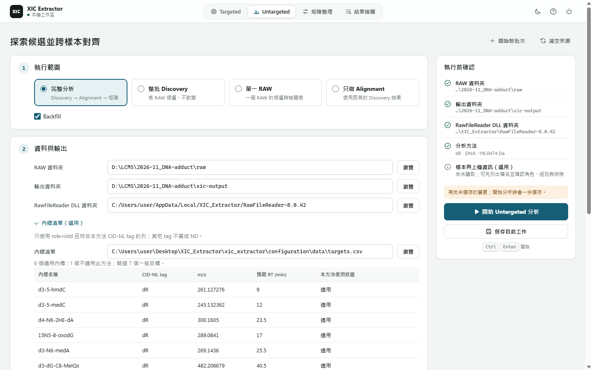
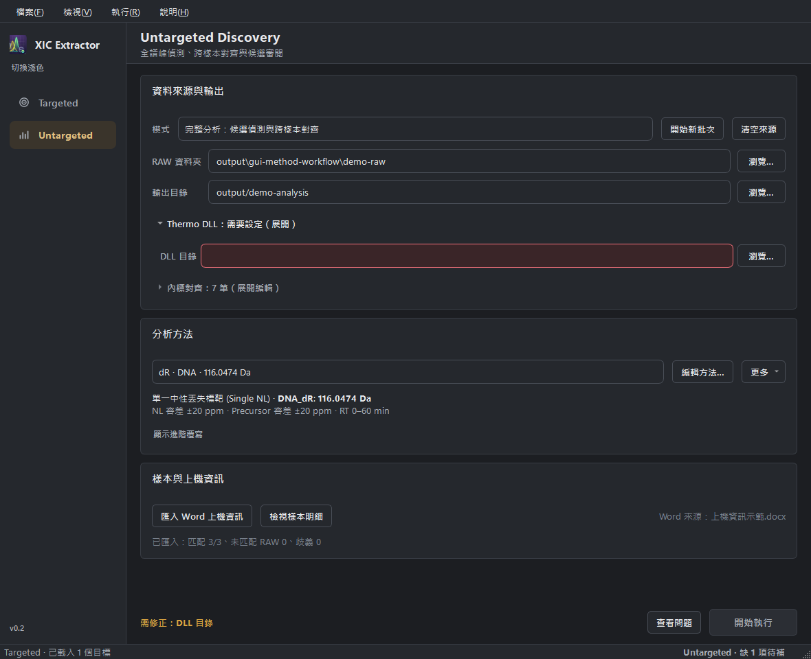

# Untargeted GUI





The Untargeted workspace is the human GUI surface for discovery, alignment,
and reviewable output access. It orchestrates existing product workflows; it
does not create a separate product-authority lane.

## Contract

- The main window exposes **Targeted Extraction** and **Untargeted Discovery**
  as first-class workspaces.
- The application provides Porcelain / Indigo (light) and Graphite / Amber
  (dark) themes. Switch using the button below the sidebar brand, **檢視 → 深色模式**,
  or `Ctrl+D`. Both workspaces update immediately; the choice survives restart
  through the main window's existing `QSettings` preference. `gui/styles.py`
  owns the shared palette, including method-editor actions.
- Untargeted settings are local GUI state in `config/discovery_gui.json`;
  that file stays ignored.
- Batch setup uses a scrollable overview with shared run feedback below it.
  Sample and target tables open in a full-height detail workspace; **返回批次設定**
  (`Alt+Left`) restores the overview without rebuilding data or discarding edits.
  Table filtering, role correction, import, and export retain their existing owners.
- DLL and internal-standard inputs show compact status summaries when valid;
  invalid restored inputs expand for correction. **查看問題** reveals the relevant
  setup section. Method selection and editing share one row; import and creation
  are available under **更多**.
- An existing DLL directory entered in either workspace is remembered immediately
  in the main window's machine-local `QSettings`, independently of Save or Run.
  Startup reuses it in both workspaces, ahead of batch-config defaults. A valid
  existing workspace path seeds this preference on first use; missing remembered
  paths remain visible for correction instead of silently selecting another path.
- **開始新批次** preserves the selected method, explicit overrides, internal
  standards, DLL, and mode. It clears RAW/batch-index/output inputs, sample roles,
  acquisition-source binding, and displayed results. **清空來源** retains the
  existing reset behavior, including resetting the method to dR.
- Completion, failure, and stopping feedback survive readiness refreshes.
  Editing settings after a run labels its results as previous results; starting
  another run or batch clears them. Stop remains disabled while cancellation is
  pending. These states describe worker feedback, not scientific acceptance.
- Method settings come from built-in presets or imported TOML methods through
  the same `xic_extractor.presets` loader used by the CLI. The method section
  exposes create, import, edit, Apply, and Save As operations for CID-NL methods.
  The starting choices are dR, R, and MeR. The editor selects and combines their
  tags, or adds custom neutral losses; Delta Mass, HCD-PI, and mixed methods are
  not exposed by this GUI. Unsupported imports leave the selected method intact.
- The operator configures Discovery tags, their combination, Discovery tuning,
  and dataset inputs. Alignment and Backfill strategy remain platform-owned.
- Advanced values are explicit user overrides layered on the selected preset.
- The GUI uses an explicit RT range of 0–60 minutes for built-in starting
  methods. This override travels with the request and exported TOML; CLI defaults
  are unchanged. Imported out-of-range methods are rejected, not clipped.
- Save As materializes the effective method values through the preset owner;
  the result can be used directly with CLI `--preset`. Apply stores an effective
  method through the same owner in local `config/current_discovery_method.toml`,
  without a Save As dialog. Cancelling the editor or rejecting an import
  preserves the current method. The GUI stores only the
  selected locator and overrides in its local config, not a second method format.
- A run uses the method snapshot displayed by the GUI. External edits to the
  source file do not silently change that run; re-import selects the new content.
  On restart the locator is loaded normally. Missing or invalid persisted methods
  remain visible and block Run until the operator selects a valid method.
- Stop requests cancellation, then waits for the current worker stage to
  yield.
- Automatic Backfill gallery / MS1 overlay generation is parked outside the
  normal GUI route. The retained helper remains available to explicit
  diagnostic callers and cannot change the Matrix.
- Frozen builds must bundle preset TOMLs, because GUI startup loads presets.
- Selecting a RAW directory lists files without assigning injection order. The
  imported acquisition-information document supplies order through the shared
  sample-metadata loader and matcher. Its source is persisted and reloaded before
  explicit role corrections; folder changes clear the old sequence binding.
- The sample table edits a view of the complete imported metadata record.
  Undisplayed fields, including exclusions and their reasons, survive visible
  edits, filtering, request construction, and CSV export. Filters change only
  visibility, not the submitted population. Importing a replacement source uses
  its records; clearing or changing the RAW source removes the previous records.
  A failed explicit import preserves the current data. A failed persisted-source
  restore still clears injection order so a run cannot use stale acquisition order.
- The shared targets example is loaded by default. Untargeted uses only rows
  marked `is_istd=TRUE` through `read_istd_targets`, the same selection consumed
  by Alignment CLI. The GUI reports the selected and skipped row counts. Other
  analytes do not become expected detections or constrain discovery. A supplied
  list without internal standards is invalid; an empty input opts out.
- Opening the bundled targets example for external editing first saves a user
  copy. Reload validates external edits through the shared targets reader.

## Modes

| Mode | GUI input | Runs |
| --- | --- | --- |
| `full` | RAW directory, DLL directory, output directory | Batch discovery, alignment |
| `discovery_only` | Single RAW file, DLL directory, output directory | Single-file discovery |
| `align_only` | RAW directory, `discovery_batch_index.csv`, DLL directory, output directory | Alignment |

Batch discovery-only remains a CLI surface. Use `full` when the GUI should
run directory-level discovery plus alignment.

## Surfaces

| Surface | Role |
| --- | --- |
| `gui/views/untargeted_view.py` | Workspace state and run lifecycle |
| `gui/ui.py` | Shared overview/detail layout; moves the same editor widget and keeps execution feedback visible |
| `gui/sections/discovery_source_section.py` | RAW, DLL, output, mode, batch-index inputs, and the shared internal-standard list |
| `gui/sections/discovery_samples_section.py` | Acquisition-document matching, displayed sequence, and role corrections |
| `gui/sections/discovery_method_section.py` | Method selection/import, displayed snapshot, and advanced overrides |
| `gui/method_editor.py` | Name, tag, and composition editing; delegates TOML saving to the preset owner |
| `gui/sections/discovery_results_section.py` | Output links and run summary |
| `gui/workers/discovery_worker.py` | Threaded mode dispatch; reports the gallery route as parked |
| `gui/workers/backfill_gallery.py` | Retained explicit diagnostic composition helper; not a normal GUI caller |
| `gui/discovery_config_io.py` | Local persisted Untargeted settings |
| `xic_extractor.spec` | Frozen-release resource bundle contract |

User-visible outputs surfaced by the GUI:

- `discovery_candidates.csv`
- `discovery_review.csv`
- `discovery_batch_index.csv`
- `alignment_matrix.tsv`

The default GUI Alignment route surfaces only `alignment_matrix.tsv`. Alignment
review TSV, HTML, XLSX, and other sidecars remain explicit non-default outputs
for machine, validation, or diagnostic workflows.

## Boundaries

- Owns: workspace layout, run/stop lifecycle, local config persistence,
  preset loading, mode dispatch, and output link presentation.
- Does not own: product authority, selected backfill values, counted
  detections, matrix publication, maturity tier, or RAW-tier production
  readiness. Those belong to [Discovery](discovery.md),
  [Alignment](alignment.md), [Presets](presets.md), and
  [Productization](productization.md).
- If a GUI change alters matrix values, schemas, selected peaks, counted
  detections, or product authority, update the owning product docs first.

## Verification

| Change area | Focused tests |
| --- | --- |
| Main-window routing | `tests/test_gui_main.py`, `tests/test_main_window_layout.py` |
| Local GUI config | `tests/test_gui_config_io.py` |
| Method editing and portable TOML | `tests/test_gui_method_editor.py`, `tests/test_presets_serialization.py` |
| Untargeted run/stop behavior | `tests/test_untargeted_view.py` |
| Worker mode dispatch | `tests/test_discovery_worker.py` |
| Shared run controls | `tests/test_pipeline_worker.py` |
| Parked GUI gallery route | `tests/test_discovery_worker.py` |
| Retained diagnostic gallery contract | `tests/test_backfill_gallery.py` |
| Alignment output surfaces | `tests/test_alignment_output_levels.py`, `tests/test_alignment_pipeline_outputs.py` |
| Frozen preset bundling | `tests/test_pyinstaller_spec.py` |

Full PR gate:

```powershell
$env:UV_CACHE_DIR='.uv-cache'; uv run ruff check xic_extractor tests
$env:UV_CACHE_DIR='.uv-cache'; uv run python scripts/check_diagnostics_index.py
$env:UV_CACHE_DIR='.uv-cache'; uv run mypy xic_extractor
$env:UV_CACHE_DIR='.uv-cache'; uv run python -m tools.testing.test_shards --check
$env:UV_CACHE_DIR='.uv-cache'; uv run python -m tools.testing.test_shards docs-config -- -v --tb=short -x
$env:UV_CACHE_DIR='.uv-cache'; uv run python -m tools.testing.test_shards gui -- -v --tb=short -x
$env:UV_CACHE_DIR='.uv-cache'; uv run python -m tools.testing.test_shards targeted-core -- -v --tb=short -x
$env:UV_CACHE_DIR='.uv-cache'; uv run python -m tools.testing.test_shards alignment-core -- -v --tb=short -x
$env:UV_CACHE_DIR='.uv-cache'; uv run python -m tools.testing.test_shards product-gates-activation -- -v --tb=short -x
$env:UV_CACHE_DIR='.uv-cache'; uv run python -m tools.testing.test_shards product-gates-evidence -- -v --tb=short -x
$env:UV_CACHE_DIR='.uv-cache'; uv run python -m tools.testing.test_shards diagnostics-tools -- -v --tb=short -x
```

## Pitfalls

- Adding a preset but forgetting the PyInstaller data bundle.
- Committing machine-specific GUI state.
- Reattaching the diagnostic gallery / overlay helper to an automatic GUI run.
- Re-enabling controls immediately after Stop while the worker is still
  alive.
- Letting the GUI recompute domain evidence or override Discovery/Alignment
  ownership rules.
