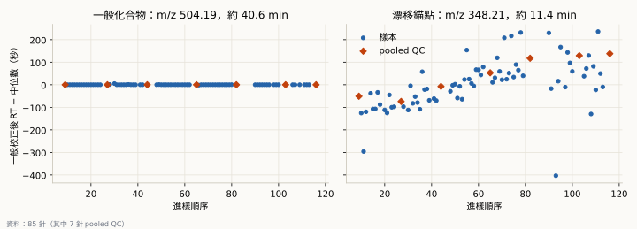
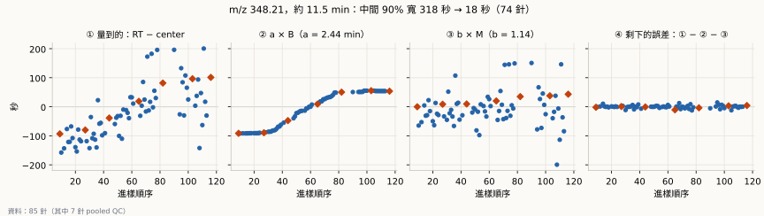
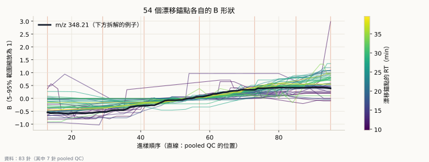
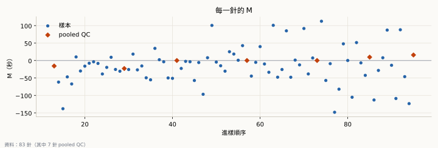
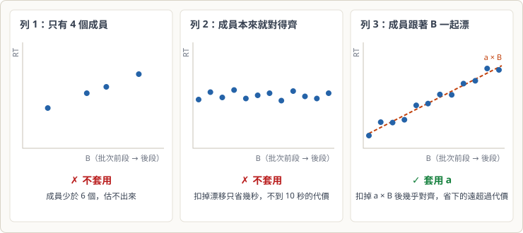
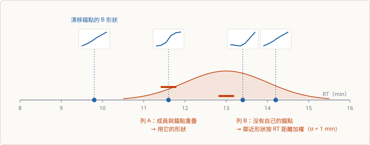
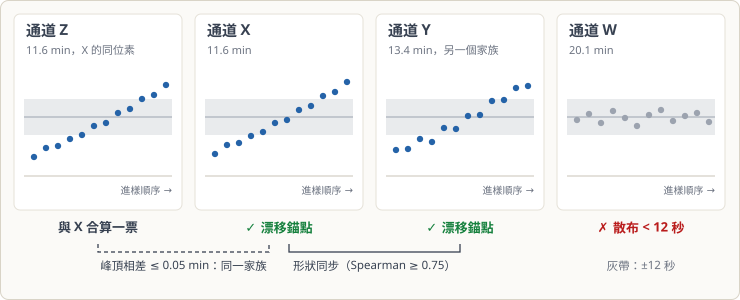

# RT 漂移模型

Untargeted 對齊前，程式先做一般 RT 校正：同一個 RT 的化合物，在每一針裡一起往前或往後移。少數化合物在一般校正之後仍然漂移，漂得更多，而且漂法不同。漂移模型處理的就是這些化合物，讓同一化合物在對齊時不會因為 RT 差太多被拆成好幾列。

它只改對齊時比較 RT 用的座標。觀測到的 RT、峰邊界與面積都不變。

## 一般校正後，少數化合物仍漂好幾分鐘

下圖比較兩個化合物在一般校正後的 RT。資料來自一批組織 DNA 驗證資料：85 針，其中 7 針 pooled QC；本頁的真實資料圖都來自這一批（85 針擷取檔以現行程式重播列投票 M 後的結果），圖上不列樣本名，橫軸是進樣順序。

縱軸是一般校正後的 RT，減去該化合物在全批的中位數。

- 左：一個一般化合物，一般校正後幾乎貼在 0；大部分化合物都是這樣。
- 右：m/z 348.21 在一般校正後，批次前段與後段仍相差約 2.5 分鐘，相鄰進樣的樣本之間還彼此錯開。

只靠「RT 相差多少」判斷是不是同一個化合物，右邊這種會被拆成好幾列。

## 把漂移拆成「隨時間」與「隨樣本」兩部分

右圖的漂移看起來有兩種成分：一條隨進樣順序慢慢上升的趨勢，加上每一針各自往上或往下的跳動。漂移模型就把一般校正後的 RT 寫成這兩部分相加：

> RT(c, s) = center(c) + a(c) × B(s) + b(c) × M(s) + 誤差

c 是一列（一個化合物），s 是一針。

| 符號 | 名稱 | 每一針或每一列 | 意思 |
| --- | --- | --- | --- |
| B | 批次狀態 | 每一針 | 層析狀態隨進樣順序的慢變化，也就是「隨時間」的部分 |
| M | 樣本位移 | 每一針 | 這一針自己的滯留偏移，也就是「隨樣本」的部分 |
| a | 時間係數 | 每一列 | 這一列對 B 有多敏感 |
| b | 樣本位移係數 | 每一列 | 這一列對 M 有多敏感 |

B 與 M 是整批共用的量，每一針一個值；a 與 b 是每一列自己的係數。大部分化合物的 a、b 都是 0，也就是只用一般校正。

用 m/z 348.21 看這條式子怎麼運作：

- ① 是量到的 RT 減去 center，也就是上一張圖的右邊。
- ② 是 a × B。a = 2.44 分鐘：B 從批次前段到後段走完一個單位，這個化合物就比一般校正多漂約 2.4 分鐘。
- ③ 是 b × M。b = 1.14：某一針的 M 是 +60 秒時，這個化合物在那一針多偏約 68 秒。
- ④ 是 ① 扣掉 ② 與 ③ 後剩下的誤差。中間 90% 的樣本（5–95%）所占的寬度從 318 秒縮到 18 秒。對齊時比較的就是扣掉 ② 與 ③ 之後的 RT。

B 與 M 不是猜的，而是從一批明顯漂移、彼此佐證的化合物量出來，這些化合物叫**漂移錨點**；m/z 348.21 就是其中一個。怎麼選放在[最後一節](#b-與-m-從漂移錨點量出來)。

## B：整批隨進樣順序的慢變化

下圖每條線是一個漂移錨點的 B，黑色粗線是上面拆解的 m/z 348.21。

- B 都隨進樣順序上升，但形狀不只一種：顏色代表漂移錨點的 RT，早洗脫與晚洗脫的化合物漂法不同。所以 B 不是全批共用一條曲線，每一列用的是 RT 附近漂移錨點的形狀（見[哪些列會套用 a、b](#哪些列會套用-ab)）。
- B 沒有單位：每條形狀都縮放成中間 90% 的範圍等於 1。乘上以分鐘為單位的 a，才是這一列因為時間多漂了幾分鐘。

## M：每一針自己的偏移

- 有些針整體偏早或偏晚，而且只有部分化合物會受影響。可能的原因是基質效應；組織類型解釋不了多少，所以逐針量。
- pooled QC 每次都是同一份基質，RT 只受 B 影響，所以各針 pooled QC 的 M 應該彼此相近。M 由各列和進樣順序前後鄰針的比較投票決定（見[最後一節](#從漂移錨點算出-b-與-m)第 4 步），零點不是 pooled QC，所以 pooled QC 不一定落在 0：本批 7 針 pooled QC 的 M 在約 0 到 38 秒之間，樣本則從約 −175 到 +133 秒。
- 一針量不到 M 時是「未知」，不是 0。M 的零點本身沒有意義：整體加一個常數，會被每一列的 center 吸收。

## 哪些列會套用 a、b

大部分列不套用，a = b = 0，只用一般校正。一列要同時過兩關才會套用：

1. **估得出來**：至少 6 個成員知道 B，而且它們的 B 跨過形狀範圍的四分之一以上，才估得出 a。估 b 也一樣要 6 個成員，而且它們的 M 至少相差 10 秒。
2. **套用後明顯更好**：每用一個係數，要付出一筆代價，大小等於「兩個成員 RT 差 10 秒」。扣掉漂移後，成員之間 RT 的差距縮小的量要比這筆代價大，才值得套用。

程式把「不套用、只用 a、只用 b、a 和 b 都用」四種做法各算一次「成員 RT 對不齊的程度 + 代價」，取最小的那種。

選定之後，這一列的成員都用扣掉漂移後的 RT 互相比較；回填缺值的樣本時，預測位置也會加上那一針的漂移。某個成員的 B 或 M 未知時，它不參與估計，比較時權重減半，但不會讓整列因此不套用。

結果資料夾中，每個 feature 的 a、b 寫在 `alignment_review.tsv` 的 `rt_time_coefficient`（a）與 `rt_sample_shift_coefficient`（b）。漂移錨點清單、M 未知的樣本與係數非零的列數，記在 `alignment_run_metadata.json` 的 `rt_drift_summary`。

### 每一列用哪一條 B

- 成員與某個漂移錨點的觀測重疊：直接用那個錨點的 B 形狀。
- 沒有重疊：把附近漂移錨點的形狀混在一起，RT 越近的權重越大（高斯權重，σ = 1 分鐘）。

## B 與 M 從漂移錨點量出來

B 與 M 在一般校正之後、最終分組之前算一次就凍結；之後每一列只決定自己的 a、b，不會再改 B 與 M。

### 漂移錨點怎麼選

每個通道要過兩道關卡才算漂移錨點：

**通道**是一組 CID-NL 方法條件，也就是 precursor m/z 加中性丟失。某一針在這個通道恰好只有一個有方法直接支持、可定量的峰時，才用它的峰頂 RT；有好幾個就當這一針不知道。

1. **漂得夠多**：一般校正後，這個通道的 RT 在各針之間的散布（穩健估計）至少 12 秒。上圖的 W 留在灰帶裡，不過關。
2. **有別的化合物跟著一樣漂**：它的偏移與另一個洗脫家族的通道同步，至少 6 針共同樣本，Spearman 相關 ≥ 0.75。上圖的 V 漂得很多，但沒有別的通道跟它一樣，可能只是這個通道自己的雜訊，不過關。

**洗脫家族**是峰頂幾乎同時出現（中位數相差 0.05 分鐘以內）的通道，例如同一化合物的同位素、adduct、共洗脫離子。同一家族的通道本來就會一起動，所以不能拿來互相佐證；上圖的 Z 能過關，靠的是另一個化合物 Y，不是 X。

在初始分組時沒有聚在一起的化合物也能當漂移錨點，因為這一步不看初始分組的結果。漂移錨點只用來量 B 與 M，不參與一般校正。

### 從漂移錨點算出 B 與 M

M 先算，因為 B 要扣掉 M 的影響：

1. 每個漂移錨點的偏移，先扣掉 pooled QC 沿進樣順序的趨勢。帶到這個錨點的 pooled QC 少於 2 針時，改用全部樣本自己的滑動中位數。
2. 剩下的是每一針偏離趨勢的量。這個偏離的散布至少 8 秒、而且與另一個家族同步的錨點，才拿來定 M。
3. M(s) 是每個家族在這一針的偏離中位數，再取各家族的中位數；同一家族只算一票。
4. 漂移錨點要求「這個質量在這一針只有一支峰」，所以有些針只有一兩個家族投票。樣本數達 20 針的批次會再做一步：把有 NL 事件的峰先分一次列，取 20 針以上的列，看每一針比進樣順序前後 8 針偏多少。這個偏移確實跟著上一步的 M 走的列（反應至少 0.3、Spearman 相關 ≥ 0.75）才投票，票值是偏移除以這條列自己的反應。一針拿到 3 票以上就取中位數當 M，不到 3 票沿用上一步的值。

每個漂移錨點的 B 形狀：

1. 取這個錨點的偏移，扣掉它對最後定下來的 M 的反應。
2. 沿進樣順序取滑動中位數，得到隨時間變化的趨勢。
3. 縮放成 5–95% 的範圍等於 1，方向統一為隨進樣順序上升。

## 它管不到什麼

- **不改量測**：觀測 RT、峰邊界與面積都不變，只改對齊時的比較座標。
- **不做鑑定**：它描述的是 RT 在針與針之間怎麼漂，不判斷兩個峰是不是同一化合物。
- **借錯形狀**：沒有自己的漂移錨點、又剛好位在兩種形狀交界附近的漂移化合物，可能借到不合適的形狀。
- **異構物占據不同進樣區段**：只有在各區段內的位移彼此不矛盾時，才能用一個與區段對齊的 M 解釋。
- **沒有 pooled QC**：M 只能以樣本自己的滑動趨勢為基準。樣本若依組織類型分段進樣，時間與組織會混在一起。
