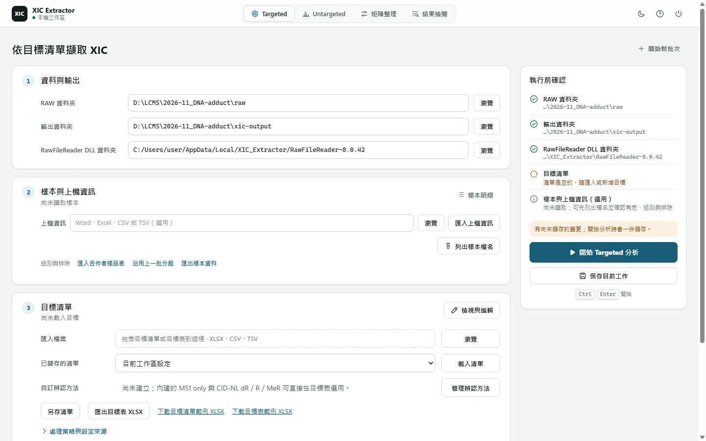

# Targeted Extraction

Use Targeted when you have a known target list and want to measure and review
a batch. Prepare names, m/z and expected RT; specify identification methods
and internal-standard relationships where applicable. The main result is one
Excel workbook, read from batch summary to the individual results needing attention.



## Workflow

1. Open `XIC_Extractor.exe`, or run `uv run xic-workbench` in a developer
   checkout. On first use, follow the [reader setup notice](../../README.md#run-the-html-workbench)
   to install RawFileReader 8.0.42 and, if needed, .NET 8 or later.
2. Select **Targeted**.
3. Set the RAW folder and result location. The local DLL setting is retained.
4. Select a saved target list and press **載入清單**, import a list, or choose
   **檢視與編輯** to open the full-height target table.
   **返回批次設定** (`Alt+Left`) preserves edits and returns to the batch summary.
5. Check sample roles and exclusions in **樣本明細**. Statistical groups are
   not required or edited here. **上機資訊與樣本檔案（選用）** contains optional
   acquisition-information import and sample export. Confirmed roles and
   exclusions are shared by both analysis workflows and matrix curation.
6. Press **開始 Targeted 分析** in the run panel.
7. The finished run opens its result. Each run writes a new
   `<date>_<time>_targeted_<RAW folder>` folder under **結果存放位置**.

**開始新批次** clears the RAW directory, injection-order source and displayed
samples while retaining targets, DLL, the selected strategy and result location.
Confirmed groups and exclusions stay with their original RAW folder. Settings
edited after a run apply to the next analysis only; an opened result keeps the
settings it ran with.

The GUI and CLI use the same Targeted pipeline and `config/workspace.json` current
work state. A fresh workspace has no selected targets. Download the method or
target-table XLSX example from the target-list card and save a copy. Drag the file
onto the import area or click **選擇檔案** (no pasted path). Workbench detects the
file type and previews targets and ISTD pairs; **確認匯入並取代** applies the list,
while **取消** leaves current work unchanged. **保存批次設定** saves the current
setup for reopening; starting analysis also saves it. **另存清單** creates a
reusable XLSX, without changing the current batch.
Reading settings never creates or imports old CSV working copies.

Keep real machine paths in ignored runtime files. Do not commit local RAW, DLL,
or private lab paths. The [field reference](targeted-config-reference.md) owns
workbook sheet names and the exact editable fields.

## Inputs

| Input | Role |
| --- | --- |
| RAW directory | Batch of Thermo `.raw` files to process |
| DLL directory | RawFileReader 8.0.42 folder selected by setup; not the Xcalibur folder |
| Target table | Names, m/z, expected RT, identification method, role, and ISTD pairing |
| Reusable analysis method | Processing strategy plus the complete targets/ISTD table |
| Environment and output | DLL and output location; shared worker count in execution resources |

Target labels become public workbook and CSV identifiers. Rename them only when
downstream scripts and review expectations can tolerate the changed column
prefixes.

## Analysis Method And Saved Settings

The normal flow is **select samples → choose method/targets → run → review**.
The target table specifies name, m/z, expected RT in minutes, identification
`method`, role and an optional ISTD relationship. An analyte may reference an ISTD
row or leave the pair blank; an ISTD does not reference another row. The method
is the single chemistry input: `dR`, `R` or `MeR` for a built-in CID-NL recipe, or
the name of a custom method (see the [configuration reference](targeted-config-reference.md)).
Leave it blank for MS1-only extraction; no neutral-loss evidence is required
and the shared 20 ppm precursor tolerance applies. Names such as `D1` or `R1`
are identifiers, not chemistry tags. Rows with different methods may share a batch.
MS1-only compares retained regions using the reference RT, supported batch drift,
and same-ion target order before deciding which touching lobes to integrate
together. There is no fixed RT acceptance window. Plausible uncertain matches,
shoulders, and double tops can retain area with review notes; incompatible
correspondence means ND. A cleaner or larger peak elsewhere is not automatically
a replacement for a reference-supported body.

Use **另存清單** to save the complete target table plus the scientific strategy.
Load it for another batch without changing that batch's RAW/DLL paths
or injection order. There is no advanced method panel or method reset: scientific
processing belongs to the platform, not hidden settings. Local worker count is
an execution resource, never part of a portable method.

The current sample's credible paired ISTD supplies the RT shift while preserving
the declared expected analyte–ISTD offset. Expected RT is an identity hint, not an
acquisition crop. Targeted enumerates exact-mass MS1 physical candidates across
the sample acquisition span, even without MS2, and uses the shared Discovery
CID-NL event and physical-peak owners. Missing NL does not count as direct support.
Conservative, confirmed-peer ISTD Backfill keeps its separate provenance.

The CLI accepts `--method <file.xlsx>` and `--data-dir <new-batch>`; execution
inputs are frozen at start. Local settings contain RAW/DLL paths, sample metadata and worker count. The [field reference](targeted-config-reference.md) is the input contract.
Old target/scientific-settings formats are rejected, not silently converted.

## Main Output

```text
output/xic_results_YYYYMMDD_HHMM.xlsx
```

Open it from the workspace result actions. Cancellation or failure publishes no
completed workbook.

| Workbook sheet | Purpose |
| --- | --- |
| `摘要` | First view: batch conclusion and one table of targets with what to look at first |
| `需檢查` (when needed) | The results to look at first (a target's minority outcome, or its review notes when there is no clear majority), with reason and suggested check |
| `面積` | Saved Area per sample and target; analytes sharing an ISTD sit together, followed by that ISTD |
| `XIC Results` | Sample-target Area, RT, counted status and review reason; expand secondary columns for evidence |
| `Targets` | Supporting reference: snapshot of the target table used for the run |
| `Run Metadata` | Supporting reference: method settings and provenance |
| `欄位說明` | Meaning and unit of every column |

The normal output directory contains one XLSX only. A nonempty supplied sample
context table remains in a hidden sheet so it can be inspected without sidecar
files.

Use **在結果檢閱開啟** after completion, or open the XLSX in the
workbench's result picker. Inspector shows saved values without RAW, DLLs,
recomputation or additional output files. Start with the batch overview, select
a target or review action, then a sample for its details. The workbook does not contain chromatogram curves.

## Detection And Review

`XIC Results` keeps two separate answers beside the measurements:

- **Counted Detection** is decided by the formal Targeted projection. A row
  can retain RT/area without counting; NL tokens alone do not decide it.
- **Review / Review Reason** identify rows needing attention. A counted
  detection can still require review. Filter `Review` in Excel or use the
  Inspector's attention filter, then inspect the recorded explanation.

For missing MS2, the formal projection applies the ISTD/analyte role and
support policy. Missing MS2 is not direct CID-NL support; there is no detection
override. The [Decision Policy](../product/decision-policy.md) owns these rules.

## Review The Batch

1. Open the completed workbook from the result actions. Read `摘要` for the
   batch conclusion and which targets need attention.
2. Follow the indicated items into `需檢查` when present. A review note asks
   for inspection; it does not by itself mean that the area is unusable or the
   detection was rejected.
3. In workbench result review, select the target and sample. Compare the saved
   area, RT, counted status, and reason. Request the XIC when you need to check
   the peak; this needs the source RAW files and reader. Reading saved workbook
   values alone does not.
4. Use `面積` for saved sample × target areas and any intended in-workbook
   calculations. Check the method, ISTD pairing and units before comparing
   results across batches. The workbook preserves the input snapshot and run
   metadata for this purpose.

An area, a counted detection, and a review flag answer different questions.
Do not infer chemical identity from area alone, or turn a missing result into
zero. For the reasoning, see the [processing story](processing-guide.html#decisions);
for exact fields, use the [output reference](targeted-output-reference.md).
Review does not overwrite the saved scientific result; changed analysis inputs
require a new run.

## CLI

Developer checkout:

```powershell
uv run python -m scripts.run_extraction --base-dir .
```

Installed entry point:

```powershell
uv run xic-extractor-cli --base-dir .
```

Useful overrides:

| Argument | Meaning |
| --- | --- |
| `--base-dir` | Directory containing `config/` and `output/` |
| `--data-dir` | One-run RAW directory override |
| `--method` | Saved target-intent XLSX (`Method` + `Targets`) |
| `--injection-order-source` | Explicit injection order for this batch |

Execution scheduling is automatic; actual workers are recorded in run metadata.

## Validation

Result review is described [above](#review-the-batch). Operator validation uses
`.venv\Scripts\python.exe tools\diagnostics\targeted_validation.py --help` for suite
selection, dry-run and baseline comparison through the finalized Targeted
application. Manual-2RAW calibration separately compares acquisition RT/area
against the supplied manual measurements. For developer environment and
RAW-run constraints, see [Local Execution](../agent/local-execution.md).
Regression checks do not establish method-wide scientific readiness.

## Troubleshooting

| Symptom | Action |
| --- | --- |
| XLSX or current-work JSON format error | Fix the file, row, and column named in the error |
| `data_dir` does not exist | Point Settings to the folder containing `.raw` files |
| DLL load failure | Follow the reader setup notice; use RawFileReader 8.0.42 with .NET 8 or later, then restart the workbench |
| One RAW file fails | Continue the run and inspect the `FILE_ERROR` diagnostic row |
