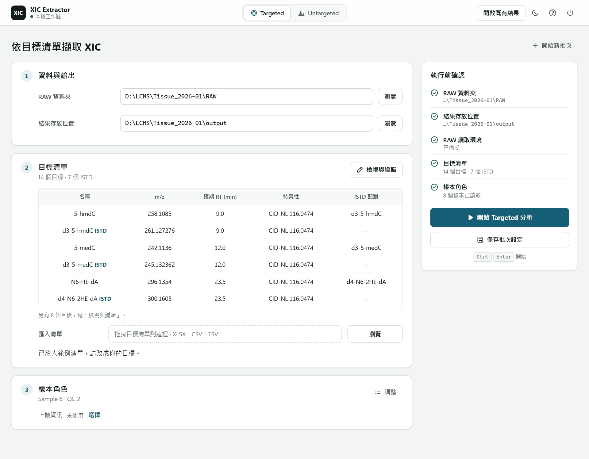

# Targeted 分析

依目標清單，量出每個樣本中每個目標的面積，結果存成一份 Excel。

## 開始前準備

| 項目 | 內容 |
| --- | --- |
| RAW 資料夾 | 同一批的 Thermo `.raw` 檔 |
| 目標清單 | XLSX、CSV 或 TSV；沒有清單可從範例開始，欄位見[目標清單](targeted-config-reference.md) |
| 上機資訊（選用） | 上機序列表（Word、Excel、CSV 或 TSV），用來核對樣本 |

第一次使用要先備妥 RawFileReader，見[開始使用](README.md)。

## 執行一批

1. 頂端選 **Targeted**（<kbd>Ctrl</kbd> <kbd>1</kbd>）。
2. **資料與輸出**：**RAW 資料夾** 按 **瀏覽** 選資料夾。**結果存放位置** 有預設值，需要再改。
3. **目標清單**：把檔案拖到 **匯入清單**，或按 **瀏覽**。核對預覽的檔名與目標數，按 **匯入**。
   - 沒有清單：按 **從範例開始** 或 **新增目標**。
   - 要修改：按 **檢視與編輯**，改完按 **完成**。
4. **樣本角色**：選好 RAW 資料夾後自動列出樣本。要改角色或排除樣本，按 **調整**。
5. 右側 **執行前確認** 都打勾後，按 **開始 Targeted 分析**（<kbd>Ctrl</kbd> <kbd>Enter</kbd>）。

分析在本機執行，關閉分頁不會中斷。完成後自動開啟結果。

## 看結果

結果頁先列出最值得確認的結果：每個目標裡與多數不同的少數，例如多數計入時沒計入的那幾筆。

1. 按 **先看這 N 筆 →**。
2. 左側選目標，再選樣本，看面積、RT 與判斷理由。
3. 要看峰形，按樣本列的 **看 XIC**。這一步需要原 RAW 檔與 RawFileReader。

全部樣本按 **查看所有樣本結果 →**。Excel 按 **下載結果 Excel**。

> 面積、計入偵測、需檢查是三個獨立的答案：有面積不一定計入，計入的也可能需要看。`ND` 與空白都不是 0。見[判讀原理](processing-guide.html#decisions)。

## Excel 結果

每次分析在結果存放位置建立 `<日期>_<時間>_targeted_<RAW 資料夾名>` 資料夾，內含一份 `xic_results_<日期>_<時間>.xlsx`。

| 工作表 | 內容 |
| --- | --- |
| `摘要` | 整批結論與每個目標的計入數，從這裡開始 |
| `需檢查` | 先看的結果，附原因與建議確認的事；沒有就不出現 |
| `面積` | 樣本 × 目標的面積；共用 ISTD 的目標排在一起 |
| `XIC Results` | 每個樣本 × 目標一列：面積、RT、是否計入、檢閱原因 |
| `Targets` | 本次使用的目標清單 |
| `Run Metadata` | 本次的設定與版本 |
| `欄位說明` | 每一欄的意義與單位 |

各欄定義見[結果檔案](targeted-output-reference.md)。

## 下一批與重開結果

- **開始新批次**：清空 RAW 資料夾與樣本，保留目標清單與結果存放位置。
- **保存批次設定**（<kbd>Ctrl</kbd> <kbd>S</kbd>）：保存目前設定。開始分析時也會保存。
- **開啟既有結果**（右上角）：選 `xic_results_*.xlsx` 重看結果，不需要 RAW。

分析後才改的設定只影響下一次分析。

## 遇到問題

| 狀況 | 處理 |
| --- | --- |
| **開始 Targeted 分析** 不能按 | 看 **執行前確認** 哪一項沒打勾 |
| 目標清單無法匯入 | 依訊息修正指出的列與欄 |
| RAW 讀取環境未備妥 | 依畫面提示安裝 .NET 或 RawFileReader，見[開始使用](README.md) |
| 某個 RAW 檔讀取失敗 | 其他樣本照常完成；失敗的檔列在 `需檢查` |
