# Targeted 分析

依目標清單，量出每個樣本中每個目標的面積，結果存成一份 Excel。

> **看結果前先記得**：有面積不一定計入偵測，計入的也可能有疑點；`ND` 與空白都不是 0。見[判讀原理](concepts.md)。

## 開始前準備

| 項目 | 必填 | 內容 |
| --- | --- | --- |
| RAW 資料夾 | 是 | 同一批的 Thermo `.raw` 檔 |
| 目標清單 | 是 | XLSX、CSV 或 TSV，格式見下方[目標清單](#目標清單)；沒有清單可從範例開始 |
| 上機資訊 | 否 | 上機時的序列表檔案（Word、Excel、CSV 或 TSV）；匯入後帶入樣本角色、組別與排除 |

第一次使用要先備妥 RawFileReader，見[開始使用](README.md#第一次使用準備-rawfilereader)。

## 目標清單

列出要量的化合物。範例有兩種取得方式：

- 工作區：目標清單是空的時，按 **從範例開始**，範例直接放進清單。
- Excel：右上角 **？**（使用說明與快捷鍵）→ **下載目標清單範例 XLSX**；程式資料夾的 `examples/targets.xlsx` 是同一份。XLSX 表頭每一格都附填法註解。

### 欄位

工作表名稱是 `Targets`，第一列是欄名。也可以用 CSV 或 TSV，欄名相同。

| 欄名 | 必填 | 填什麼 | 例 |
| --- | --- | --- | --- |
| `label` | 是 | 目標名稱，不可重複；會成為結果的欄名 | `5-hmdC` |
| `mz` | 是 | 定量離子的 m/z | `258.1085` |
| `expected_rt_min` | 是 | 預期 RT（分鐘） | `9.0` |
| `role` | 是 | `analyte` 或 `istd` | `analyte` |
| `istd_pair` | 否 | 配對 ISTD 的 `label`；ISTD 列留空 | `d3-5-hmdC` |
| `cid_nl_loss_da` | 否 | 中性丟失（Da） | `116.0474` |
| `delta_mass_mz` | 否 | 伴隨離子與 `mz` 的精確質量差，逗號分隔 | `+1.0021, +4.0052` |

- 值要填數字或文字，不要用公式。
- 從工作區匯出的 XLSX 可能多兩張工作表：`Delta Mass`（每個伴隨離子一列）與 `Delta Mass Settings`（整份清單共用的門檻）。照原樣保留即可；不接受其他工作表。

**`expected_rt_min` 要多準**：預期 RT 用來辨認是哪一個峰，不是搜尋視窗，不會裁掉搜尋範圍，也不能單靠 RT 確認身分。填這套 LC 方法實測的 RT；換方法或換批次時要重新確認。有配對 ISTD 時，分析物與 ISTD 的預期 RT **差值**會用來判定峰位：ISTD 已計入時，分析物峰頂與 ISTD 峰頂的差要落在這個差值的 12 秒內（同批有兩對以上確認配對時，改用實測差值校正位置與容許範圍），超出就記為 `ND`。

### 特異性：怎麼確認是這個化合物

`cid_nl_loss_da` 與 `delta_mass_mz` 決定除了 m/z 與 RT 之外還要看什麼證據。

| 填法 | 判定方式 |
| --- | --- |
| 兩欄都空白 | MS1 only：只看 m/z（20 ppm）與 RT |
| 只填中性丟失 | 用 MS2 是否見到這個中性丟失來挑峰與確認 |
| 只填 Δm/z | 同一 RT 要同時見到伴隨離子 |
| 兩欄都填 | 兩個條件都要在同一個峰上符合 |

常用的中性丟失：dR `116.0474`、R `132.0423`、MeR `146.0579`。沒有採到 MS2 不算中性丟失的證據；配對 ISTD 可以補上，見[判讀原理](concepts.md#istd)。

### Delta Mass：伴隨離子怎麼填

伴隨離子是和目標在同一 RT 一起出現的其他 MS1 離子，例如同位素或標記物。**基準** 是這一列的 `mz`；**Δm/z** 是伴隨離子的 m/z 減去基準，填精確質量差，正負都可以。

| 這一列的 `mz`（基準） | 伴隨離子的 m/z | `delta_mass_mz` 填 |
| --- | --- | --- |
| `300.1000` | `306.1201` | `+6.0201` |
| `300.1000` | `301.1021`、`304.1052` | `+1.0021, +4.0052` |

填了 Δm/z 的目標，一定要見到伴隨離子才算符合，不會退回 MS1 only。

### 匯入與編輯

- **匯入**：把檔案拖到 **匯入清單**，或按 **瀏覽**。預覽列出目標、預期 RT、角色、ISTD 配對與特異性，確認後按 **匯入**（已有清單時是 **取代目前清單**）。只換目標清單，RAW 資料夾與上機資訊不變。檔案上限 1 MiB，不支援 `.xls`。
- **編輯**：按 **檢視與編輯**。選取目標列（拖曳框選、<kbd>Ctrl</kbd> 加選、<kbd>Shift</kbd> 連選，或搜尋）後，在上方填 **CID-NL 中性丟失（Da）** 或 **Delta Mass Δm/z** 按 **套用**，只寫入有填的欄；**設為 MS1 only** 清空兩欄。
- **單一目標的伴隨離子**：點該列的 **Delta Mass Δm/z** 格，按 **＋ 伴隨離子**。**強度比（伴隨 ÷ 基準，只記錄）** 只記錄，不拿來排除；勾 **比對峰形** 時，伴隨離子的峰形要和基準相似。共洗脫與峰形門檻在 **進階：Delta Mass 判斷設定（整份清單共用）**，通常不必改。
- 改完按 **完成**。要給其他批次用，按 **匯出清單 XLSX**。

## 執行一批

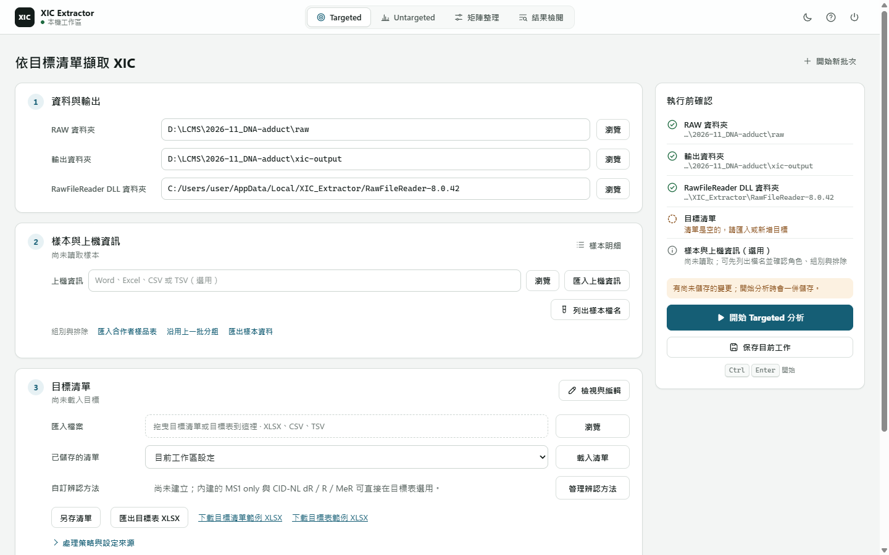

1. 頂端選 **Targeted**（<kbd>Ctrl</kbd> <kbd>1</kbd>），在 **資料與輸出** 選 **RAW 資料夾**。
2. 匯入 **目標清單**。
3. **樣本角色**：選好 RAW 資料夾後自動列出樣本。有上機資訊時，表上的角色、組別與排除會帶入；沒有時依 RAW 標頭與檔名推定角色。要修正，按 **調整**。
   - Targeted 分析所有未排除的樣本，角色只是標籤。不想分析某個樣本時，把它排除。
4. 右側 **執行前確認** 都打勾後，按 **開始 Targeted 分析**（<kbd>Ctrl</kbd> <kbd>Enter</kbd>）。

分析在本機執行，關閉分頁不會中斷。完成後自動開啟結果。

## 看結果

結果頁先列出 **需先看** 的結果：每個目標裡與多數不同的少數，例如多數計入時沒計入的那幾筆。

1. 按 **先看這 N 筆 →**。
2. 左側選目標。右側列出各樣本的 RT、面積、結果（已計入／未計入）、依據與疑點，見[依據與疑點](#依據與疑點)。
3. 要看峰形，按該樣本列的 **看 XIC**。這一步需要原 RAW 檔與 RawFileReader。

全部樣本按 **查看所有樣本結果 →**。Excel 按 **下載結果 Excel**。

## Excel 結果

每次分析在結果存放位置建立 `<日期>_<時間>_targeted_<RAW 資料夾名>` 資料夾，內含一份 `xic_results_<日期>_<時間>.xlsx`。打開看得到四張工作表：

| 工作表 | 用途 |
| --- | --- |
| `摘要` | 從這裡開始：整批結論與 **需先看** 的結果 |
| `面積` | 樣本（列，依注射順序）× 目標（欄）的面積，帶去下游計算；共用 ISTD 的分析物排在一起，後面接該 ISTD |
| `XIC Results` | 追查某一筆：每個樣本 × 目標一列 |
| `Targets` | 本次使用的目標清單、特異性與實際套用的容差 |

### `摘要`

- 第一行是結論：要先看幾筆。
- 第二行：樣本數、目標數、ISTD 是否全部計入（沒有時點名是哪個 ISTD）、版本與日期。
- 接著逐筆列出 **需先看** 的結果（目標、樣本、結果、依據、疑點、RT、Area）。讀取失敗的 RAW 也列在這裡，依據是 `RAW 失敗`。最後每個分析物一列計入樣本數。

**需先看** 是每個目標裡占 20% 以下的那一方判定，例如多數計入時沒計入的幾筆；沒有明顯多數時，改列[需要看](#依據與疑點)的結果。它只決定閱讀順序，不改判定。

### `面積`

| 看到的 | 意思 |
| --- | --- |
| 黑字數值 | 已計入的面積（counts·s） |
| 灰字數值 | 未計入，數值保留給你判斷 |
| `ND` | 未偵測；`AVERAGE` 會略過 |
| 空白 | 沒有可靠的定量值；`XIC Results` 的 `依據` 是 `不足以定量` |

面積比要自己算：分析物與 ISTD 排在相鄰欄，例如 `=B5/D5`。

### `XIC Results`

前八欄回答日常判讀，其餘欄預設收合，按欄標上方的 **＋** 展開。

| 欄 | 意思 |
| --- | --- |
| `SampleName` | 樣本名稱 |
| `Target` | 目標名稱 |
| `RT` | 所選峰的峰頂 RT（min） |
| `Area` | 所選峰的面積（counts·s）；有數值不代表已計入 |
| `IntSmoothed` | 平滑後的峰頂強度（counts），不是面積 |
| `Counted Detection` | `TRUE` 即已計入，`FALSE` 即未計入；未計入的列是灰字 |
| `依據` | 這筆結果依據的觀察：一個標籤 |
| `疑點` | 不確定的地方：0 到多個標籤，以「、」分隔；多數列空白 |
| `PeakStart`、`PeakEnd` | 積分起點與終點（min） |
| `Group` | 樣本組別；目標是 ISTD 或分析物見 `Targets` |
| `Int`、`PeakWidth` | 原始峰頂強度與峰寬 |

需要看的 `依據` 或 `疑點` 那一格以強調色標出。標籤的意思見[依據與疑點](#依據與疑點)。

其餘工作表是設定與追查用的紀錄，預設隱藏；需要時在工作表標籤按右鍵 →「取消隱藏」。

| 工作表 | 內容 |
| --- | --- |
| `Delta Mass`、`Method Evidence`、`Delta Mass Evidence` | 有 Delta Mass 目標時才有：伴隨離子設定，以及每個候選峰各條件是否符合 |
| `Run Metadata` | 版本、時間與分析設定 |
| `診斷事件` | 挑峰時的事件，供追查過去的判定 |
| `Sample Context` | 這次使用的上機資訊；有提供時才有 |

## 依據與疑點

`XIC Results`、`摘要` 與結果頁用同一組固定標籤說明每筆結果：

- **依據**：每筆恰好一個，回答「為什麼是這個結果」。
- **疑點**：0 到多個，以「、」分隔，回答「哪裡不確定」；多數空白。

標籤描述觀察到的事，欄位決定它的角色：同一個觀察在兩欄都用同一個詞，`依據` 已寫出的觀察不會再列進 `疑點`。

**需要看**：`依據` 是下表「需要看」標「是」的標籤，或 `疑點` 有字，這筆就需要看。唯一的例外是 `無可用 MS1 峰`：分析物沒有峰是完成的 `ND`，有加入的 ISTD 沒有峰才要查。需要看決定強調色，也是 **需先看** 在沒有明顯多數時改列的結果。

標籤不帶數字。被拒峰的確切 RT、面積與偏離量在隱藏的 `診斷事件`；峰在哪裡，到結果頁按 **看 XIC**。

### 身分從哪裡來

| 目標 | 身分來源 | 對應的 `依據` |
| --- | --- | --- |
| 有配對 ISTD 的分析物 | 配對 ISTD 已計入時，只看 ISTD 位置：不在位置上，即使自己有中性丟失也記為 `ND`。配對 ISTD 未計入時，改看自己的中性丟失 | `ISTD 位置`、`偏離 ISTD 位置`；改看自己時 `NL 確認`、`ISTD 未計入` |
| ISTD | 自己的中性丟失，或同批其他樣本的峰（回填） | `NL 確認`、`回填`；不成立時 `未見 NL`、`無 MS2` |
| 沒有配對 ISTD 的分析物 | 自己的中性丟失 | `NL 確認`；不成立時 `未見 NL`、`無 MS2` |
| 有 Delta Mass 的目標 | 特異性條件 | `特異性條件`、`不符特異性條件` |
| 不要求中性丟失的目標 | MS1 峰 | `僅 MS1 峰` |

這個方法預期看到中性丟失。身分由 ISTD 或回填確認時，沒見到的中性丟失仍列在 `疑點`，例如 `依據` 是 `ISTD 位置`、`疑點` 是 `未見 NL`。設定了中性丟失、又有選到峰的結果，兩欄都沒有 NL 標籤，就表示中性丟失有見到且偏差正常。

### 標籤

示意圖是合成資料：藍線是這筆的 XIC，填色是所選峰；灰虛線是配對 ISTD；黃色帶是預期位置；綠色點線是伴隨離子。下方的綠色 ▲ 是見到中性丟失的 MS2，橘色 ▲ 是中性丟失質量偏差大，△ 是沒見到中性丟失的 MS2。

| 標籤 | 示意 | 意思 | 出現在 | 需要看 |
| --- | --- | --- | --- | --- |
| `NL 確認` | 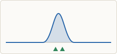 | MS2 見到預期的中性丟失 | 依據 | 否 |
| `ISTD 位置` | 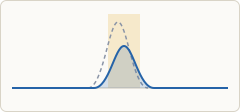 | 峰形合格，落在已計入的配對 ISTD 位置 | 依據 | 否 |
| `回填` | 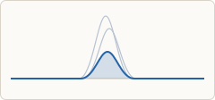 | ISTD 的峰由同批其他樣本的峰定位確認 | 依據 | 否 |
| `特異性條件` | 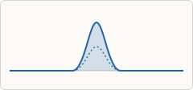 | 所選峰符合全部特異性條件 | 依據 | 否 |
| `僅 MS1 峰` | 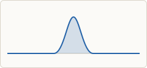 | 這個目標不要求中性丟失，只看 MS1 峰 | 依據 | 否 |
| `NL 偏差大` | 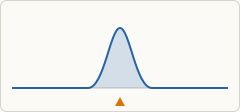 | 見到中性丟失，但質量偏差大 | 依據；身分由別處確認時是疑點 | 是 |
| `未見 NL` | 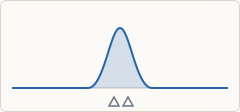 | 有 MS2，但沒見到預期的中性丟失 | 因此未計入時是依據；身分由別處確認時是疑點 | 是 |
| `無 MS2` | 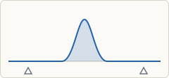 | 所選峰沒有對應的 MS2 | 因此未計入時是依據；身分由別處確認時是疑點 | 是 |
| `無可用 MS1 峰` |  | 沒有可量測、RT 又合理的 MS1 峰，包括完全沒有峰；記為 `ND` | 依據 | 只有 ISTD |
| `偏離 ISTD 位置` | 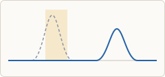 | 有峰，但不在配對 ISTD 位置；記為 `ND` | 依據 | 否 |
| `ISTD 未計入` | 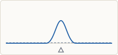 | 配對 ISTD 在這個樣本未計入，分析物也沒有自己的中性丟失 | 依據 | 是 |
| `肩峰／重疊` | 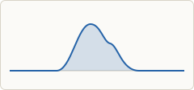 | 峰旁有肩峰，或與鄰近峰重疊 | 因此未計入時是依據；否則是疑點 | 是 |
| `峰形不完整` | 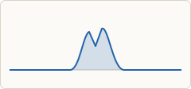 | 峰形不連續或不完整 | 因此未計入時是依據；否則是疑點 | 是 |
| `不符特異性條件` | 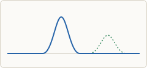 | 沒有候選峰符合全部特異性條件 | 依據 | 是 |
| `不足以定量` |  | 看得到訊號，但不足以可靠定量；面積留白 | 依據 | 是 |
| `證據衝突` | 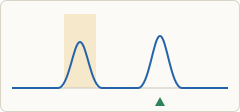 | 證據互相矛盾，身分未定 | 依據 | 是 |
| `共用離子區段（A / B）` | 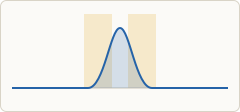 | 與括號內的目標共用同一段訊號，RT 參考不同：分不開時未計入，計入時面積不獨立 | 依據或疑點 | 是 |
| `RAW 失敗` |  | RAW 檔無法處理；訊息在 `診斷事件` | 依據 | 是 |
| `訊號缺口` | 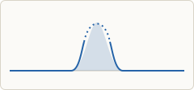 | 原始訊號中間有斷點，面積含平滑估計 | 疑點 | 是 |
| `多個候選峰` | 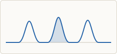 | 範圍內有多個像樣的峰，依整批結果推定 | 疑點 | 是 |
| `RT 偏移` | 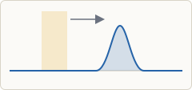 | 峰離 RT 參考較遠，對應是暫定的 | 疑點 | 是 |
| `證據單薄` |  | 所選峰只有單一類型的證據支持 | 疑點 | 是 |

## 下一批與重開結果

- **開始新批次**：清空 RAW 資料夾與樣本，保留目標清單與結果存放位置。
- **保存批次設定**（<kbd>Ctrl</kbd> <kbd>S</kbd>）：保存目前設定。開始分析時也會保存。
- **開啟既有結果**（右上角）：選 `xic_results_*.xlsx` 重看結果，不需要 RAW。較舊版本產生的結果檔打不開時，用目前版本重新分析。

分析後才改的設定只影響下一次分析。

## 遇到問題

| 狀況 | 處理 |
| --- | --- |
| **開始 Targeted 分析** 不能按 | 看 **執行前確認** 哪一項沒打勾 |
| 目標清單無法匯入 | 依訊息修正指出的列與欄 |
| RAW 讀取環境未備妥 | 依畫面提示安裝 .NET 或 RawFileReader，見[開始使用](README.md#第一次使用準備-rawfilereader) |
| 某個 RAW 檔讀取失敗 | 其他樣本照常完成；失敗的檔列在 `摘要` 的需先看結果，依據是 `RAW 失敗` |
