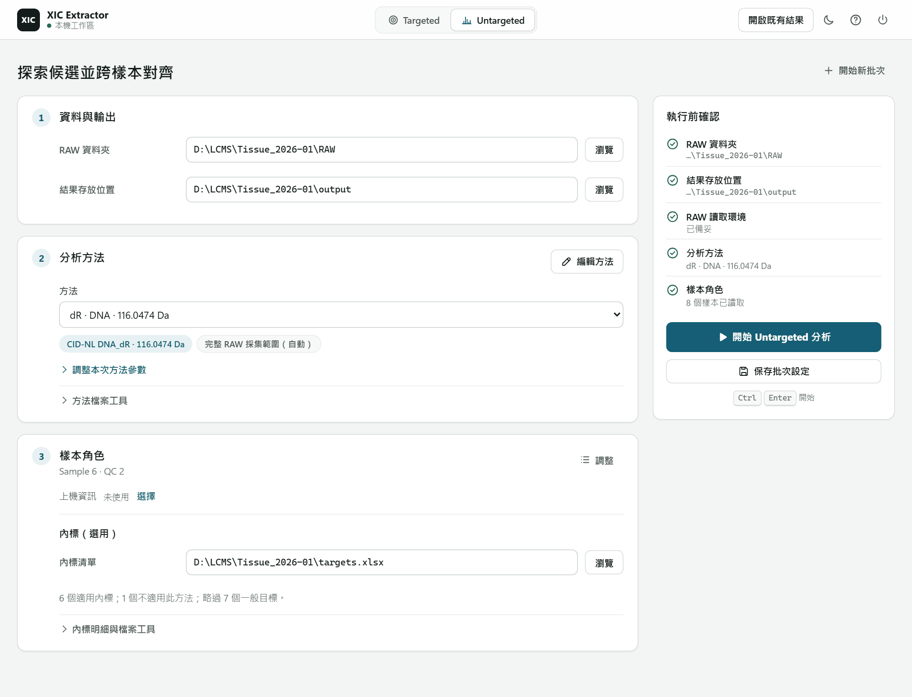

# Untargeted Discovery

Use Untargeted to discover features under a selected method and compare them
across samples. A full run produces a feature × sample area Matrix; candidate
tables and workbench review explain how a feature or missing cell arose.
Aligned features are not automatically identified compounds. The Matrix is an
input to downstream analysis, not a normalized or batch-corrected result.

## Workflow

1. Open `XIC_Extractor.exe`. On first use, follow the [reader setup notice](README.md#reader-setup)
   to install RawFileReader 8.0.42 and, if needed, .NET 8 or later.
2. Select **Untargeted**. The GUI always runs the complete analysis with Backfill.
3. Set the RAW folder. **結果存放位置** has a default; each run creates its own
   `<date>_<time>_untargeted_<RAW folder>` folder there, so earlier results are
   never overwritten. Reader setup supplies the shared DLL directory.
4. Choose a CID-NL starting method and open **編輯方法** to select dR, R, MeR,
   or custom NL tags and their combination. **套用至批次設定** updates the draft;
   **方法檔案工具** contains import and new-method actions. Parameters without a
   GUI control are retained.
5. Check sample roles and exclusions in **樣本明細**; statistical groups are
   not inputs to this analysis. Roles and exclusions are shared with Targeted
   and matrix curation. **上機資訊與樣本檔案（選用）** contains optional acquisition
   information import and sample export. Alphabetical file order is not
   injection order. Exclusion is a direct toggle and does not require a reason.
6. Check the **內標** applicability summary below the samples. Choose or drop an
   XLSX, CSV or TSV file; **內標明細與檔案工具** contains the full table and shared
   XLSX example. Only `role=istd` rows are used;
   the preview shows method-compatible standards and skipped rows. A dR method
   uses dR standards, not R standards such as `[13C,15N2]-8-oxo-Guo`. Incompatible
   standards are marked not applicable, not ND; changing the method refreshes
   this selection.
7. Press **開始 Untargeted 分析**. The finished run opens its result; **返回設定**
   goes back to the setup of the next analysis.

Use **檢閱結果** to inspect quantitation, then **整理矩陣** to prepare a
separate analysis matrix. The result card presents one main matrix download;
**分析紀錄與其他檔案（進階）** holds trace files grouped by sample and the
optional Inspector export. Candidate and physical-fact files are not ordinary
workflow choices.

**保存批次設定** saves the setup for reopening; starting analysis also saves it.
**另存方法檔…** exports a reusable TOML without applying the edited method to the
current batch. **開始新批次** clears RAW, acquisition information and the displayed
samples, keeping the method, tuning, internal-standard list and result location.
Confirmed roles and exclusions remain with their original RAW folder.

The workbench retains the current Untargeted setup locally. Export a named method when you want to reuse or share its scientific settings; local paths are not part of that method.

The workbench defaults to each RAW file's full acquisition RT range, read from
instrument metadata. Optional RT cropping accepts one or both finite,
non-negative bounds; an unspecified end remains automatic. Explicit cropping
is limited to the acquired span. Target-list RT windows remain compound search
windows, not acquisition bounds.

## Inputs

| Input | Role |
| --- | --- |
| RAW directory | Thermo sample files for the complete analysis |
| DLL directory | RawFileReader 8.0.42 folder selected by setup; not the Xcalibur folder |
| Output directory | Where candidate and Alignment artifacts are written |
| Acquisition information | Word sequence table supplying file/sample matching and injection order |
| Internal-standard list | Shared Targeted XLSX, CSV or TSV; Untargeted consumes only `role=istd` rows |
| Preset | CID-NL method with selected tags and combination |
| Advanced overrides | Optional per-run method changes layered on the preset |

The target list uses the same format as Targeted. Save a copy of the bundled
example, edit it in Excel, then choose or drop it in the GUI. Keep the `Targets`
sheet headers and `role=istd` for standards. A Targeted method XLSX is also accepted;
its method settings do not change the Untargeted method. There is no separate
Untargeted list to maintain. A supplied file with no internal standards shows an
error; clearing the field runs without an internal-standard list.

## Outputs

GUI Alignment writes `alignment_matrix.tsv` with its bound identity and the
review/provenance tables from the `machine` output level. The identity supports
the results panel's **篩選匯出…** action.

Successful retained CID-NL publication also saves `alignment_explanation.sqlite`
alongside its runtime marker for Inspector evidence.

Start with the file that matches your review question:

| Output | Content | Use it for |
| --- | --- | --- |
| `discovery_peaks.csv` | Per-sample MS1 peaks: one row per ion and peak, with m/z, RT, area, status and evidence | Check which peaks enter Alignment and why |
| `discovery_events.csv` | Per-sample NL events: each MS2 event with the peak it locates and why it does not attach | Trace where an MS2 event went |
| `discovery_batch_index.csv` | Links each sample's peak and event CSVs | Input for alignment (generated automatically) |
| `alignment_matrix.tsv` | Samples as columns, aligned features as rows, area values in cells | Default cross-sample quantitative output |
| `alignment_review.tsv` | Group identity, detection/quantification summaries, warnings, and bound Matrix row references | Investigate a group or trace a Matrix row |
| `alignment_explanation.sqlite` | Completed CID-NL decisions and retained curve evidence | Source for XIC Inspector export |
| `xic_inspector.html` | Offline chromatogram review | Open with **開啟 Inspector** once ready |

## Read And Use The Matrix

1. Open `alignment_matrix.tsv` for the published feature × sample areas. Check
   sample names and roles against the intended batch. Feature correspondence
   does not establish a chemical identity.
2. Investigate an unexpected value or blank in workbench result review. Select
   the feature and sample, then inspect the saved decision and available XIC
   evidence. A Discovery peak table alone is not the final Matrix.
3. Distinguish numeric availability from detection. Zero is a numeric value;
   a blank is not automatically zero or proof that a compound is absent.
   Backfill revisits local evidence, not an interpolation of other samples'
   areas. Use the [processing story](processing-guide.html#backfill) when you
   need to understand that distinction.
4. If you need a curated Matrix, choose **整理矩陣** in the completed results.
   On **矩陣整理**, check the source folder and sample data, choose enabled
   steps and any required thresholds, then start curation. An unavailable step
   reports its missing input; it does not silently establish a decision.
5. Read the curation summary and `feature_decisions.tsv` before using the kept
   Matrix downstream. Curation writes a new `matrix_curation_<time>` folder;
   the original Matrix and Alignment decisions are preserved.

For the finite-value fraction step, zero and finite backfilled values count
as available; blank/nonfinite cells do not. QC, blank, unknown-role and excluded
samples are outside the denominator. This is availability filtering, not a
detection rate. Read each step's input requirements and the saved curation decisions before using its result. Normalization, calibration
and statistical analysis remain separate downstream decisions.

Use **開啟既有結果** in the workbench to reopen the completed batch folder.
Review and offline reports explain the saved result; they do not change its
peak selection, area, or group membership. Use the
[output reference](untargeted-output-reference.md) to look up a column rather
than guessing its meaning from a number.

## Troubleshooting

| Symptom | Action |
| --- | --- |
| Run button says settings are incomplete | Fill every visible path field and verify the files/folders exist |
| DLL load failure | Follow the reader setup notice; use RawFileReader 8.0.42 with .NET 8 or later, then restart the workbench |
| Inspector is unavailable | Check the Inspector status below the output buttons; a completed run needs a published evidence source |
| Matrix selection is disabled | The result needs its bound identity; rerun Alignment for older Matrix-only outputs |
| Results look unexpected | Verify RAW inputs and method settings; use the supported RawFileReader version rather than matching Xcalibur |
