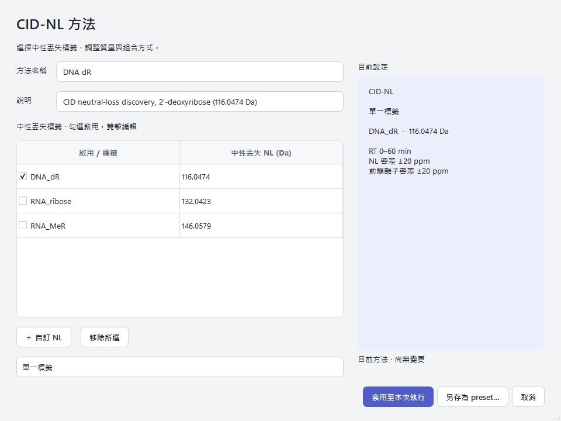

# Untargeted Preset Guide

Presets are TOML files that bundle discovery and alignment settings into a
named method. Built-ins live in `xic_extractor/presets/data/`; custom methods
can be saved anywhere and selected in the GUI or passed to CLI scripts.

## Configure A Method In The GUI



In **Untargeted Discovery → 分析方法**:

1. Select a built-in preset, or choose **匯入方法…** to open a TOML file.
2. Choose **編輯方法…** to select dR, R, and MeR, edit neutral-loss tag
   names/masses, or add a custom NL. **新增方法…** starts a new method.
3. Choose whether the same peak must match any or all selected tags. The method
   summary updates as you edit; it describes the configuration, not a predicted
   analytical result.
4. Apply to use the edited method for the current run. Save As writes a reusable
   TOML independently. Cancel leaves the previously applied method intact.
5. Advanced parameters remain a secondary, collapsed control. RT defaults to
   each RAW file's full acquisition range from instrument metadata. Enable
   optional RT cropping only when needed; either bound may remain automatic.
   Apply and Save As preserve explicit crop values, while automatic bounds are
   omitted from the TOML. Finite, non-negative crop bounds are owner-validated
   and limited to the acquired span. Compound target windows are unchanged.

The saved file is accepted by the same CLI `--preset` input. It includes the
effective Discovery values and preset-owned runtime option, so export does not
silently revert to defaults. It excludes RAW/output paths and GUI state.
Alignment and Backfill strategies are handled by the platform.

The GUI runs the method currently displayed. If its TOML changes externally,
re-import it to select the new content. Restart loads the saved locator afresh;
a missing or invalid file is shown as unavailable instead of silently falling
back to a built-in method.

For current CID-NL entry points, one preset selection is bound before execution
to the existing route. GUI `full` runs RAW -> Discovery -> the retained
finalized CID-NL batch -> the canonical Matrix writer; `align_only` starts from
an existing Discovery index and enters the same retained batch;
`discovery_only` stops at Discovery. Normal presets do not run Standard Peak.
Presets do not expose a public workflow graph or `[workflow]` TOML section.

## Available Presets

| Name | Display name | Strategy | NL mass (Da) | Description |
| --- | --- | --- | --- | --- |
| `dna_dr` | DNA dR | CID neutral loss | 116.0474 | 2'-deoxyribose neutral-loss discovery |
| `rna_ribose` | R | CID neutral loss | 132.0423 | Ribose neutral-loss starting method |
| `rna_mer` | MeR | CID neutral loss | 146.0579 | MeR neutral-loss starting method |
| `dna_dr_product_ready` | DNA dR Owner Backfill (compat) | CID neutral loss | 116.0474 | Historical compatibility profile; pure CID-NL execution uses the retained batch, and the preset ID is not a readiness assertion |

The GUI starting list contains only dR, R, and MeR. Other CLI presets retain
their existing support; GUI editing currently accepts only pure CID-NL methods.

---

## Preset Structure

Every preset TOML must contain:

```toml
name = "Display Name"
description = "One-line human-readable description"
combine_mode = "single"          # single, union (OR), or intersection (AND)

[[tag]]
strategy = "neutral_loss"        # discovery strategy type
name = "TAG_NAME"                # tag identifier used in outputs
value = 116.0474                 # neutral loss mass (Da)

[discovery]                      # optional overrides for discovery defaults
# nl_tolerance_ppm = 20.0

```

### Tag Rules

- `combine_mode = "single"` requires exactly one `[[tag]]` entry.
- `union` accepts any configured tag on the same physical peak; `intersection`
  requires every configured tag on that peak in the same sample. Evidence on
  separate peaks or in separate samples cannot satisfy AND. Both combinations
  use the shared Alignment/Backfill path and canonical Matrix writer.
- The GUI and CID-NL runners accept `strategy = "neutral_loss"`. Pt methods
  remain on the separate delta-mass Discovery path.
- `value` must be a finite number (not boolean, infinity, or NaN).

## Run The Saved Method With CLI

Pass the same TOML to both stages:

```powershell
.venv/Scripts/python.exe -m scripts.run_discovery --raw-dir RAW_DIR --dll-dir DLL_DIR --preset method.toml --output-dir output/discovery
.venv/Scripts/python.exe -m scripts.run_alignment --discovery-batch-index output/discovery/discovery_batch_index.csv --raw-dir RAW_DIR --dll-dir DLL_DIR --preset method.toml --output-dir output/alignment --output-level production
```

Keep the complete Discovery output directory together when moving or reusing
results. Alignment needs its accompanying physical-fact and receipt files to
verify the method and exact peak inputs; the candidate CSV alone is insufficient.

Discovery tuning flags override only explicitly supplied values. `--preset`
cannot be combined with separate tag selectors such as `--feature-list` or
`--neutral-loss-da`; edit the method file to change its tags.

---

## Discovery Defaults

These values apply unless overridden in the `[discovery]` section.

| Parameter | Default | Description |
| --- | --- | --- |
| `nl_tolerance_ppm` | 20.0 | Per-ion precursor/product m/z tolerance (ppm); their absolute Da windows combine in quadrature for neutral-loss matching |
| `precursor_mz_tolerance_ppm` | 20.0 | Precursor m/z tolerance (PPM) |
| `product_mz_tolerance_ppm` | 20.0 | Product ion m/z tolerance (PPM) |
| `product_search_ppm` | 50.0 | Product ion search window (PPM) |
| `ms2_precursor_tol_da` | 0.8 | Maximum precursor inference radius (Da), capped by the recorded isolation half-width; explicit saved values are preserved |
| `nl_min_intensity_ratio` | 0.01 | Minimum NL intensity ratio (1%) |
| `seed_rt_gap_min` | 0.20 | Minimum RT gap between seeds (min) |
| `ms1_search_padding_min` | 0.35 | MS1 search window padding (min) |
| `rt_min` | automatic | Optional lower RT crop bound; otherwise RAW acquisition start |
| `rt_max` | automatic | Optional upper RT crop bound; otherwise RAW acquisition end |
| `resolver_mode` | `local_minimum` | Peak resolver algorithm |

---

## Alignment Defaults

Alignment uses the retained CID-NL batch route. Presets do not select an
owner-build XIC backend; `owner_build_xic_backend` is not accepted.

All former `standard_peak_backfill*` and `backfill_expansion*` alignment keys
are retired from normal presets. Supplying one is an error; there is no ignored
compatibility mode or replacement publication choice.

---

## Preset Comparison

| Parameter | `dna_dr` | `dna_dr_product_ready` |
| --- | --- | --- |
| NL mass | 116.0474 Da | 116.0474 Da |
| Discovery overrides | none | none |
| Owner Backfill | yes | yes |
| Standard Peak product route | retired | retired |
| XIC backend | raw (default) | raw-super-window |

`dna_dr_product_ready` differs from `dna_dr` only by the
`raw-super-window` Owner Build backend. Its historical name does not run a
readiness checker or confer publication authority.

---

## GUI Advanced Overrides

When running from the GUI, the Advanced panel allows per-run overrides on top
of the selected preset. These Discovery-method overrides are applied after
preset defaults and take precedence. They include:

- RT window (`rt_min`, `rt_max`)
- Tolerance values (`nl_tolerance_ppm`, `precursor_mz_tolerance_ppm`)
- Product search, intensity ratio, seed-gap, and MS1 padding values
- Resolver mode

Owner Build backend remains preset/CLI-owned. Former Standard Peak Backfill
chunk/publication settings are retired from every normal GUI, preset, and CLI
route; supplying their compatibility fields or flags fails closed.

Overrides are stored in `config/discovery_gui.json` (machine-local, untracked).
