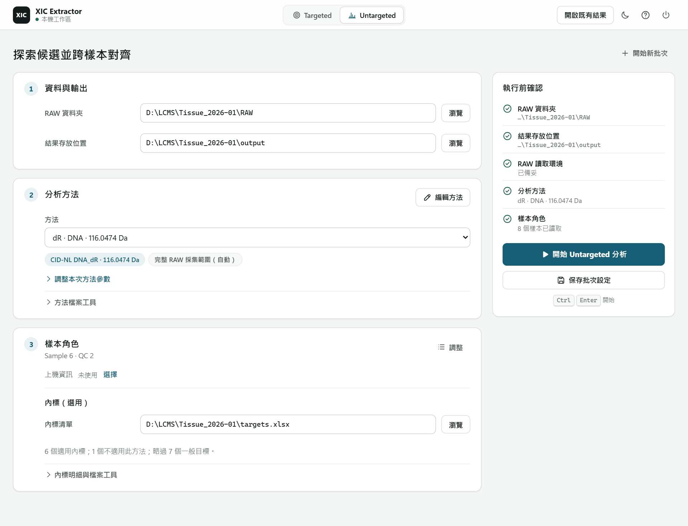

# Untargeted 分析

依一種探索方法找出候選，跨樣本對齊，輸出 **feature**（對齊後矩陣的一列）× 樣本的面積矩陣。

> **看結果前先記得兩件事**：矩陣的一列是一個 feature，不等於已確認的化合物；空白格是沒有可靠的定量值，不是 `0`，也不代表樣本裡沒有訊號。見[判讀原理](concepts.md)。

## 開始前準備

| 項目 | 必填 | 內容 |
| --- | --- | --- |
| RAW 資料夾 | 是 | 同一批要一起對齊的 Thermo `.raw` 檔 |
| 分析方法 | 是 | 內建 dR、R、MeR 等，或匯入自訂方法檔，見下方[分析方法](#分析方法) |
| ISTD 清單 | 否 | 和 Targeted 相同格式的[目標清單](targeted.md#目標清單)，只讀 ISTD 列，見[ISTD 清單](#istd-清單) |
| 上機資訊 | 否 | 上機時的序列表檔案（Word、Excel、CSV 或 TSV）；匯入後帶入樣本角色、組別與排除 |

第一次使用要先備妥 RawFileReader，見[開始使用](README.md#第一次使用準備-rawfilereader)。

## 分析方法

分析方法決定找哪一類候選。

| 方法 | 找什麼 | 產出 |
| --- | --- | --- |
| dR · DNA · 116.0474 Da | MS2 失去 dR（2'-deoxyribose）的離子 | 矩陣 |
| R · RNA · 132.0423 Da | MS2 失去 ribose 的離子 | 矩陣 |
| MeR · RNA · 146.0579 Da | MS2 失去 methylribose 的離子 | 矩陣 |
| Pt pattern · Delta Mass | 符合 Pt 同位素型態的 MS1 離子群 | 候選表 |
| Pt pattern ＋ CID-NL dR | Pt 型態且失去 dR 的離子 | 候選表 |

Delta Mass 方法只找候選，不做跨樣本對齊，也不產生矩陣。Pt 方法仍是暫定設定。

### 編輯方法

按 **編輯方法**，改完按 **套用至批次設定**。套用只改這一批；按 **保存批次設定** 或開始分析才會留存。

- **CID-NL 中性丟失**：按 **＋ 中性丟失**，填名稱與中性丟失（Da）。兩個以上時選 **組合**：**全部符合** 要求同一個峰全部見到，**任一符合** 見到一個即可。
- **Delta Mass**：按 **＋ 伴隨離子**，填法同 Targeted 的[伴隨離子](targeted.md#delta-mass伴隨離子怎麼填)，但基準不同（見下表）。離子角色與篩選門檻在 **進階：離子角色與篩選門檻**，預設值來自所選方法。
- 兩張卡同時勾選時，組合固定為兩者都要符合，中性丟失固定為 DNA_dR 116.0474 Da。

| 在哪裡設定 | 基準 | Δm/z |
| --- | --- | --- |
| Untargeted 分析方法 | 最輕的離子（Δ 0） | 只能 ≥ 0 |
| Targeted 目標清單 | 該列的 `mz` | 正負都可以 |

### 方法檔與本次參數

- 方法可另存成 TOML 方法檔給其他批次或其他人用，不含 RAW 與結果路徑。在 **編輯分析方法** 按 **另存方法檔…**（內建方法不會被覆寫）；用 **方法檔案工具** 的 **匯入方法** 開啟，**新增方法** 開一份預設 DNA_dR 116.0474 Da 的草稿。方法檔在程式外被修改後，要重新匯入才會生效。
- **調整本次方法參數** 可改容差、最低強度比與分析 RT 範圍，只影響這一批，平常不需要改。預設分析每個 RAW 的完整採集範圍；**限制分析 RT 範圍（選用）** 留空的一端沿用 RAW 的起點或終點。改過的值會寫進另存的方法檔。

## ISTD 清單

ISTD 清單直接用 Targeted 的[目標清單](targeted.md#目標清單)檔案：

- 只讀 `role` 為 `istd` 的列，其他列略過。
- 只用中性丟失和目前方法相符的 ISTD。例如 dR 方法不用 R 的 ISTD；不相符的列標為不適用，不是 ND。
- 每個樣本的 ISTD 峰位置直接取自 Discovery 結果，不另外讀 RAW：m/z 與中性丟失相符、峰頂落在 `expected_rt_min` 前後 2 分鐘內的峰，有多支時取 MS2 事件最多的那支。某個樣本的 ISTD 沒有觸發 MS2、Discovery 沒有這支峰時，這個樣本就不用該 ISTD 校正 RT。
- 整理矩陣時，ISTD 對應的列一律保留。

## 執行一批

1. 頂端選 **Untargeted**（<kbd>Ctrl</kbd> <kbd>2</kbd>），在 **資料與輸出** 選 **RAW 資料夾**。
2. **分析方法**：從 **方法** 選一個。
3. **樣本角色**：選好 RAW 資料夾後自動列出樣本。有上機資訊時，表上的角色、組別與排除會帶入；沒有時依 RAW 標頭與檔名推定角色。要修正，按 **調整**。
   - 只有未排除的 `Sample` 與 `QC` 進入分析。`Blank`、`STD`、`Other` 與已排除的樣本不參與對齊，系統也不會用 Blank 自動扣背景。
4. **ISTD（選用）**：**ISTD 清單** 按 **瀏覽** 選檔案，下方會顯示幾個 ISTD 適用此方法。
5. 右側 **執行前確認** 都打勾後，按 **開始 Untargeted 分析**（<kbd>Ctrl</kbd> <kbd>Enter</kbd>）。

分析在本機執行，關閉分頁不會中斷。完成後顯示 **Untargeted 分析結果**。

## 看結果

結果卡片列出 RAW 檔案數、**矩陣 feature** 數，以及其中 **全部樣本都有值** 的數目。

| 想做什麼 | 按哪裡 |
| --- | --- |
| 拿原始面積矩陣 | **下載 Alignment 矩陣**（`alignment_matrix.tsv`） |
| 確認某個 feature 的峰形與每格來源 | **檢閱結果** |
| 收斂成統計用的矩陣 | **整理矩陣**，見下一節 |
| 探索結果、結果資料夾、自訂匯出 | **其他檔案**（含 **開啟結果資料夾**、**自訂 Inspector 匯出**） |

按 **檢閱結果** 後：

1. 標題是「N 個 feature 進入矩陣」。按 **瀏覽矩陣 feature**，左側用約略 m/z 或 RT 範圍搜尋，選一個 feature。
2. 右側顯示各樣本的曲線，預設 **峰頂置中**，可切換 **原始 RT**、**校正 RT**。沒有保存曲線的樣本，展開 **RAW 曲線**、勾選樣本後按 **載入 XIC** 從原 RAW 讀取。
3. 曲線下方列出各樣本的 Area 與來源：直接偵測、回填或空值。

沒進矩陣的紀錄在 **未進入矩陣的紀錄**：未採用、整理時移除、未分組候選。部分樣本多峰無法判定時，那一格留空。

## 整理矩陣

把矩陣整理成給下游統計用的版本，另存新資料夾，原本的矩陣不會被改動。整理只篩選與收斂列，不做 normalization、批次校正或統計。

1. 在結果卡片按 **整理矩陣**。**資料來源** 預設沿用這次分析的結果、樣本角色與 ISTD 清單；要換，展開 **改用其他來源（選用）**。
2. 勾選 **整理步驟**：
   - **同化合物收斂**：移除同一化合物的同位素、adduct 與聚集離子，保留 [M+H]⁺。預覽與結果會列出各原因（同位素峰、鈉鉀銨加成、鎂鈣鐵錯合物、溶劑造成的加成、重複出現的質量差等）各移除幾列。
   - **排除清單核苷**：只移除 m/z 與 RT 同時命中清單的非 ISTD 列。
     - DNA dR 結果：直接勾選，預覽內建 dG、dT、dA、dC 視窗會移除幾列。
     - RNA 結果，或你的 LC 保留時間和內建清單不同：不套用內建 DNA 清單，在 **改用其他來源** 選自訂核苷清單 TSV。
   - **有效值比例篩選**：未排除的 `Sample` 中，有數值的比例達到 **最低有效值比例**（0 到 1）才保留。例如 10 個未排除的 `Sample` 填 `0.5`，至少 5 個樣本有數值才保留。`0` 與回填值算有數值，空白不算；`QC` 等其他角色不計入分母，欄位仍留在輸出矩陣。
3. 填好門檻後，預覽列出每一步保留與移除的列數。ISTD 對應的列一律保留。
4. 按 **產生新矩陣**，完成後按 **下載整理後矩陣**。

整理結果放在原結果資料夾內的 `matrix_curation_<日期>_<時間>/`。之後開啟這份結果，檢閱畫面會跟著最新一次整理的矩陣，標題旁標出整理資料夾；被移除的 feature 在 **整理時移除**，附移除原因。

## 結果檔案

每次分析在結果存放位置建立 `<日期>_<時間>_untargeted_<RAW 資料夾名>` 資料夾，不會覆蓋舊結果。

| 檔案 | 內容 |
| --- | --- |
| `alignment_matrix.tsv` | 主要結果：feature × 樣本的面積矩陣 |
| `alignment_explanation.sqlite` | 檢閱畫面用的判定與曲線，不需要自己開 |
| `alignment_run_metadata.json` | 本次的輸入、設定和整理矩陣用的列身分 |
| `sample_metadata.tsv` | 本次使用的樣本角色、注射順序與排除 |
| `discovery.sqlite` | 探索結果：各樣本找到的 MS1 峰、每個中性丟失 MS2 事件與它落在哪個峰。給對齊與診斷工具讀；想自己看，用任何 SQLite 工具開 `discovery_peaks`（每個峰一列）與 `discovery_events`（每個事件一列）兩個檢視 |
| `matrix_curation_<日期>_<時間>/` | 整理矩陣的結果，見下方 |

### `alignment_matrix.tsv`

| 欄 | 意思 |
| --- | --- |
| `Mz` | feature 的中心 m/z（四位小數） |
| `RT` | feature 的中心 RT（min） |
| 每個樣本一欄 | 面積；沒有值時留空 |

樣本欄依注射順序排列。要看某列的判定、樣本結果和 XIC，回到 Workbench
開啟這份結果。整理矩陣會用執行資訊裡的 feature ID 對列，不會用四捨五入
後的 `Mz` 猜身分。

### 整理矩陣的資料夾

| 檔案 | 內容 |
| --- | --- |
| `analysis_matrix.tsv` | 整理後的矩陣，給下游統計用 |
| `feature_decisions.tsv` | 每個 feature 在每一步的保留或移除，以及原因 |
| `same_compound_relations.tsv`、`same_compound_review.tsv` | 同化合物收斂找到的關係 |
| `sample_metadata.tsv` | 整理時使用的樣本角色 |
| `matrix_curation_summary.json` | 本次整理的步驟、參數與列數 |

### Delta Mass 方法

結果只列成立的候選，沒有矩陣：

| 檔案 | 內容 |
| --- | --- |
| `delta_mass_candidates.csv` | 每個候選一列：樣本、m/z、RT、強度、找到幾個位置、哪些位置，以及配到的 dR 峰 |
| `discovery.sqlite` | 方法設定、各樣本的質量校正結果、候選的每個位置與峰界，給候選檢閱讀取 |

Pt pattern ＋ CID-NL dR 另有 `cid_nl_dR/discovery.sqlite`，是同一批樣本的 dR 探索結果。

## 下一批與重開結果

- **開始新批次**：清空 RAW 資料夾、上機資訊與樣本，保留方法、ISTD 清單與結果存放位置。
- **保存批次設定**（<kbd>Ctrl</kbd> <kbd>S</kbd>）：保存目前設定。開始分析時也會保存。
- **開啟既有結果**（右上角）：選結果資料夾重看，不需要 RAW。

## 遇到問題

| 狀況 | 處理 |
| --- | --- |
| **開始 Untargeted 分析** 不能按 | 看 **執行前確認** 哪一項沒打勾 |
| ISTD 清單顯示 0 個適用 | 檢查 `role` 是否為 `istd`，以及中性丟失是否和方法相同 |
| 選了 Delta Mass 方法，沒有矩陣 | Delta Mass 方法只產生候選表，按 **下載 Delta Mass 候選表** |
| RAW 讀取環境未備妥 | 依畫面提示安裝 .NET 或 RawFileReader，見[開始使用](README.md#第一次使用準備-rawfilereader) |
