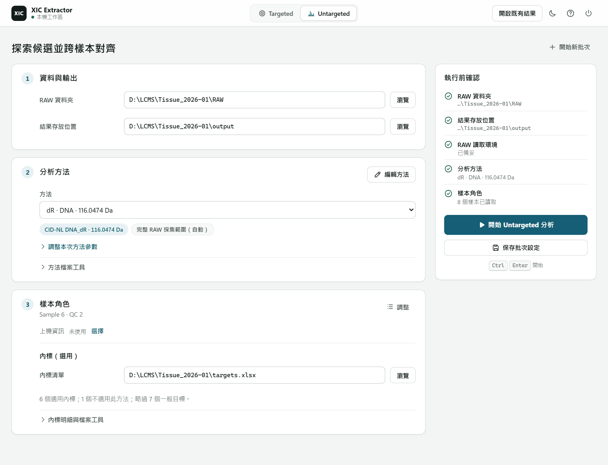

# Untargeted 分析

依一種探索方法找出候選，跨樣本對齊，輸出 feature × 樣本的面積矩陣。

## 開始前準備

| 項目 | 內容 |
| --- | --- |
| RAW 資料夾 | 同一批的 Thermo `.raw` 檔 |
| 分析方法 | 內建 dR、R、MeR 等，見[分析方法](methods.md) |
| 內標清單（選用） | 和 Targeted 相同格式的[目標清單](target-list.md)，只讀內標列 |
| 上機資訊（選用） | 上機序列表（Word、Excel、CSV 或 TSV），用來核對樣本 |

## 執行一批

1. 頂端選 **Untargeted**（<kbd>Ctrl</kbd> <kbd>2</kbd>）。
2. **資料與輸出**：**RAW 資料夾** 按 **瀏覽** 選資料夾。**結果存放位置** 有預設值，需要再改。
3. **分析方法**：從 **方法** 選一個。要改中性丟失或組合，按 **編輯方法**。
4. **樣本角色**：選好 RAW 資料夾後自動列出樣本。要改角色或排除樣本，按 **調整**。
   - 分析只用 Sample 與 QC；Blank、STD、Other 與已排除的樣本不參與。
5. **內標（選用）**：**內標清單** 按 **瀏覽** 選檔案，下方會顯示幾個內標適用此方法。不用內標就留空。
6. 右側 **執行前確認** 都打勾後，按 **開始 Untargeted 分析**（<kbd>Ctrl</kbd> <kbd>Enter</kbd>）。

分析在本機執行，關閉分頁不會中斷。完成後顯示 **Untargeted 分析結果**。

## 看結果

結果卡片列出 RAW 檔案數、矩陣群組數與全部樣本都有值的群組數。

- **下載 Alignment 矩陣**：下載 `alignment_matrix.tsv`。
- **檢閱結果**：逐一查看每個群組。
- **整理矩陣**：產生給統計用的另一份矩陣，見下一節。
- **其他檔案**：各樣本的候選表、**開啟輸出資料夾** 與 **自訂 Inspector 匯出**。

按 **檢閱結果** 後：

1. 標題是「N 組進入矩陣」。按 **瀏覽矩陣群組**。
2. 左側清單可用 m/z、RT 或分組 ID 搜尋。選一個群組。
3. 右側列出各樣本的面積與狀態。勾選樣本後按 **載入 XIC** 看曲線。
   - 有保存曲線的樣本直接顯示；標「讀 RAW」的樣本需要原 RAW 檔。

沒進矩陣的群組在 **未進入矩陣的紀錄**：未採用、整理時移除、未分組候選。部分樣本多峰無法判定時，那一格留空。

> 矩陣的一列是一個 feature，不等於已確認的化合物。空白格不是 0，也不代表沒有訊號。見[判讀原理](concepts.md)。

## 整理矩陣

把矩陣整理成給下游統計用的版本。原本的矩陣不會被改動。

1. 在結果卡片按 **整理矩陣**。
2. **資料來源**：預設沿用這次分析的 Alignment 輸出、樣本角色與內標清單。要換，展開 **改用其他來源（選用）**。
3. **整理步驟**：勾選要做的步驟。
   - **同化合物收斂**：移除同一化合物的同位素、adduct 與聚集離子，保留 [M+H]⁺。
   - **有效值比例篩選**：研究樣本中有數值的比例達到 **最低有效值比例**（0 到 1）才保留。只計未排除的 Sample；0 與回填值算有數值，空白不算。
4. **預覽**：填好門檻後，列出每一步保留與移除的列數。內標對應的列一律保留。
5. 按 **產生新矩陣**，完成後按 **下載整理後矩陣**。

整理結果放在原結果資料夾內的新資料夾 `matrix_curation_<日期>_<時間>`。之後開啟這份結果，檢閱畫面會跟著最新一次整理的矩陣，標題旁標出整理資料夾；被移除的群組在 **整理時移除**，附移除原因。

整理不包含 normalization、批次校正或統計。

## 下一批與重開結果

- **開始新批次**：清空 RAW 資料夾、上機資訊與樣本，保留方法、內標清單與結果存放位置。
- **保存批次設定**（<kbd>Ctrl</kbd> <kbd>S</kbd>）：保存目前設定。開始分析時也會保存。
- **開啟既有結果**（右上角）：選結果資料夾重看，不需要 RAW。

每次分析在結果存放位置建立 `<日期>_<時間>_untargeted_<RAW 資料夾名>` 資料夾，不會覆蓋舊結果。檔案內容見[結果檔案](results.md#untargeted-結果資料夾)。

## 遇到問題

| 狀況 | 處理 |
| --- | --- |
| **開始 Untargeted 分析** 不能按 | 看 **執行前確認** 哪一項沒打勾 |
| 內標清單顯示 0 個適用 | 檢查 `role` 是否為 `istd`，以及中性丟失是否和方法相同 |
| 選了 Delta Mass 方法，沒有矩陣 | Delta Mass 方法只產生候選表，按 **下載 Delta Mass 候選表** |
| RAW 讀取環境未備妥 | 依畫面提示安裝 .NET 或 RawFileReader，見[開始使用](README.md#第一次使用準備-rawfilereader) |
